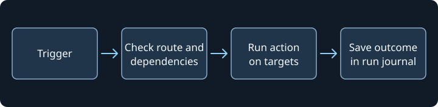

# kortty

Native Rust port of the Java application. This development stage includes local terminal sessions, native windows, and initial editor and diagram tools. The references for further porting are Java 2.26.0 (`1ebbe724ee84`) and SithTermFX 1.2.7 (`8b02de38b7c6`).

## Getting started

Use the optimized build to check interaction and performance.

```sh
cargo run --release --locked -p kortty --bin kortty
```

`cargo run --locked` starts the unoptimized development build. On macOS, the software renderer retains the window image between updates. Changes in the terminal trigger a partial redraw, for example only in the line that changes while typing. More is redrawn on the first frame, when the window size changes, and for large-scale changes.

Use the development build to check interaction.

```sh
cargo run --locked -p kortty --bin kortty
```

Maximize the window and run the following command in a local zsh session to update one line repeatedly.

```zsh
for n in {1..400}; do printf '\e[H\e[36mframe %05d\e[0m\e[K' "$n"; sleep 0.03; done; printf '\n'
```

Open and close a menu during output, abort with `Ctrl+C`, and continue typing at the prompt. Use the same window size and transparency for comparison. `cargo test --locked -p kortty --bin kortty terminal_row_damage` compares the partial redraw after text and cursor changes pixel-perfectly with a full redraw at Retina scaling.

Development and test builds include line information for backtraces by default. Cargo does not create an incremental build cache or separate debug objects for this. On macOS and Linux, `bash scripts/with-scratch.sh cargo test --locked --workspace` bundles temporary files and cleans up the run directory and its process group even after an error. Run `cargo clean --profile dev` after the last check and `cargo clean --release` after verifying packages. Archives under `target/dist/` are preserved. The cleanup steps in [AGENTS.md](AGENTS.md) apply for cross-builds and VM tests.

**File → New Tab** and the tab symbol open **Quick Connect**. The second terminal symbol starts a local shell. In Quick Connect, you can choose the emulation for the new session. The menu contains Xterm, the six DEC-VT profiles, Sun CDE, Wyse 50/60/160, TeleVideo 910/920/925, HP 2392 and 700/92, SCO ANSI, DEC CTERM, and PETSCII. The worker sets the corresponding `TERM` identifier. **View → Panes** contains **Split Pane**, **Split Right**, and **Split Down** for independent sessions. **Split Pane** selects the direction based on the character dimensions. The direction focus and **Next Pane** or **Previous Pane** restore the split view for a zoomed pane. The pane title can be dragged within the tab. **Move tab** moves an entire tab to an existing or new window and retains its sessions. Dragging the tab title has native paths for macOS, Windows, X11, and Wayland. Under Wayland, the compositor confirms the drop on a registered kortty window. The compositor assigns keyboard focus. **Move tab** remains available as a target selection.

The main view adopts the Java groups **Terminal**, **Tools**, and **Settings** in the toolbar and the application menus below it. The macOS system menu offers the same available actions. **View → Customize toolbar…** opens the editor. It offers search, drag-and-drop, icon sizes from 16 to 64, and separate visibility for bars and groups. **Add connection** directly opens the catalog for saved connections and groups. **Finish** saves the layout for all windows. **Cancel** discards the draft. When renaming in **Connection Manager**, attached folders and their subfolders follow the new path. This also applies to an open draft.

**Manage Connections…** opens a Connection Manager for the current main window. Another main window can open its own manager and keep its own selection, search and edit draft. The connection editor and exchange dialogs belong to the manager that opened them. After the manager closes, **Connect** or **SFTP** opens the selected connection in that manager's main window.

Choose **Map** above the connection list to generate a network plan from the current search and scope. The plan shows this computer, folder zones, saved hosts and external jump hosts. **Jump routes** and **Tunnels** control their layers separately. **Fit** resets the zoom to the available space. Selecting a host also selects it in the inspector. Double-click a connection to connect, or drag a saved SSH connection onto a folder zone to move it. **Undo** reverses the last move when the connection and destination still match.

A saved SSH connection can set its own **Window geometry**. Select **Connect in New Window** in the Connection Manager to use its size, position and maximized state. The desktop can constrain the size and position. The setting is kept in the private connection catalogue and is also read from private Java connection XML. Portable connection exports and duplicates use the default geometry.

In **Map**, choose **PDF…** to export the current view. Set the title and A4 orientation, then choose a destination. The PDF includes jump routes and follows the **Tunnels** switch. Map text stays searchable and zones and routes stay sharp when printed. Large zones continue onto subsequent pages between node rows. OS symbols appear both on the map and in its PDF.

Use **Teamwork → Teamwork Settings…** to add a shared kortty connections XML file or a Git repository. A shared file uses an absolute path or file URL. A Git repository uses an explicit HTTPS, HTTP, SSH or `git://` URL and a system Git executable on the PATH. kortty follows the initially advertised default branch and reads `kortty-teamwork-connections.xml`, with `connections.xml` as the fallback. The Git integration runs noninteractively in a private bare repository. HTTP(S) sources must be readable without authentication. SSH uses local OpenSSH trust and credentials. HTTP and `git://` use cleartext transport.

kortty checks enabled sources at startup and again after each scheduled delay. The shortest enabled interval at startup controls the delay for that run. Intervals range from 1 to 1440 minutes and start at 15 minutes for a new source. **Save** checks the sources immediately. Interval edits take effect at the next start.

Shared SSH connections appear in **All connections** and **Teamwork connections**, use their own folder zones in Map, and are marked in the PDF. The private profile cache retains the last successful snapshot across failed refreshes and restarts while the same source remains enabled. Shared route settings and source files are read-only.

Use the inspector star or **Favorite on/off** in the row's context menu to add a shared connection to **Favorites**. The list, Map, and PDF honor that scope. Each mark belongs to the current profile and identifies the source and shared connection together. The profile can hold up to 512 shared favorite marks.

Use **Hide locally…** on a shared row to remove it from this profile's connection views. The Teamwork toolbar opens **Restore Teamwork Connections**, where each hidden row shows its saved name, host, and source. You can restore a row while its source is unavailable. If it exists in the retained snapshot, it appears immediately. Otherwise it appears when the source next provides it. The toolbar's **Refresh Teamwork connections** action reloads the retained snapshot.

**Recently used** combines up to 15 local and shared connections. Shared dates come from the source. The manager's search, Map, and PDF use the same recent selection.

In **Teamwork connections**, choose a **Default Teamwork authentication** method and select **Apply**. A shared target with its own authentication reference uses manual authentication. If an eligible target uses a Vault password and the Vault is locked, the app offers to unlock it before opening the connection form. **Paste private key** reads from the configured clipboard on your click and keeps the key in memory for the chosen lifetime.

Administrators can declare sources in `[[teamwork-source]]` tables with `name`, `type` (`"shared-file"` or `"git"`) and `url`. They appear as read-only sources in Teamwork Settings and take precedence over a duplicate user source. `[rule.teamwork] allow-custom-sources = false` limits synchronization to the managed list. `[rule.features] teamwork = "deny"` disables the workflow.

With Git and `git-daemon` available, run `cargo test --locked -p kortty --bin kortty git_reads_the_tracked_branch_over_loopback -- --ignored` to verify that the integration retains the tracked branch after a change to the remote default and follows a forced update.

For the folder smoke test, attach `Team`, `Team/Nested`, and `Teamwork`. Open the toolbar in one window for editing and rename `Team` from a second window in the connection manager. The first two entries must follow the new path. `Teamwork` retains its name. Apply the draft, briefly wait for the save operation to complete, and check the bar again after a restart. `cargo test --locked -p kortty --bin kortty folder_pin` also checks renames during an ongoing save operation.

In customization mode, the categories **Actions**, **Settings**, and **Connections** are on the left. Clicking a tile adds the entry. When dragging, the drop target determines the position. **Add connection** switches to the connection catalog and clears the search. Clicking or right-clicking an already attached symbol opens its menu for moving and removing. To verify, search for **Appearance**, drag the tile to **Settings**, and discard the draft with **Cancel**. Then add it again and apply it with **Finish**.

The tab bar in **Global Settings** can be scrolled horizontally in narrow windows. The arrows select the previous or next tab. **Manual for this page** opens the corresponding section in the local manual. To verify, drag the window narrow, switch to **Video**, and press the manual button. After switching to **Window**, the same manual dialog must display the new chapter. `bash scripts/with-scratch.sh cargo test --offline --locked -p kortty --bin kortty -- settings_page_guide video_shortcuts_match_java` checks the navigation and the protection of its own keyboard shortcuts.

**Help → Manual** displays bundled text and figures offline. Choose a section under the chapter title or follow a link to a bundled section. Use **A−** and **A+** to change the saved zoom. Wide figures can scroll horizontally and keep their proportions. **Ask the manual** uses the configured text or default profile, including a saved CLI profile. Review the destination, effective system prompt, masked question, and numbered manual excerpts before selecting **Send reviewed question**. The CLI review also shows its invocation. A source button opens the exact excerpt supplied for that answer.

In **Global Settings**, **Ctrl+F** on Windows and Linux or **Cmd+F** on macOS focuses the search. Use the Up and Down keys to select a result and Enter to reveal it in its settings section. Escape clears the search. Press Escape again to close the dialog.

On macOS, **⌘⇧V** opens the **Video Manager** and **⌘V** inserts text. On Windows and Linux, **Ctrl+Shift+V** is assigned to paste. **⌘⇧E** or **Ctrl+Shift+E** starts or stops recording once enabled. To verify, open the **Video Manager** in the menu **Tools**, compare the action symbols with the list, and enable recording for the current app session. Then start and stop the recording with the shortcut. **Refresh** displays the finished recording.

Under **Configuration → Global Settings → Window** you can change the size of the toolbar icons between 16 and 64 px. The gear icon shows the current design size. **Save** applies it to both toolbars and the customization catalog of all windows. An open toolbar draft retains its own changes. To verify, open two windows, set 40 px, and then cancel. Afterward, set it again, save, and compare the size in both windows and in **Customize toolbar**.

When space for a group becomes tight, **»** opens its additional actions. The connection bar remains single-line. To verify, set 64 px, drag the window narrow, and trigger an action via **»**. `cargo test --locked -p kortty --bin kortty toolbar_overflow` checks the assignment to the correct window and the handling of disabled actions.

Under **View → Customize toolbar… → Settings** you can pin **Appearance** with its own icon. After **Finish** the icon directly opens the page **Appearance**. To verify, restart the application and click the pinned icon again.

On Windows, the standard toolbar contains **New PowerShell** and **New Command Prompt**. The same shells are available for selection in **Quick Connect → Local Shell**. The selection is preserved for splits of the same connection, reconnection, and native layouts. To verify, run `$PSVersionTable.PSEdition` in the PowerShell tab and `echo %COMSPEC%` in the command prompt. `cargo test --locked -p kortty-pty --test local_shell windows_presets_run_distinct_system_shells` checks both real ConPTY processes on Windows.

**Plugins → Terminal Effects…** opens the eleven built-in effects with animated previews. The global toggle and the activation per effect are saved in the profile. **View → Terminal Effect** selects the effect for the focused pane of the active tab. The terminal context menu offers the same selection for the clicked pane. In the window menu bar and in the context menu, you can change the speed between 1× and 99×. The profile and the session state store the effects separately. The managed rule `rule.features.plugins = "deny"` locks the selection and display.

The standalone Terminal Effects Manager is owned by the main window that opened it. While the manager is open, other application windows route input back to it. Closing the manager returns focus to its owner.

The connection editor saves the effect and speed for future SSH sessions. Enter a fractional speed such as `2.5` beside the slider. Java connection exchange preserves the speed, and Java project exchange carries it when all panes in a tab use the same effect and speed. New splits inherit the setting of the source pane if an effect is active there. **Typewriter Noir** outputs short Xterm outputs with character and line pauses. Larger outputs and protocol requests bypass the delay.

For the desktop smoke test in the manager, select **Amber CRT '90** and **MU/TH/UR 6000** and check the different previews. Then select **View → Terminal Effect → Amber CRT '90**, query the shell PID with `echo $$`, and select **None**. The terminal must return to its previous colors and report the same PID. In a tab with split panes, select an effect only in the secondary pane, save the layout, and restore it in new windows. The effect and speed must remain assigned to their respective pane.

Under **Configuration → Global Settings → Window → Tabs**, **Open tool windows as tabs** switches the next opening of **OpenPGP Recipients**, **SSH Key Management**, **Known Hosts**, **Session Processes**, **Video Manager**, **Logfile Manager**, **Snippet Manager**, **JobScheduler**, **Session Journals**, and **Terminal Effects** to tabs. By default, these tools open their own windows. Opening them again in the same main window selects the existing tool tab. **New Snippet Manager Window** opens another window regardless of the setting. With `Ctrl+Tab` you can cycle through terminal and tool tabs together. A drag starts in the tab bar and also accepts the content area of another main window. Tool state and drafts are preserved when moving. Project and session persistence covers terminals and the local file tabs described below.

**Frame the split pane the keyboard is in** in the same tab draws the focus frame for shared tabs. It is active by default. To verify, split a tab, switch between the panes, and briefly leave the main window. The last focused pane shows the dimmed frame. Turn off the switch and select **Save**. `bash scripts/with-scratch.sh cargo test --offline --locked -p kortty --bin kortty -- split_pane_focus_ring` checks the saved setting and the rendered frame.

**Frame the terminal in its connection's tab color** uses the color of the main connection. A directly set color takes precedence over the next colored folder and the access data environment. In **Connection Manager**, **Tab Color…** sets the color of the selected folder. To verify, open a connection in a subfolder, change the color of the parent folder, and observe the color change on the open tab. A split with its own color receives a separate frame. When the frame is disabled, the color marking on the tab remains visible.

**Configuration → Prevent System Sleep** saves the selection on macOS and Windows. The requirement applies during active terminal, scheduler, or AI work. To verify, enable the menu item, open a local shell, and search for the requirement with `pmset -g assertions` or `powercfg /requests`. After closing the last active session or disabling it, it must disappear. On Linux, the menu item is disabled.

For the window smoke test, open two main windows and save the option. Open **Known Hosts** in both windows and call the import view in the first window. Drag the tab to the content area of the second window and check the open import view. Then move an active tool tab via **View → Move Tab…**. A main window with a modal dialog must not be offered as a target during this. Create a draft in **Snippet Manager** or **JobScheduler**, create another draft in a separate tool window of the same main window, and close the main window. After **Keep Editing**, both drafts must remain intact. `cargo test --locked -p kortty --bin kortty hosted_` checks routing, pending operations, and closing decisions.

**Tools → Session Journals…** reads stored Java session journals in format v1. Specify the absolute folder that contains the journal directories and select **Refresh**. **Open** displays the timeline. **Capture log** searches JSON, XML, and YAML log parts including Zstd and Gzip files. A timeline entry can reference its recorded sequence range and display a locally stored PNG. The viewer reports missing parts and reached read limits. A managed setting can lock the feature or preset the journal folder. `cargo test --locked -p kortty --bin kortty session_journal` checks formats, rotation, missing parts, and path limits.

**Summary settings…** in the journal manager enables periodic and closing summaries for new eligible recordings. It starts off. A connection can disable automatic summaries or set its own interval. The closing pass can suggest a title when enabled and preserves manually set titles. Summaries link back to their capture ranges. When a model is unavailable, raw activity cards keep the original capture accessible.

At startup, kortty finishes abandoned native interactive recordings in the active journal folder in the background. This recovers the end time and command count even when AI summaries are off. It leaves active recordings and imported journals alone.

Select stopped journals and choose **Re-evaluate with AI…** to review the scope and select an AI profile. **Catch up summaries…** finds stopped journals with missing or raw summaries. The selected profile is tested before manual evaluation. **Show progress…** reopens the progress window with the current stage, completed summaries, elapsed time, and an estimate when enough work has been measured. Closing the progress window or the journal manager leaves the pass running. **Cancel pass** stops that batch, including its waiting journals. Original capture files, manual notes, markers, and screenshots remain available. With a vision-capable local profile, **Describe the screenshots again** replaces the AI descriptions and tags. Saved progress allows a pass to resume after an interruption. Pending journals are protected from deletion.

Command summaries follow shell command boundaries. Help-only calls and commands that failed to start are omitted from summaries while their original capture remains available. Enable **Read long command output in chunks** to analyze additional retained output from long commands in bounded requests and combine the result into a single summary. Choose a trusted HTTPS profile or a saved, reviewed CLI profile to approve masked text from the listed journals. In **Summary settings…**, the separate automatic approval covers masked text from new eligible recordings and scheduled journals. The approvals bind the saved profile, journal directory, redaction rules, and reviewed chunk setting. Review again after those settings change. Select the local profile or disable automatic summaries to revoke the automatic approval. Both reviewed routes summarize text. Screenshot descriptions use a local vision profile.

Streaming summary requests show the current stage and received byte count in the journal manager. A manual summary can preview complete keywords that occur in its masked capture excerpts. Automatic summaries show progress only. The journal stores each summary after the complete response passes validation.

With journal AI enabled, use **Ask journal…** in the viewer or **Ask across journals…** in the manager. Review the question and masked excerpts before sending them to a local journal profile, a trusted HTTPS profile, or an approved CLI profile. The CLI review shows the executable, expanded arguments, and exact input. A streaming answer can preview complete quotations from the reviewed excerpts. After validation, citations link to the original entry or exact log part and sequence. The cross-journal workflow ranks the current journal filter locally. If a local embedding profile is configured, it can also rank the separately reviewed candidate cards. Unchanged cards can reuse a private vector stored with each journal. Changes to the document, masked card or embedding model invalidate its vector. When semantic ranking is unavailable, the workflow uses lexical matches. **Show local matches** displays the selected excerpts without a model call. Managed policy can disable questions independently of summaries with `[rule.session-journal] ai-ask = false`.

In **JobScheduler**, enable **Record a session journal per target** for a command, script, shared snippet, file action, scheduled AI Agent, or supported AI Swarm mode. The journal manager groups the targets under the run and shows their individual outcomes. Choose which outcomes to keep, when journals expire, and whether to keep one copy of identical target activity. File journals record masked result metadata for each attempted target. **Include the file action and paths for each target** separately enables masked descriptions of SFTP and rsync operations. Capturing sent commands is also a separate opt-in. The **Journal each completed target** option in **AI Swarm** records the reviewed activity for each non-private target. Both workflows can explicitly request closing summaries through the configured local journal model. Pinned journals, active captures, and journals with pending summaries are protected during maintenance.

The manager groups automated journals by source and run. Groups and runs start collapsed. A run with a single journal appears directly as a journal row. The filters **All journals**, **Interactive**, **JobScheduler**, **AI Swarm**, **Failed runs**, and **Pinned** as well as the metadata search apply before grouping. **Failed runs** includes blocked and aborted runs. A refresh in the same folder retains existing selection and expansion keys. Changing the folder resets them. The table scrolls with a limited number of built rows.

Managed policy can disable automatic capture with `[rule.session-journal] automation-allowed = false`. Scheduled jobs and reviewed Swarm commands continue running. Existing automated journals remain subject to their configured retention and the managed caps. Managed caps use positive signed 32-bit integers.

**Search contents** extends the metadata search to include titles and text from entries, notes, screenshot descriptions, and tags as well as stored terminal outputs. The selected source filter also applies to these matches. The search reads rotated and compressed log parts in the background. Meanwhile, the table displays the metadata matches of the current request. The manager reports skipped journals and reached read limits.

In the test profile, store one term in a note and another in a recorded terminal output. In the manager, search first without **Search contents**, then enable the option and verify the matching rows. During a search, change the term, switch the source filter, and clear the search. `bash scripts/with-scratch.sh cargo test --offline --locked -p kortty --bin kortty -- content_search` checks real XML files, compressed log parts, and delayed results.

In the open journal, **Search journal** searches the timeline, including stored screenshot analyses and AI chat details. The search ignores case, requires all words, and treats double-quoted phrases as a unit. **Only matches** shows matching entries. **Enter** and **Shift+Enter** cycle through the marked occurrences in the search field. **Ctrl+F** or **Cmd+F** opens the field. **Markers** jumps through all marked entries or a selected marker category. The timeline displays the color and name of stored markers.

To verify, open a journal with the same term in a note and a chat step as well as two different markers. Search for the term, jump backward to the chat, enable **Only matches**, and then select a category in the marker menu. Under **Capture log**, additionally search for a recorded terminal line. `bash scripts/with-scratch.sh cargo test --offline --locked -p kortty --bin kortty -- journal_viewer journal_timeline_find` checks among other things page jumps, Unicode, link targets, and the input routes of native windows and hosted tabs.

The keyword chips in the journal manager show the terms of a single selected journal or the 15 most frequent terms of the loaded catalog. A click adopts the term into the existing search and sets the cursor to the end. For verification, load journals with shared keywords, select them individually and multiple times, and use the search with an active source filter. `bash scripts/with-scratch.sh cargo test --offline --locked -p kortty --bin kortty -- journal_keyword_chips` checks ranking, selection, and handover to the search.

**Refresh** reloads the displayed journal. Opened native viewers and active viewer tabs also check in the background at an interval of 1.2 seconds for a new file state. An update retains the search and uniquely assignable selection. If the read operation fails or the journal directory was replaced, the last valid timeline remains visible and the viewer reports the error. With an open Capture Log, it reloads the first page with the previous search term and sequence range.

To verify, open a recorded journal, select an entry in the timeline, and save another note while recording is running. The note must appear after the next sync or via **Refresh**. `bash scripts/with-scratch.sh cargo test --offline --locked -p kortty --bin kortty -- journal_viewer stopped_journal_open` checks the update, stale responses, and the defense against a directory replacement with the same XML ID.

**Appearance** in the viewer and under **⋯ → Appearance** in the Live Journal displays the rendering directly in the native view. Available options are Auto, Terminal colors, Paper, Midnight, Ocean, Forest, Retrowave, and High contrast. Text and monospace fonts can be selected separately. The zoom ranges from 70 to 250 percent and retains the visible line in the timeline. The values are stored in the profile. **Reset** resets the schema, fonts, and size. **◐** controls the separate light/dark mode for Auto.

To verify, on a filtered follow-up page, set 100 → 250 → 70 percent, then select Paper and another monospace font. In the Capture Log and in the Live Journal, verify whether the terminal output uses the selected font. After a restart, check the last selected state. `bash scripts/with-scratch.sh cargo test --offline --locked -p kortty --bin kortty -- journal_appearance journal_viewer_zoom` checks palettes, profile values, popup operation, and scroll anchors.

**Edit** opens the entry list and the form for title, summary, marker, and note next to the timeline. In narrow windows, the areas are stacked vertically. The resizable divider starts at 62 percent and its position is saved in the profile. **Save** saves the entry, and **Revert** loads the saved state. A right-click on a timeline row opens **Set marker…**. When closing or switching with unsaved changes, the viewer asks for confirmation.

**Manage markers…** next to the marker selection opens the management of custom markers and rules. Rules can be reordered by priority. The first matching active rule wins. **OK** saves markers, rules, and the switch for automatic markers in the profile. **Apply now** uses the current rules directly in the open session journal, even during a recording. Manual markers are preserved by default. Only with **Also overwrite markers set by hand** are they re-evaluated. Session journals store the used marker definitions for later display.

To verify, create a color marker and two matching rules, reorder the rules, and use **Apply now** with automation turned off. Compare a manually marked entry and the capture log with the previous state. Then turn on automation, select **OK**, and save a matching note in a running session journal. `bash scripts/with-scratch.sh cargo test --offline --locked -p kortty --bin kortty -- journal_marker live_marker live_manual_marker` checks the profile, priority, manual markers, and the write paths for saved and running session journals.

To verify, save a multi-line note and an error marker, then open the linked capture area. During a running recording, write another entry and end the session journal. The edited entry and its references must be present after reopening. `bash scripts/with-scratch.sh cargo test --offline --locked -p kortty --bin kortty -- journal_entry_edit live_entry_edit entry_editor` checks both viewer forms, editing rules, conflicts, marker counters, and the saving by the running writer.

**Delete entry** opens a confirmation dialog for the selected editor row. The operation works during a running recording and respects the managed deletion lock. The capture file remains byte-identical. A screenshot is removed after XML publication only if its file identity is verified and no other timeline row references it. `.orig.png` backups are preserved.

To verify, select a screenshot entry, first cancel the dialog, and then confirm it. After reopening, check the row, the error counter, and the associated capture area. `bash scripts/with-scratch.sh cargo test --offline --locked -p kortty --bin kortty -- journal_entry_delete entry_delete_screenshot live_entry_deletion` also checks shared image references, swapped files, the deletion lock, and the continuation of the recording.

**Export screenshot…** is in the context menu of the open image and in the screenshot row of the editor. The native target dialog takes over the PNG filename. An existing target requires its own confirmation. To verify, open an image, export via right-click, first cancel, and then save. Then compare the PNG with the displayed file and repeat the process from the editor row. `bash scripts/with-scratch.sh cargo test --offline --locked -p kortty --bin kortty -- journal_screenshot` checks among other things dialog binding, image identity, and conflicts at the target.

**Edit screenshot…** opens the native image editor from the same context menu. A double-click on a screenshot row in the entry editor also opens it. Pen, frame, **Unreadable**, text, color, and stroke width work in original pixels. **Undo** removes the last mark. **Remove all** removes all marks. When saving is confirmed, the note and marks are saved with the entry. The unmarked original is kept locally for later editing. A session journal import without a verifiable original still allows note editing.

To verify, create marks with all four tools, change the window size, and first select **Cancel**. Open the editor again, save, and export the image. Then confirm **Remove all** and compare the visible PNG with the unmarked source image. The same process is possible during a recording. `bash scripts/with-scratch.sh cargo test --offline --locked -p kortty --bin kortty -- journal_annotation journal_screenshot journal_dialog_geometry` checks rasterization, XML, backup, live writer, and the dialog entry points.

The timeline and the **Live Journal** show reduced screenshot previews. A click opens the image in the respective view. With **Esc** or **Back to timeline**, you return to the timeline. Via the image menu, marks can be edited and the visible PNG can be exported in full resolution. After saving, kortty replaces the preview even if the filename is unchanged.

To verify, scroll in a session journal with multiple screenshots, select a hit in **Find**, and open an image. The visible position should be preserved when the preview is reloaded. In a live session journal, open an image, press **Esc**, and then save a mark. When reopening, the same file with the new mark must appear. `bash scripts/with-scratch.sh cargo test --offline --locked -p kortty --bin kortty -- journal_thumbnail journal_dock:: viewer_navigation::` checks image scaling, scroll anchors, and delayed load results.

**Copy screenshot** copies the visible PNG with its marks. **Copy screenshot path** copies the session journal relative path `screenshots/…png`. Both actions are available at the preview and in the large view. In the managed internal mode, the image remains in kortty. A terminal application can read it there as `image/png` via OSC 5522 after approval.

To verify operation, copy a marked screenshot and paste it into a native image application. The image must appear in full resolution with its markings. Then select **Copy screenshot path** and paste the relative path into a text field. Repeat this on macOS, Windows, Wayland, and X11. `bash scripts/with-scratch.sh cargo test --offline --locked -p kortty --bin kortty -- journal_screenshot_copy` checks the internal clipboard, the relative path, and delayed copy operations.

**Replace…** in the journal editor or in **Search journal** opens the journal-wide replacement. **Count matches** shows the number of affected entry fields and capture data records. The capture log can be excluded. A modified search rule or a file modified since the count requires a new check. During an active recording, only counting is possible. For the operation check, search for a test term in a note and in the capture log, count it, first cancel, and then confirm. After reopening, check both views. `bash scripts/with-scratch.sh cargo test --offline --locked -p kortty --bin kortty -- journal_replace capture_replacement` also checks XML, JSON, and YAML with and without gzip or Zstandard, as well as outdated previews and partial publications.

Under **Tools → Session Journals… → Options…**, **Capture log format** sets new recordings to XML, JSON, or YAML. JSON is the default. A managed default under `[rule.session-journal]` with `log-format` locks the selection. To verify, save a format, start a new recording, add a multi-line note, and open **Capture log** during and after the recording. `bash scripts/with-scratch.sh cargo test --offline --locked -p kortty --bin kortty -- journal_capture_formats_round_trip_java_framing_and_live_rotation journal_settings_capture_format journal_log_format_policy` checks the formats and reloading over log rotations.

kortty compresses completed capture log parts with Zstandard during rotation and when stopping. The live dock reads running log parts and continues at the same position in the compressed part after rotation. If compression fails, the readable original part remains available. For the operation check, look for `.zst` files in the journal folder during a long recording and check the continuous text in the live dock. `bash scripts/with-scratch.sh cargo test --offline --locked -p kortty --bin kortty -- journal_compression journal_capture_formats journal_live_cursor_pages` checks the recovery, the occupied archive name, and the transition to the compressed file.

**Export** offers **PDF**, **Markdown**, and **HTML bundle (complete)** in the manager and in the viewer. In the options dialog, you can enable or disable AI chat histories and set time windows, markers, and a local text or regex filter. PDF and Markdown additionally offer a switch for screenshots. For up to ten selected journals, the dialog shows the number of matching timeline entries. **Pick from journal…** in the viewer allows selecting time ranges by clicking on dated timeline rows. **Pick an export time range** in the viewer bar opens the PDF options directly with the marked time span. **OK** opens the target selection. Only **Save** writes the output.

Under **Global Settings → Logging → Session journal**, you can explicitly allow a numeric loopback address and a model with **Enable local journal AI profile**. For an allowed profile, the export dialog offers **Let the AI choose the entries**. The selection is made only with **Save** and considers time windows and markers. The local chat endpoint receives excerpts from the title, text, and note after applying the journal editing rules. Per journal, at most 480 entries in groups of up to 60 are checked. Additional entries are checked by the local text filter. An invalid model response leads to the local text filter and a notice. A valid empty hit list results in no AI hits. The export can also be canceled during a model request.

For the operation check, activate the profile, enter a topic, and cancel the dialog before **Save**. The local service must not receive a request in the process. Then export with **Save** and check the fallback notice upon a model error. `bash scripts/with-scratch.sh cargo test --offline --locked -p kortty --bin kortty -- journal_export_ai journal_ai_profile topic_ai local_ai::` checks profile changes, policies, the three formats, and real HTTP connections to a local test double.

With **Allow image input for this local model**, **Analyze screenshot with AI** appears on the image in the viewer and in the live journal. The profile receives the visible PNG including markings, limited to a maximum width of 1,200 pixels and 8 MiB. The description and tags appear on the journal entry. Once a local image profile is saved and allowed, new screenshots are automatically analyzed by default. In the journal manager, **Options…** leads directly to **Automatically analyze screenshots with AI**. Remove the checkmark and select **Save** to permanently disable the automation. **Analyze screenshots in this recording** disables it for the current recording. `[rule.session-journal] ai-screenshot-analysis = false` locks both triggers.

For the operation check, start a recording with the allowed local image profile, open the live journal, and create a screenshot. The description and tags should appear automatically. With the live journal open, select **Tools → Session Journals… → Options…**, remove the checkmark for the automation, and save. Create a second screenshot in the running recording and another one after a restart. Both must appear in the journal. An analysis can be triggered manually for these images. `bash scripts/with-scratch.sh cargo test --offline --locked -p kortty --bin kortty -- journal_dock journal_vision screenshot_analysis screenshot_ai` checks loopback transmission, settings, outdated images, and updates during the recording.

With journal AI enabled, **Translate** translates a note in the live journal, the entry editor, or the screenshot editor. It uses the **Text and translation** profile or the default AI profile. A configuration without either assignment can still use the local journal profile. Saved HTTPS and CLI profiles show the exact masked input and destination for one approval. The worker rechecks the saved profile, masking policy and journal source before dispatch and before returning the translation. The target language is saved for the next translation. **Undo translation** or Cmd/Ctrl+Z in the note field restores the previous text. Only **Add** or **Save** adopts the draft into the journal. `bash scripts/with-scratch.sh cargo test --offline --locked -p kortty --bin kortty -- journal_note_translation journal_note_outbound_cli translation_stays translation_preserves` checks profile selection, source changes, the loopback request, the exact CLI payload and delayed responses.

A single unprotected Markdown journal is saved as `.md` with a `-files` folder for attachments. An HTML bundle contains `journal.html`, `journal.xml`, decompressed capture logs, and the associated PNG files. Filtered HTML bundles include only the selected entries and the capture lines within their sequence ranges and time windows. `journal.html` works offline in the browser after extraction. Search, marker and time jumps, as well as the embedded capture preview, are part of the export file. A separate storage limit applies to the preview. The capture files are additionally included in full for the selected export range. If the output exceeds 128 MiB or 4,096 files, the export is aborted.

A single PDF uses A4 pages, embedded Noto fonts, and selectable text. Screenshots appear directly in the document. Optional chat histories begin in the appendix and are accessible via PDF bookmarks. **Configuration → Global Settings → Export** configures the footer for all three journal formats and the optional watermark for PDF. The watermark color can be set as `#RRGGBB`.

Multiple journals and each HTML bundle are written as ZIP. Password protection uses AES-256 in the ZIP. OpenPGP writes a single PDF as `.pdf.gpg` and otherwise bundles the output as `.zip.gpg` for a saved recipient. Existing files and screenshot folders are not overwritten.

For the usability check, open a test journal with two dated entries, capture references, and a screenshot. In the viewer, mark a note via **Export → HTML bundle (complete) → Pick from journal…** and check the preview. Cancel the target selection once and verify that the target folder remains empty. Then save the bundle, extract it, and open `journal.html` offline. Also verify the entry, the screenshot, and the matching capture lines in the XML and the log. `bash scripts/with-scratch.sh cargo test --offline --locked -p kortty --bin kortty -- session_journal::capture::bundle session_journal::export workspace::journal_access::export` checks format compatibility, filters, target conflicts, and the decryption of both archive variants.

For the PDF smoke test, mark a time range in the viewer and open the PDF options via **Use for export**. In the finished PDF, search for the last line of a multi-page terminal excerpt, open a chat bookmark, and check the page numbers. `bash scripts/with-scratch.sh cargo test --offline --locked -p kortty --bin kortty -- journal_pdf java_long_window_capture journal_export_branding` checks rendering, archives, settings, and Java Zstd files in the capture viewer and in the full-text search.

The independent Poppler check generates a complete and a filtered test PDF in the scratch folder. Six or three A4 pages, three embedded fonts with Unicode mapping, and the last terminal line in both files are expected.

```bash
bash scripts/with-scratch.sh bash -ec '
  cargo test --offline --locked -p kortty --bin kortty \
    session_journal::export::pdf::tests::journal_pdf_smoke_fixture -- --ignored --exact
  for pdf in "$TMPDIR"/journal-pdf-fixture/*.pdf; do
    pdfinfo "$pdf"
    pdffonts "$pdf"
    pdfimages -list "$pdf"
    pdftotext -layout "$pdf" - | rg -F "terminal-row-119"
    pdftoppm -f 1 -l 1 -png "$pdf" "$TMPDIR/$(basename "$pdf" .pdf)"
  done
'
```

For the usability check, open a group with multiple runs and servers. Use **Cmd** on macOS or **Ctrl** on Windows and Linux to add individual lines to the selection, and use **Shift** to select a range. Selecting a group counts all journals underneath it, and doubly selected journals count once. **Open**, **Rename**, and description require exactly one selected journal. A double-click on a journal opens it. On a group or a run, it changes the expansion state. Within the focused table, arrow keys, **Home**, and **End** navigate. **Enter**, **Space**, and **F2** select the focused line. The search field and description editor retain their own keyboard controls. `bash scripts/with-scratch.sh cargo test --offline --locked -p kortty --bin kortty -- session_journal:: manager_tree` checks the model, import, and workspace integration.

**Rename** opens the dialog **Rename Session Journal** for the selected journal. During a running capture, the title change in the viewer is performed via a double-click on the title or its context menu **Rename journal…**. In the manager, **Save description** saves the description even during a capture. A managed rule with `[rule.session-journal] allow-rename = false` locks title changes.

A right-click on an automation journal, a run, or a group offers **Pin** and **Unpin** for the journals of the clicked line. For job lines, **Open job** leads to the saved job in the JobScheduler. **Delete** uses the table selection and requires confirmation for the checked journals. The function applies in the configured journal folder. Running captures lock the action, and pinned journals can be deleted manually. The managed rule `[rule.session-journal] allow-delete = false` locks manual deletion.

**Estimate journal summary usage** in the scheduler projects usage for the selected
job or draft. It uses kept runs with complete reported token counts for that job,
or labels its assumed summary workload when measured history is unavailable. It
counts scheduled starts over the next seven local calendar days and extrapolates
that cadence to 30 days. Cost is shown when the selected journal profile has
complete configured prices. Generating the estimate uses local journal metadata
and the schedule.

On Linux, deletion requires `openat2` to check filesystem boundaries. Errors after a partial deletion show the path of the private temporary folder with the remaining files.

For the usability check, use an isolated profile with imported test journals. Pin and unpin a group with pinned and unpinned journals and check the filter **Pinned** in each case. Then select the group and a child simultaneously. The deletion dialog must list each journal once. First cancel and check the unchanged files, then confirm only the test journals. `bash scripts/with-scratch.sh cargo test --offline --locked -p kortty --bin kortty -- session_journal:: workspace::journal_access:: journal_delete_policy journal_open_job` checks the file operations and the native state logic.

For the metadata check, open an imported journal with entries and a screenshot, change the title first, and select **Cancel**. Then change it again and save with **OK**. In two open managers, save a multi-line description and compare the display. During a capture, save its description in the manager, change the viewer title, record another note, and finish the capture. After reopening, the title, description, and new entries must be present. `bash scripts/with-scratch.sh cargo test --offline --locked -p kortty --bin kortty -- journal_metadata session_journal::writer::tests journal_rename_policy` checks these workflows including stale responses, path aliases, and write errors.

**Tools → Start/Stop Session Journal** starts a manual recording for the main pane of the active tab. kortty takes over a limited scrollback excerpt and the ongoing text output. The recording follows the tab when switching windows. After a reconnection, it binds the new main pane. **Note** inserts a timeline note. **Screenshot** saves the visible grid of the focused pane as a PNG if the session can capture the image without known credentials and without managed text masks. Incognito tabs and IBM block mode are locked for this recording. The data is stored by default under `journals/` in the active profile. **Open journal** opens the finished session journal.

For the session journal smoke test in an isolated profile, run `printf 'journal-seed\n'`, start the recording, and wait for **Journal recording**. Then run `printf 'journal-live\n'`, add a note and a screenshot, and end the recording. Search for `journal-live` under **Open journal → Capture log**. The timeline must be able to open the note and the screenshot. `cargo test --locked -p kortty --bin kortty journal` additionally checks the recording of a real local PTY, text masks, and the writer limits.

**Configuration → Global Settings → Logging → Session journal** saves the session journal folder. An empty field uses `journals/` in the active profile. Relative paths and `~/` are resolved before use. A policy setting for `[rule.session-journal].storage-path` locks the folder selection. For the folder smoke test in an isolated profile, choose and save a custom folder, start and end a new recording, and open **Tools → Session Journals…**. The manager must show the session journal in the chosen folder. Then change the selection and choose **Cancel**, record again, and check the saved folder. `cargo test --locked -p kortty --bin kortty journal_settings` checks default values, path resolution, saving, policy, and stale answers from the folder selection.

Saved SSH, local-shell and serial profiles expose **Session journal** settings.
**Start a journal on connect** starts fresh capture once per primary stream.
**Capture typed commands at recognized shell prompts** starts with the next
shell-integration prompt and records confirmed physical input. Paste, mirrored
input, password prompts and partial commands already in progress are excluded.
Capture-log part sizes and counts are bounded, and managed limits remain effective.

**View → Live Journal** opens the running recording on the left or right side of the main window. Position and width are saved. **Show/Hide** restores the last selected side. On macOS, this is also possible with `Cmd+Alt+L`, and on Linux with `Ctrl+Alt+L`. For the dock smoke test during recording, open **Dock Right** and **Live Log** and run `printf 'dock-live\n'`. Switch to a tab without a recording and choose **Note** in the dock. The note must appear in the previous session journal. Move the recording tab to a second main window via **View → Move Tab…**. The last state remains visible in the source window. In the target window, the dock can take over the running recording.

**File → Create Backup…** or **⌘⇧B** or **Ctrl+Shift+B** creates an encrypted profile archive at the chosen target. This includes window and toolbar settings, environments, connections, projects, snippets, job definitions, trusted SSH host keys, as well as the vault and registered SSH keys. For externally registered keys, the path is preserved. Copies in the kortty profile are included in the archive. The native password ZIP uses AES-256 with an archive key derived via Argon2id. In OpenPGP mode, kortty encrypts the entire ZIP for the selected recipient.

The encrypted archive can also carry saved masked AI and Swarm chats, eligible AI memory files, local skill statistics, AI profiles and knowledge source definitions, and GGUF/MLX registration metadata. Restored endpoint, executable, and source access needs a new review. Model weights, knowledge indexes, and runtime caches stay on the original device. Existing local memory and skill statistics take precedence during restore.

**Configuration → Global Settings → Backup** manages encryption, retention, and automatic backups. For the password mode, store a vault password of the type **ZIP archive password**. In OpenPGP mode, enter a public certificate with a verified full fingerprint under **Configuration → Security → OpenPGP recipients…** and select the recipient in the backup settings. The recipient dialog is also accessible via **⌘⇧G** or **Ctrl+Shift+G**. For the weekly standard schedule, choose an existing absolute target folder. kortty checks 120 seconds after startup or after saving the backup settings, and then hourly. The password mode requires an unlocked vault. The OpenPGP mode requires the stored public certificate. **Last backup** shows the last successful backup. The schedule and progress data remain on this device.

The separate window **OpenPGP Recipients** is also accessible via **Manage Recipients…** in the backup settings and from the snippet management. **Add… → Browse…** opens the local file selection. The selection shows a preview with the key ID, full fingerprint, and possibly a user ID signed by the certificate itself. For direct path entry, **Inspect Certificate** starts the same check. Verify the full fingerprint via an independent route and enter it for confirmation. If the certificate changes between preview and saving, kortty requests a new preview. **Edit…** changes the name or updates the certificate of the same identity. **Remove…** opens a confirmation. When closing, kortty asks if a draft is open. On macOS, this also applies to **File → Close Window** and **⌘W** while the name field has focus. `cargo test --locked -p kortty openpgp` checks certificate preview, catalog, and window routing.

For the standard names `kortty-backup.zip` and `kortty-backup.zip.gpg`, kortty backs up previous native backups byte-for-byte into `old-backups/` before the new file is published. Retention counts older native backups of both formats together. By default, ten older backups are retained. `0` means unlimited. Foreign archives are preserved. For a freely chosen file name, the target must be new. A managed rule under `[rule.backup]` can set the schedule and target folder independently using `auto-interval` and `auto-directory`.

**File → Import Backup…** detects the format from the file content. A password-protected ZIP requires the archive password. OpenPGP requires the recipient's private key file and, if applicable, its passphrase. kortty verifies integrity before the preview. The OpenPGP encryption does not confirm the sender's identity. **Keep existing files** restores missing files upon restart, allowing their associated keys and credentials to be imported. **Replace portable profile** replaces the portable profile data. Close all kortty instances and restart kortty. The local session files and terminal recordings remain intact. When replacing earlier scheduler journals and their recordings, these are located in the profile folder `job-history/`. A restored vault uses its original master password. A managed SSH host key lock remains effective.

For a Java korTTY backup, the preview lists supported connections, snippets and variables, custom themes, project layouts, credential environments with tab colors, saved AI chats, and Swarm histories. Supported formats include AES-256 and legacy ZipCrypto archives and GnuPG archives encrypted to one supported recipient. Export the recipient's private key from GnuPG to open the latter. **Saved Chats** shows imported AI conversations with supported Agent steps and read-only Swarm archives with their messages, server outcomes, times, and token counts. Provider names and Java Agent references are historical metadata. Existing chats with the same ID, environment names and tab colors take precedence.

Choose **Review SSH Host Keys…** in the Java backup preview to inspect the endpoint, algorithm and SHA-256 fingerprint. Verify each fingerprint against a trusted source and select the keys you want to add. **Import Selected Keys** applies only that selection to the local trust store, independently of profile restore on restart. Local pins take precedence at conflicts.

Supported Java HTTPS AI profiles restore as drafts. Open them in **AI Manager → Profiles** and review the destination before using them. Set a default explicitly if desired. Local profile names take precedence. The import omits Java API keys, prior approvals, role assignments, other global settings, model registrations, and RAG definitions.

Supported Java Scheduler command and snippet-script jobs restore disabled. Targets must resolve to SSH connections added by the same restore. Snippet jobs also require matching snippet and variable definitions. Existing job IDs take precedence. The import omits unresolved or conflicting references, unsupported actions, groups, Scheduler credentials, host pins, run history, and webhooks. Review the imported jobs and set up the required native approvals before enabling them.

In **Review Java Backup**, choose **Review Keys Without Passphrases** to add supported unencrypted managed keys without a destination vault. For protected managed keys or stored SSH passwords, unlock the destination vault, enter the Java master password, and review the SSH credentials. Check the counts before choosing **Merge on Restart**. Supported private keys copied into the Java profile are checked offline and copied into the Rust profile. Passphrases are sealed in the Rust vault with supported stored and inline passwords. Eligible new connections retain their active key or password assignment and any supported jump-host password. Existing entries take precedence at conflicts. The review lists omitted files and assignments. If the local vault, key catalogue or connection catalogue changes before startup applies the review, the startup error screen can discard the pending import. Open the archive again to review it against the current profile.

For the backup smoke test, use two isolated test profiles. In the first profile, save an environment color and a connection, open **Create Backup…**, and create the archive. In the second profile, save a different color scheme and first attempt with an incorrect archive password. Then open the preview with the correct password and select **Merge on Restart**. After the restart, the existing environment color must be preserved, and the missing connection file must come from the backup. Repeat the import with **Replace on Restart** and verify the imported environment color. `cargo test --locked -p kortty profile_backup::` also checks renamed files, manipulated archives, multiple running instances, and the simultaneous replacement of the vault and managed keys. `cargo test --locked -p kortty backup_ui` checks the dialog state. `cargo test --locked -p kortty gnupg_decrypts_the_native_v4_backup -- --ignored` checks the decryption of a native OpenPGP backup using a locally available GnuPG.

For rotation and scheduling, set **Maximum number of backups** to `1` in an isolated profile and save twice to the same folder using the default name. The file under `old-backups/` must be byte-for-byte identical to the first backup. To verify automatic backups, save a different existing target folder and **Daily**, keep the vault unlocked, and wait for the check after 120 seconds. `kortty-backup.zip` and the timestamp in the backup tab must appear. `cargo test --locked -p kortty backup_settings_` checks the settings dialog. `cargo test --locked -p kortty profile_backup::writer` checks timestamps, errors, managed targets, and competing instances.

**View → Command Palette…** opens the common search with `Cmd+Shift+P` or `Ctrl+Shift+P`. `>` limits it to commands, `#` to tabs in open windows, `@` to connections, and `$` to snippets. **View → Snippet Palette…** already enters `$`. Enter selects the highlighted match. Alt+Enter or Option+Enter opens the saved snippet in the manager. Save a snippet for `printf '%s\n' 'palette-run-ok'` and select it in the snippet palette. The output must appear in the pane that was focused before opening. Use `#` to select the tab of a second window and verify the window switch. `cargo test --locked -p kortty --bin kortty workspace::palette` checks ranking, input safety, tab identity, and shared connection selection. `cargo test --locked -p kortty --bin kortty snippet_` checks, among other things, sending to the selected PTY.

In the `@` scope, shared connections show **Shared (Teamwork)** next to their source address and group. The palette omits locally hidden entries. Enter opens the same Teamwork SSH sign-in as the Connection Manager. If the source route or local visibility has changed since the row was displayed, reopen the palette to select the current entry.

**Quick Connect** contains the tabs **Individual Connection** and **Open Group**. SSH and SFTP use the common login fields with host, port, user, and authentication. The dialog also offers local shell, serial port, and both IBM connectors. For a new SSH connection, **Save connection** can save the profile. Typed passwords and passphrases remain in the login process. The profile stores the identifier of a selected vault login if needed. The host key check remains mandatory. The search for saved profiles understands substrings and `*`. Enter accepts the first match. The quick accesses show the most recently successfully opened saved connections. **Open Group** starts the saved SSH connections of the selected folder one after another. Entries that require a typed password are skipped.

**Connections → Manage Connections…** opens the connection management with library, tree, and inspector. Folders, tags, favorites, and recently used profiles are managed in the connection store. New Rust versions read existing profiles. Older Rust builds cannot open a file with the new library field.

**Configuration → Global Settings** contains the ported tabs **Font**, **Colors**, **Themes**, **Appearance**, **Terminal**, **Backup**, **Logging**, **Export**, **Window**, and **Keyboard** with search, save, and cancel. **Font** offers installed font families and sizes from 8 to 72 pt with live preview. Under **Terminal**, warning mode and size threshold for pasting are available. A managed minimum warning level remains effective. **Window** contains the transparency preview. Under **Keyboard**, the shortcut of a menu action can be recorded, removed, or reset. Conflicts lock **Save**. Saved shortcuts apply immediately in the work areas and appear in the window menu and in the toolbar hints. The macOS system menu retains its own shortcuts. **Tools → JobScheduler** shows the job table on the left and **Job**, **Action**, and **Journal** on the right. The two splitters change the pane sizes. The journal search supports multiple search terms and `*`.

For the font smoke test, open a local default terminal and a quick connect tab with explicit size. Under **Font**, change the family and size, check the preview, and discard with **Cancel**. Repeat the change and save. Only the pane with inherited size adopts the new size. **Reset Zoom** returns this pane to the new default afterwards. The saved values are available again in the dialog after a restart.

**Global Settings → Terminal → Bold text** offers **Bold font**, **Bright colors**, and **Bold font and bright colors**. To test with `printf '\033[1;31mBold red\033[0m\n'`, display a bold ANSI color value, switch the mode, and select **Save**. The open pane adopts the display. `bash scripts/with-scratch.sh cargo test --offline --locked -p kortty --bin kortty -- bold_text` checks the palette, saving, and playback of a recording with mode switching.

**Themes** offers the 14 themes from the Java reference with preview, as well as an editor for custom and bundled themes. Font family and font size are adopted on request. **Save** applies the colors to open terminal panes. For the app design, **Default** continues to have menus and the toolbar also adopt the theme colors. For the restart test under **Themes**, select **GitHub Light**, save, and restart kortty. The terminal background must appear white and the terminal cursor blue. `cargo test --locked -p kortty theme` checks palettes, persistence, preview, the settings transaction, and the running PTY.

**Appearance** selects one of the 17 designs from the Java reference for windows, menus, toolbars, and dialogs. For a new profile, **AtlantaFX Primer Dark** is selected. In an open terminal, select **AtlantaFX Primer Light** in the preview and press **Cancel**. The window surface must remain dark. After **Save**, it must become light, while the terminal background retains its color profile. `cargo test --locked -p kortty --bin kortty appearance` checks the saved selection and its adoption in open windows.

Under **Colors**, named profiles provide foreground, background, and cursor colors. **Custom (no profile)** allows custom values for these. Selection color, 16 ANSI colors, and cursor blinking are independently adjustable. **Enable terminal colors** controls incoming SGR color changes. For the smoke test, set the normal red value to `#123456`, save, and execute `printf '\033[41m         \033[0m\n'` in an open pane. The ANSI background must show the saved color. `cargo test --locked -p kortty --bin kortty color` checks saving, the renderer, and OSC color queries on a real PTY.

**Settings → Terminal → Set Up Shell Integration…** displays the startup snippets for Bash, zsh, fish, PowerShell and CMD. The dialog can remain open during terminal use. **Quick Connect → Local Shell → Add shell integration automatically**, or the same choice in a saved local shell profile, loads integration for that launch without editing your startup files. The option is initially off. Supported custom shell executables can use reviewed interactive/login flags. Command/script arguments cannot use automatic integration. On Windows, POSIX shells need a full executable path, such as Git Bash, rather than a WSL launcher alias. PowerShell preserves the existing prompt. CMD uses a drive/path prompt for that session and reports prompt boundaries only, without command duration, exit status or directory evidence.

For SSH, install the matching snippet in the remote user's shell startup file and reconnect. Right-click **Set Up Shell Integration…** to inspect the selected pane's Agent shortcut readiness, including after prompt navigation becomes available. **Previous Prompt** proves that a prompt mark arrived, while Agent shortcuts also require the input-boundary mark and an empty live prompt. `cargo test --locked -p kortty-pty --test shell_integration` checks the available POSIX shells. `cargo test --locked -p kortty-pty --test windows_shell_integration` checks native PowerShell and CMD.

The terminal context menu refers to the clicked pane. **Clear Buffer** retains the current cursor line in the main screen. **Select Last Output** and **Copy Last Output** use the most recent completed OSC-133 block. Under **Extras**, font size, splits, and broadcast are available. On macOS, `Cmd+K` clears the buffer in the focused main screen. With an active alternate screen, Quick Connect remains accessible via this key. `cargo test --locked -p kortty-terminal --test command_output` and `cargo test --locked -p kortty local_pty_terminal_commands` check the buffer, output blocks, and forwarding to a real local PTY.

With `Cmd` on macOS or `Ctrl` on Windows and Linux, OSC-8 links and recognized web and mail addresses can be clicked. The context menu offers **Open Link** and **Copy Link Address**. If the label of an OSC-8 link names a different host, kortty displays both targets for confirmation. **Settings → Terminal** toggles the detection of printed addresses. `cargo test --locked -p kortty terminal_links` checks soft line breaks, host comparison, and URI allowance. For the window test, execute `printf '\033]8;;https://target.example/path\ahttps://shown.example\033]8;;\a\n'` in a POSIX shell, right-click on the output, and select **Open Link**. The dialog must display both hosts. Return with **Cancel**.

For the desktop smoke test, start the native package, open **Quick Connect** via the tab icon, and return to the same terminal via **Cancel**. Open **Tools** and select **JobScheduler** with arrow keys and Enter. In the macOS system menu, select **Configuration → Global Settings**, search for `transparency`, and open the hit. Cancel a tab title draft and then open it again. After **Save**, the changed value must remain visible. `cargo test --locked -p kortty settings_window` checks the saved settings. `cargo test --locked -p kortty scheduler_window` checks scheduler state, search filter, and splitters.

For the pane menu check, open a local tab with exactly one pane. Under **View → Panes**, **Split Pane** must be active. **Close Pane**, focus change, zoom, and broadcast must be disabled. Create a second pane, maximize it with **Zoom Pane**, and switch to the first pane with **Previous Pane**. Both panes must be visible again. Open the host key dialog via **Configuration → Security → Known Hosts…**. `cargo test --locked -p kortty --bin kortty workspace::chrome` checks submenu navigation, split alignment, and focus change.

**Configuration → Security → Unlock Vault…** opens the password dialog for an existing locked vault. After successful entry, the vault is available in all windows. To test, create a vault in a test profile and lock it. Invoke the dialog via **Unlock Vault…**, try a wrong password, and unlock with the correct password. `bash scripts/with-scratch.sh cargo test --offline --locked -p kortty --bin kortty -- unlock_vault` checks menu status, password verification, and the application modal dialog.

Enable **Require master password at startup** in **Global Settings → Window** to unlock or create the vault before the workspace opens. The personal setting is off by default. An installation rule of `require-master-password = true` under `[rule.security]` requires the password and locks the control. The startup dialog must succeed before sessions and background services start. Shared Java policies may contain a Boolean `allow-telemetry` field. The native app accepts the field for policy compatibility.

To verify the connection in a test profile, open a local OpenSSH test server with a test key via **Quick Connect**. Compare the displayed host fingerprint with `ssh-keygen -l -E sha256 -f host.pub` and save the profile via **Save connection**. Open the connection management, assign the profile to a folder, and in the dialog search for a profile whose name starts with `web` using `WEB*`. Start two test profiles in the folder via **Open Group**. Then pin the profile under **Add connection**, set the icon size to 40, apply with **Finish**, and check again after a restart. The targeted Rust tests can be reproduced with `cargo test --locked -p kortty --bin kortty quick_connect`, `cargo test --locked -p kortty --bin kortty connection_`, and `cargo test --locked -p kortty --bin kortty workspace::chrome::toolbar`.

Record an existing shortcut for a second menu action in the **Keyboard** tab. The conflict must mark both actions and lock **Save**. Record a free combination, end the recording with Escape, save it, and trigger the shortcut in the already open terminal. `cargo test --locked -p kortty --bin kortty keyboard` verifies this sequence for two work areas.

**Find** searches the current display and its scrollback for a literal. **Match case** toggles case sensitivity. **Previous** and **Next** highlight matches in the history. New terminal output and grid changes invalidate previous matches. In the Xterm profile, programs report mouse events once they enable the corresponding modes. **Shift** preserves the local selection and scrolling.

**Edit → Quick Select** marks recognized addresses, paths, and identifiers in the visible terminal with letters. The key combination is **Cmd+Shift+Space** on macOS and **Ctrl+Shift+Space** on Windows and Linux. The displayed letters copy the match. **Shift** with the hint letter opens an allowed URI or file path in the native editor. The forms `:line`, `:line:column`, and `(line,column)` set the cursor position. macOS and Linux obtain the local working directory from the original shell. On Windows, native PowerShell and CMD panes support paths on local volumes, and relative paths use a current native directory report or a conventional prompt from the foreground shell. A relative SSH path requires a reported working directory. The editor respects `load-into-snippet-editor`. **Escape** closes the selection.

To verify in a local shell, change to a test folder, create a UTF-8 file, and output approximately `./probe.txt:2:3`. Start **Quick Select** and press the marked letter with **Shift**. The editor must display the file at line 2, column 3. `bash scripts/with-scratch.sh cargo test --locked --offline -p kortty -- quick_select terminal_file_editor` checks visible cells, position specifications, and write protection. `bash scripts/with-scratch.sh cargo test --locked --offline -p kortty-pty -- terminal_file_directory` checks the directory change and the rejected process switch.

Under **Global Settings → Terminal → Links**, **Quick select label letters** and **Quick select patterns** modify the selection. The alphabet can consist of 2 to 26 distinct ASCII lowercase letters. The empty field uses the default sequence. One regular expression in Rust syntax is possible per line, up to 16 in total. Invalid inputs are marked before saving. To verify, save `xz` and `[A-Z]{3}-[0-9]{3}`, output `ABC-123` in the terminal, and open **Quick Select**. The marking should start with `x`.

**Typeahead off** enables the preview for direct keyboard input in a local Xterm pane. It appears after measured delay following confirmed character echo. Search and copy use the confirmed terminal output. The setting applies to the running pane and is off at startup. Programs can disable the echo without visible output. For such inputs, the preview should be off.

**TN3270E…** and **TN5250…** open IBM block displays. For each connection, a numeric IP with port and **Allow plaintext for this connection** must be specified. The TN3270E entry also supports classic TN3270 after complete Telnet negotiation. TN5250 negotiates the keyboard type USB, character set 697, and EBCDIC code page 37. An optional IBM device name can be selected in the connection dialog. Login occurs on the host mask. TN5250 displays the host error line, sends the packed error code via **Help**, and restores the previous line with **Reset**. The host can shift a line range in both directions. **Ctrl+Enter** sends Attention and **Ctrl+S** sends System Request. Both shortcuts also work when the host keyboard is locked. After the system menu, the host can restore the original mask with cursor and input fields. IBM tabs can be moved like local tabs. Broadcast is not available for tabs with IBM panes.

**Serial…** opens the native port selection. The dialog also accepts an absolute device path on macOS and Linux or a COM name on Windows. Baud rate, frame, flow control, Enter line ending, emulation, DTR, RTS, and local echo are configurable. **Connect** opens the device. A connected pane offers **Send Break** and asks before closing. The port remains open during tab transfer. **Split Right (new connection)** and **Split Down (new connection)** open Quick Connect for another port. In the detached serial pane, **same server** starts a new session with its port configuration. An open port remains exclusive to its session. `cargo test --locked -p kortty --bin kortty quick_split_opens_a_real_serial_pty_and_discards_a_failed_device` verifies output via a real PTY pair, the exclusivity, and the error case.

Use **New serial connection** in the Connection Manager to save port and terminal settings under a name. Quick Connect can open a saved serial connection or save new settings as a separate entry. An unnamed entry uses its port and baud rate as the label. Successful connections appear in Open Recent. Reconnect uses the serial settings held by the pane. Use Ctrl or Cmd and Shift to select SSH and serial profiles together for tagging, favorites, export, or deletion. Open individual serial profiles from their own rows.

The serial dialog can inherit **Global Settings → Terminal → Default serial character encoding** or select UTF-8, ISO-8859-1, ISO-8859-15, or Windows-1252 for that connection. A layout stores the override, and a new connection resolves its effective encoding at startup. The selected encoding applies to incoming and outgoing text. Terminal commands and their binary operands keep their wire representation. PETSCII uses its own encoding. When a DEC session negotiates eight-bit controls, those bytes are reserved for the protocol and colliding Windows-1252 characters are sent as `?`. `cargo test --locked -p kortty-terminal --test serial_encoding` exercises the text and protocol boundary.

**File → Save Layout** saves window sizes, tabs, splits, font sizes, and pane focus in the Rust profile. **File → Restore Layout in New Windows** starts fresh local shells and displays saved serial and IBM panes in the detached state. Serial settings are available again in the **Connect…** dialog. IBM target addresses and plaintext grants are not saved. On macOS, the layout is in `~/Library/Application Support/kortty/layout.json`, on Windows in `%LOCALAPPDATA%\kortty\layout.json`, and on Linux in `$XDG_CONFIG_HOME/kortty/layout.json` or `~/.config/kortty/layout.json`.

**File → Open Project…** opens the file selection for native and Java `.kortty` files. For saved SSH and serial connections from Java, the associated `connections.xml` can be specified. Upon opening, the calling window adopts the saved tabs and splits after confirmation. Additional project windows open separately. Unsaved editor drafts require their own confirmation. Local shells start anew. Serial and IBM panes wait for a manual connection.

**Offer SSH auto-reconnect when opening this project** stores the reconnection option in the project draft. A Java file with **Auto-Reconnect** offers the same approval. Explicitly select **Reconnect eligible saved SSH sessions** when opening. kortty uses only one uniquely matching saved SSH profile and verifies the host key. Missing credentials, interactive logins, and unknown or changed host keys keep the pane disconnected. **Cancel reconnects** stops pending attempts in the respective window. To verify, save a project with an SSH split, open it first without approval, and then with approval. Both panes should retain their position. `bash scripts/with-scratch.sh cargo test --offline --locked -p kortty --bin kortty -- project_file project_reconnect reconnect_worker_replaces_only` checks the project file, approval, profile assignment, and the replacement of the secondary pane.

After a failed project reconnection, the bar above the status line displays the affected SSH panes. **Details** lists the tab, pane, and reason. **Connect…** opens the login for the selected row. A new or changed host key must be verified there. **Unlock Vault…** uses the vault dialog and then retries the waiting sessions. **Dismiss** hides the hints. Disconnected panes remain in the layout. To verify, open two SSH panes with a deviating host key and select only the second pane in **Details**. The first one should remain disconnected. `bash scripts/with-scratch.sh cargo test --offline --locked -p kortty --bin kortty -- project_attention` checks the selection, tab transfer, and abort.

**File → Save Project…** stores the arrangement of windows, tabs, and panes. **Project Settings…** checks the draft with the file name, project name, and description. If a file already exists, **Save project** requests a separate confirmation via **Replace project**. To verify, save the same file again and first select **Cancel**. The file must retain its previous content, and the dialog displays the draft again. Then save again and confirm the replacement. Private tabs remain outside the project. For projects with a local sandbox folder, **File → Manage Projects…** is available. There, the named projects remain in the private profile, and the separate XML export for Java remains accessible.

**File → Open Recent** shows up to ten recently used saved connections and up to ten open or saved projects. Files with the same name are distinguishable by their folder. **Clear List** clears the history. To verify, split a tab, save the project to a test folder, and open it from a second window via **Open Recent**. First abort, then open again and check the split and pane focus. Then move the file and reopen **Open Recent**. `bash scripts/with-scratch.sh cargo test --offline --locked -p kortty --bin kortty -- project_file open_recent journal_screenshot_export` checks the XML import, the native project file, the confirmed replacement, outdated entries, and the shared write path for session journal screenshots.

For each window, the normal window dimensions, the maximized state, and the dashboard visibility are saved. This applies to layouts, projects, and session restoration. The Java project exchange transfers the maximized state, dashboard visibility, and custom tab titles in both directions. For the window test, open **View → Dashboard** in one window and maximize it. Leave a second window in normal size. Select **File → Save Layout** and then **Restore Layout in New Windows**. Only the first restored window should be maximized and show the dashboard. After leaving maximization, its normal dimensions must return.

When opening a project in an already maximized window, kortty waits for the normal state confirmed by the window manager. For the counter-case without size or position events, `cargo test --locked -p kortty --bin kortty reused_window_waits_for_normal_mode` checks the repeated state query and its termination upon confirmation, fullscreen, or timeout.

**Review Java import** in the project management reads a Java `.kortty` file. The optional Java `connections.xml` resolves saved connection IDs. The dialog displays omitted entries before saving. SSH and serial sessions are imported separately. Java does not save pane focus in this format. kortty focuses the first imported pane of the active tab. `cargo test --locked -p kortty profile::projects::java` checks the project and connection files created with the pinned Java application.

Java projects can also restore local text-editor and image-viewer tabs. The opening preview lists the paths. A selected file tab reads the checked local file and an image tab retains its saved zoom. The text editor uses its normal save and discard workflow. Projects and Java exports keep the paths, tab order and selection. File bytes and unsaved drafts stay in their respective local files and editors.

Projects also keep hosted SFTP managers, remote text editors and remote image viewers. Each restored remote tool starts in its saved tab with a review of the SSH route and paths. The tool opens through the regular authentication and host-key flow after approval. Java interchange retains each tool's own connection reference, the SFTP folders and idle timeout, and the image zoom. A local SFTP folder is carried when its path is valid on the current platform. Private connections stay outside project persistence.

For **Review Java export**, select a saved project and a new absolute `.kortty` path. Select the Java `connections.xml` for SSH, serial, or local shells that need a catalog entry. A linked session needs a unique catalog match that also supplies its requested initial columns and rows. The preview lists omitted tabs and differences in font sizes, pane focus, and monitor scaling. Use the same catalog when opening the export in Java. Java starts local shells and can connect assigned sessions according to its own configuration. Java project import takes initial dimensions from each linked connection, including separately linked split panes. `cargo test --locked -p kortty profile::projects::java` also checks the export direction. The optional test `pinned_java_project_manager_reads_the_rust_export` uses `KORTTY_JAVA_PROJECT_CLASSPATH` from an isolated build of the reference commit.

**Configuration → Window Settings → At startup** controls the restoration of the last opened terminal windows. **Ask** is the default. **Automatic** restores the session directly after a regular exit. After an unexpected exit, kortty asks in this mode as well. **Off** disables session restoration. The file `session/last-session.json` records the layout with pane focus and font sizes. New local shells receive fresh processes. SSH, serial, and IBM panes wait for a manual connection.

**Window Settings** can remember the normal size, position, and maximization state of the last main window as well as the dashboard visibility separately for the next single launch. **Use fixed window geometry** takes precedence over the last saved geometry during a single launch. Loaded projects and restored sessions use their own window arrangement. Under Wayland, the compositor determines the window position. To verify, set **At startup** to **Off**, open the dashboard, change the window to normal size, and maximize it. After a regular restart, the dashboard and maximization state should return. After leaving maximization, the previous normal dimensions should apply.

**View → Dashboard** displays the sessions of the current window in the left dock. Selecting an entry chooses its tab or pane. The context menu offers the available connection actions. **Window Settings** can switch `Ctrl+Tab` to the most recently used tabs. As long as `Ctrl` is held, the order remains stable for this pass. **View → Terminal-only Fullscreen** centers the window layout with its previous size on a full-screen background. `Esc` returns to the previous window mode. `cargo test --locked -p kortty window_navigation` checks both tab orders and the transitions of the full-screen modes.

A right-click on the tab title opens, among others, **Rename Tab…**, **Duplicate**, **Reconnect**, **SFTP Here**, **Close Other Tabs**, and **Close Tabs to the Right**. The available actions depend on the addressed session. **Reconnect** is active for disconnected or failed connections. Names of regular tabs belong to the saved layout. Closing multiple open serial tabs requires a shared confirmation. `cargo test --locked -p kortty tab_context` checks the assignment, name storage, and confirmation with an open serial PTY pair.

In the same menu, **New Group…** creates a tab group. Existing groups are available for direct selection. **Rename Group…** renames the group in the current window. **No Group** removes the assignment of the clicked tab. Unassigned tabs appear first, followed by groups in alphabetical order. The dashboard displays the same assignment. When moving to another window, the group remains with the tab. To verify, group two tabs, rename the group, drag a tab to another window, and save and reopen the layout. `bash scripts/with-scratch.sh cargo test --locked --offline -p kortty -- tab_group` also checks restoration after closing and the adoption of changed connection folders.

**Monitor for Activity** and **Monitor for Silence** are available in the tab context menu and in the command palette. Both switches apply to the open session and follow the tab when moving windows. Activity reports new output after at least ten seconds of silence. **Global Settings → Messaging** sets when silence is reported. The default is 30 seconds. A background event marks the tab with a bell. The mark disappears when viewed. To verify, set the silence threshold to five seconds, output text in a monitored tab, and switch to a second tab. `bash scripts/with-scratch.sh cargo test --locked --offline -p kortty -- tab_watch terminal_silence_threshold` also checks mirrored output, window switching, and clearing the mark.

**File → Close All Tabs** asks in a separate window. **File → Recently Closed** lists the last 25 confirmed closing operations application-wide. Tabs closed together appear as a single entry. **Reopen Closed Tab** opens the most recent entry with `Cmd+Alt+Shift+T` on macOS and `Ctrl+Alt+Shift+T` on Windows and Linux. Reopened tabs receive a new session for their original connection and their previous name. Incognito tabs remain excluded from the history. After a restart, only saved connections are listed there. For a desktop test, name two local tabs, first cancel **Close All Tabs**, then confirm it, and reopen the resulting entry via **Recently Closed**. `cargo test --locked -p kortty recently_closed` checks assignment, data privacy, and reconnection of a real serial PTY.

**Reconnect** in the tab and terminal context menus, in the dashboard, and in the command palette restarts the main pane of the tab. Split layout, focus, and font zoom remain preserved. For character-based sessions, previous output and the previously visible main screen are subsequently available in the scrollback. The new session renegotiates terminal modes such as Bracketed Paste. Saved SSH profiles are reloaded before the connection attempt. Host key and login are checked again. If the new setup fails, a running SSH session remains usable. An occupied serial port is released only after **Disconnect and reconnect**. A new plaintext approval is required for a direct IBM rebuild.

**Global Settings → Terminal** enables SSH keepalive every 60 seconds by
default. Saved SSH connections can inherit the setting or override it with
an interval from 5 to 600 seconds. Changes apply when opening or reconnecting
the terminal. Direct SSH and the isolated worker send an encrypted heartbeat
after idle time, and the connected socket uses TCP keepalive where supported.
Interactive SSH also checks for a lost connection with a separate server
request. Once the server replies, two consecutive response windows with no
incoming SSH data close the connection. An outstanding reply can delay or
prevent new remote forwarding requests.

For the reconnect smoke test in the first local shell, output a distinctive line and set the focus in a second split. Select **Reconnect** via the tab menu. The first shell must have a new process, the focus in the split must remain, and the old line must be found in the scrollback. `cargo test --locked --workspace reconnect` additionally checks the menu paths, serial restart on an operating system PTY, TN5250 on the loopback peer, and the adoption of formatted scrollback lines.

**Session security…** stores the default setting for new local shells. **Own process** starts a separate PTY shell. **Own process + sandbox** requires an absolute work area and enables **Strict** terminal filtering when the profile uses **Automatic**. The shell starts only after the operating-system boundary passes its startup check.

On Linux, the local sandbox uses Landlock ABI 6 or later and seccomp. On macOS, it applies a Seatbelt profile using the system `sandbox-exec` tool. On these platforms the session can read approved system programs and libraries and write in the work area and its private temporary directory. IPv4 and IPv6 remain available. The macOS profile denies arbitrary local Unix sockets and allows the system DNS resolver socket. Linux blocks Unix sockets, SysV IPC, POSIX message queues, and Netlink. A macOS shell or custom executable must resolve to an approved system path or the work area. macOS releases that remove `sandbox-exec` will reject this isolation level.

On Windows, the local sandbox requires Process Security Environment version 1.1 with filesystem denial and network ingress policy support. The packaged `kortty-ssh-worker.exe` also hosts the trusted console launcher, which attaches the restricted shell to ConPTY. The session grants the work area and private temporary directory, explicitly denies the user profile outside the granted paths, and keeps the shell and its descendants in a Job Object. Windows allows public outbound network access and denies private network access, host loopback and inbound traffic for this mode. The sandbox defaults to Command Prompt. It blocks Win32k system calls and rejects the Windows PowerShell preset, which requires them to initialize. [Windows capability requirements](https://github.com/microsoft/mxc/blob/main/docs/backends/process-container/os-version-support.md) · [Windows network policy](https://github.com/microsoft/mxc/blob/main/docs/backends/process-container/networking.md)

**Incognito shell** and **Incognito SSH…** start a single private tab. For saved SSH connections, **Incognito session** can be saved as the default. Private tabs remain private when splitting and moving. They do not appear in recordings, manual layouts, or the restart snapshot. The shell and server manage their own history. With `[rule.isolation] minimum = "process"` or `"sandbox"`, the organization can set a lower bound. A process minimum enforces the SSH worker for terminals and standalone SFTP. SSH, SFTP, scheduler jobs, IBM, and serial connections remain locked if they cannot meet the required level. `rule.features.incognito-sessions = "deny"` locks private starts.

Use a separate folder without existing hard links or mount aliases to protected data for the sandbox. On Windows, the work area must also be separate from the application installation. `cargo test --locked -p kortty session_security` checks start rules and incognito tabs. Run `cargo test --locked -p kortty-pty -- --include-ignored --test-threads=1` and `cargo test --locked -p kortty sandboxed_local_shell_proves_containment_and_starts_strict -- --ignored` as an unprivileged user on a supported Linux system. On macOS, run `bash scripts/with-scratch.sh cargo test --locked -p kortty-pty --test local_shell macos_seatbelt_restricts_local_shell_and_descendants -- --ignored`. On a supported Windows host, run `cargo test --locked -p kortty-pty --test windows_local_sandbox`. Both fixtures check the local shell, child processes, protected paths, network and cleanup.

On regular termination, kortty stores the last main window size in `last-window.json`. On macOS, Windows, and X11, the position is also checked against the available work area. If the original monitor is missing, the window is placed on a visible monitor. On Wayland, the compositor selects the start position. The bundled macOS app remains active for background jobs after closing the last window. When reopening via AppKit, it opens a main window. **Quit kortty** uses the regular termination path with confirmation prompts.

With **Remember window geometry** enabled, native, resizable tool and configuration windows retain their last set normal dimensions separately by dialog type in the local profile. On macOS, Windows, and X11, the start dimensions adapt to the available work area. On Wayland, kortty considers the size of the output, and the compositor determines the available area and position. A restriction when opening does not change the stored dimensions. Turning the setting off preserves the saved dialog bounds for the next time it is enabled.

To verify, open **Global Settings** and **AI → AI Manager** with a fresh profile on a small screen. The window frames and bottom buttons must be visible. Set both dialogs to different sizes and reopen one directly. Then terminate kortty regularly and restart it. With the same screen size, both dialogs must retain their respective dimensions. `bash scripts/with-scratch.sh cargo test --locked -p kortty --bin kortty -- dialog_geometry smaller_display final_main_placement` additionally checks the profile storage, smaller work areas, and the last geometry query before closing.

**F12** toggles the native fullscreen mode. In IBM panes, the window command is **Ctrl+F12** so that **F12** remains available for the host. kortty stores the last confirmed normal window size. On X11, the flow can be checked with `xprop _NET_WM_STATE`. After a switch via the window manager, **F12** must exit fullscreen. After switching back to fullscreen, terminating, and restarting, the previous normal dimensions must reappear.

**Configuration → Window Settings → Terminal transparency** affects the default background of terminal panes and their split separators. Text, explicit ANSI backgrounds, and controls remain opaque. On macOS and Linux, choose a value above 0% for the first activation and open a new main window. Afterwards, the value can be changed live. Windows uses DWM composition. In fullscreen, the panes are opaque. When leaving fullscreen, the transparency returns. The flow has been verified in the optimized package on macOS, with Mutter and Xwayland on X11, and on Windows ARM64. On X11, the window requires a matching alpha visual and a running compositor. The native Wayland verification with Mutter 50.6 and PipeWire confirmed 0%, 50%, and 100% transparency in three nested panes, opaque controls, and the restoration of the transparency value when leaving fullscreen. `cargo test --locked -p kortty transparency` checks window state, terminal colors, and split separators.

**View → Background Transparency** offers the same slider in the main window menu. The slider takes effect while dragging, saves upon release, and keeps the menu open. To verify, drag to 35% and compare the value in the global window settings.

The scrollbar next to character-based terminals shows the position in the scrollback. **View → Hide terminal scrollbars in fullscreen** hides it in both fullscreen modes. **Configuration → Global Settings → Terminal → Show scrollbar in terminal** controls the display generally. To verify, output more than one screen page, drag the handle up and back, and check visibility and scrolling with the mouse wheel in both fullscreen modes.

Under **Configuration → Global Settings → Terminal**, **Compress the scrollback in the background while idle** toggles the default active idle compression. **Save** applies the setting to open and new sessions. Already compressed lines remain available. `bash scripts/with-scratch.sh cargo test --locked --offline --workspace -- scrollback_compression` tests the toggle, the idle control, and the behavior during grid changes.

A scrolled-back excerpt remains anchored to its previous content during further output. When memory or line limits are reached, an already discarded anchor moves to the oldest retained content. Reflow assigns retained anchors to the newly wrapped lines. To test, start a longer output run, scroll up, change the pane width while running, and switch between normal and alternate screen. `cargo test --locked -p kortty held_pty_viewport` tests this sequence on macOS and Linux with a real PTY.

**Global Settings → Logging** controls the folder and retention of the native application log. By default, `kortty.log` is located under `logs/` in the Rust profile. On day changes, `kortty.YYYY-MM-DD.log` archives are created. Closed archives older than 24 hours are compressed. The default retention is seven days, and `0` removes the time limit. The application log records fixed events for windows, session status, and runtime errors. The toolbar logging button opens this page.

The policy fields `[rule.logging]` with `directory`, `retention-days`, `compress`, `format`, `rotation-max-files`, and `rotation-total-size-mb` also apply at startup. `format` supports `text` and `json`. Equal-rank rules select the tighter positive limit, activated compression, and JSON. The default folder selection and retention are locked in the dialog. To test, change the folder in a test profile, save, open another window, and after a regular exit check the files in both folders. `cargo test --locked -p kortty app_logging` tests file safety, rotation, compression, and policy resolution. `cargo test --locked -p kortty logging_settings` tests saving and asynchronous dialog flows.

**Files left** and **Files right** show the local file dock on the selected side. Its width can be changed via the divider. kortty stores the side and width in `local-dock.json`. **Edit** opens the selected UTF-8 file in the native editor. `cargo test --locked -p kortty local_dock` tests navigation, filters, and window layout.

**View → Remote Files Sidebar** shows the file list to the left or right of the terminal panes. **Global Settings → Terminal** stores the dock position, and the divider stores the width. The sidebar uses the existing SSH transport of the pane. It follows OSC-7 directory indications and confirmed simple `cd` changes, indicates a detected change of user or host, and can be pinned to a folder. Filename, size, and modification time appear in the list. **Open in SFTP Manager** opens the same displayed folder. The manager releases the borrowed SFTP channel when closing.

For the smoke test in an isolated SSH profile, create two remote folders. Open the sidebar, switch to both folders via shell integration and via breadcrumb, set the pin, and check the switch after unpinning. Upload a local file and download it again into a separate local folder. Before each transfer, check the server and path displayed in the dialog. Then open the folder in the SFTP manager, close the manager, and run another command in the terminal. `cargo test --locked --offline -p kortty --bin kortty openssh_remote_dock_coalesces -- --ignored` tests among other things list errors, channel handover, name collisions, and byte-exact transfers with OpenSSH.

**Connections → Open SFTP Here** opens the detected shell folder of the active SSH pane even when the sidebar is hidden. **SFTP-Client…** opens the separate connection dialog and is accessible via `Cmd/Ctrl+Shift+U`. Existing custom shortcuts take precedence. In the active serial pane, **Connections → Send Break** sends the break signal and reports the operating system response. The OpenSSH smoke test checks the SFTP menu path using a real remote directory and a continuing shell.

**Audible bell** enables the native signal tone for the running app start. The 19 character profiles capture BEL, and the desktop bundles rapid sequences. IBM panes forward their protocol alarms. Under Wayland, the tone is available if the compositor offers `xdg_system_bell_v1`.

**Shell tab titles** displays a title set via OSC for the focused pane in its tab. The option is active by default. The connection title remains available as a tooltip.

**Prompt jumps** stores a shared setting for all windows. It is active by default. **Cmd+Shift+↑/↓** on macOS or **Ctrl+Shift+↑/↓** on Windows and Linux jump between OSC-133 prompts of the focused pane. The jump also considers the manually scrolled history. Markers remain at their source cells during wrapping. On the alternate screen, without markers, or with the setting disabled, the previous keyboard processing applies. `cargo test --locked -p kortty-terminal --test prompts` and `cargo test --locked -p kortty prompt_navigation` test the history, the local PTY path, and the desktop keys.

**SSH…** opens a native remote shell using a password, an Ed25519, ECDSA, or RSA key, or **Keyboard-interactive**. **Also allow keyboard-interactive** enables separate server queries in addition to the password or key. The server can request them as a follow-up step or as a standalone method. kortty displays each query round along with the verified host address and the username. The server determines for each input whether it is visible or masked. The key reader accepts OpenSSH and PKCS#8 PEM with or without a passphrase, named-curve ECDSA SEC1 PEM, and unencrypted RSA PKCS#1 PEM. Encrypted PKCS#8 uses PBES2 with PBKDF2 and AES-CBC. ECDSA supports P-256, P-384, and P-521. RSA uses 2,048–8,192-bit keys with SHA-256 or SHA-512 signatures. The same public key families are supported for server identity. The server must support Strict KEX. On the first connection attempt, kortty displays the SHA-256 fingerprint for confirmation. The host key is stored under `ssh/known_hosts` in the Rust profile. A mismatched key aborts the setup before login. When saving the layout, the SSH target, emulation, and selected isolation are carried over. The pane is restored separately. When reconnecting, it can use an assigned connection profile.

For manual SSH and SFTP sign-in, create an **SSH password command** in the vault. Enter the exact SSH account and host, an absolute native executable path and, optionally, arguments as a JSON array of strings. Select the entry under **Vault password**. Review the executable, arguments and the saved target and jump host fingerprints before running the program. Add the fingerprints through the regular known-hosts workflow first. The program runs directly with a time limit and a private work directory. On successful exit the first line of standard output is passed to the verified SSH login as its password. The saved recipe stays encrypted in the vault. The action requires a fresh manual review for each login.

Under **Quick Connect → Connection settings**, you can specify a timeout of 1 to 300 seconds and up to 20 TCP connection attempts. The value 0 uses a single attempt. New quick connections use 10 seconds and one attempt. Existing profiles without these fields use 8 seconds and one attempt. Retries apply to transient network errors before the SSH handshake. The timeout applies per network attempt and separately for the SSH setup per hop. After a failed host key check or login, a new user start is required.

**Configuration → Security → Known Hosts…** in the macOS system menu and **Configuration → Known Hosts…** in the window menu open the trust store. The search filters by host, port, algorithm, and fingerprint. The import checks a selected OpenSSH file up to 8 MiB and displays the keys before approval. It adds approved Ed25519, ECDSA, and RSA pins and reports existing pins, conflicts, revoked keys, and skipped entries. Removal and replacement compare the currently stored key with the confirmed pin. For a changed host key, **Review and Replace…** displays both SHA-256 fingerprints. After explicit confirmation, **Connect** opens a new connection. The rule `enforce-host-key-check = true` under `[rule.security]` locks removal and replacement. Additive import remains possible.

**Configuration → Security → SSH-Keys…** opens the key management. The keyboard shortcut is **⌘⇧I** on macOS and **Ctrl+Shift+I** on Windows and Linux. Use **Add** to register a file and **Copy to User Directory** to mark a copy in the profile under `ssh-keys/`. An existing `.pub` file with the same name is copied along. The **OK** in the main window saves the changes. In the login dialogs and saved connections, **Registered SSH key** is then available for selection. `ssh-keys.json` manages the key identifiers and file paths. The passphrase is stored in the encrypted vault as **SSH key passphrase**. A passphrase limited to a target is only usable for this host and user.

For acceptance, use a separate kortty profile and a confirmed OpenSSH test server. Register an encrypted key, copy it into the profile, and then move the original test file. Select the registered key in a saved connection. The terminal and SFTP must still log in via the copy. Delete the entry in the key management and repeat the login attempt. The login must abort before the network setup. `cargo test --locked -p kortty ssh_key_catalog` checks the catalog, `cargo test --locked -p kortty ssh_keys_ui` checks the dialog state, and `cargo test --locked -p kortty registered_keys_from_saved_logins` checks the assignment of stored keys to the target and jump host. `cargo test --locked -p kortty job_executor::tests::openssh_script:: -- --include-ignored` checks the scheduler login with a local OpenSSH test server.

For the host key smoke test in an isolated profile, check the public file of a local test server with `ssh-keygen -l -E sha256 -f host.pub`. Import the matching entry as an OpenSSH `known_hosts`, connect, and then start the test server on the same port with a second host key. The server protocol must show the connection abort before login. Check both fingerprints, confirm the new key, and only then connect again. `cargo test --locked -p kortty-ssh trust::` checks import, conflicting changes, and revoked keys. `cargo test --locked -p kortty --bin kortty changed_host_key_replacement` checks approval in the desktop state.

In the SSH login dialog or in **Connections…**, you can select **Own process**. This starts the SSH transport with the same installed program in a separate process. Credentials, query rounds, and selected host key pins are passed via anonymous pipes. The tab retains the worker when switching windows. Remote shell, jump hosts, standalone SFTP logins, and SFTP and tunnel channels bound to the shell are available. Local and dynamic listeners belong to the desktop. **Sandbox** adds an OS boundary on unprivileged Linux on x86-64 or ARM64 with Landlock ABI 6 or newer. The worker receives only the existing TCP connection to the first host and the anonymous IPC pipes. Landlock and seccomp restrict access to the file system and block opening new network connections. The desktop provides credentials to the worker only after confirming the sandbox. The terminal parser starts in this mode with **Strict**. If the required sandbox is missing or its check fails, the start aborts.

On Windows, **Sandbox** launches the bundled `kortty-ssh-worker.exe` in a Less Privileged AppContainer without network capabilities. A Windows Job limits it to a single process. Win32k system calls are blocked. After confirmed isolation, the desktop opens the TCP connection to the first approved host. The SSH data stream runs over a private, locally connected pipe. The desktop retains the socket and aborts pending I/O at session end. Shell, SFTP, and jump servers are verified with the packaged Windows ARM64 build.

On macOS, the package contains a separately signed **App Sandbox** helper. The desktop verifies the sealed bundle and the suspended process. The helper checks before login that its App Sandbox profile blocks access to the desktop profile and new network connections. The TCP socket remains with the desktop. The encrypted data stream runs through a private Unix socket pair. The path is verified on macOS ARM64.

**Use a jump host** adds a bastion with its own login to the SSH or SFTP dialog. The bastion and the target server have separate host key pins. If a pin is missing, kortty displays the affected address. The target host is resolved via the bastion. The layout stores the address and username for both endpoints.

**Connections…** manages stored SSH targets with name, tag, emulation, optional jump host, and tunnel rules. The profiles start a remote shell or SFTP. `connections.json` contains key paths and vault references. A stored tunnel requires approval for the displayed route and the specific rule set. The approval remains valid when reconnecting with unchanged rules. Changes to the route or active rules trigger a new prompt.

Use **New local shell profile** in the Connection Manager to save a shell, a
starting directory and a terminal emulation. **Run a custom program** takes an
executable and one field per argument, including empty arguments. The PTY starts
the executable directly. On Windows, choose an `.exe` program. Saved local shells
appear in Quick Connect and the Command Palette. Successful launches also appear
in Open Recent. Private projects and session restoration reference the saved
profile. If it is unavailable, its pane displays the error and the other panes
restore normally.

Use **Show terminal overrides** when editing a saved SSH or local shell profile.
Set the theme, font, colors, encoding, scrollback limits, idle compression,
close confirmation or default terminal AI chat profile. Unset fields inherit
the current defaults. Appearance and scrollback changes apply to open panes
when saved. Scrollback retains up to the configured line and memory limits.
Lowering a limit removes the oldest excess rows. The encoding takes effect
when opening or reconnecting a session. **Use global defaults** resets the
overrides in the editor. Saving applies the reset.

The kortty XML connection format exchanges saved local shells and supported
terminal overrides. Java-compatible rows use the local shell command and
working directory fields. Launch settings that require exact arguments or a
Windows shell preset use a Rust-specific row. AI chat profile selections are
local to the current AI configuration. Import previews list local commands and
directories for review before saving them to the connection library.

**Vault…** manages SSH passwords and key passphrases. An entry can be limited to a username and a host pattern. kortty verifies these details before login. The vault encrypts its data with Argon2id and XChaCha20-Poly1305. It supports locking, unlocking, and master password changes. An encrypted backup can be restored into an empty profile.

In the unlocked vault, **Manage Environments…** opens management for Production, Development, Test, Staging, and custom environments. Environments can receive a color for SSH tabs. The marker uses the vault password selected for login and is hidden when the vault is locked. The assignment remains outside session and layout files. For testing, create a colored environment, assign it to an SSH password, and connect with that entry. Check the item in the tab and its tooltip. **Delete** must refuse the deletion of the used environment. `cargo test --locked -p kortty --bin kortty environment_` verifies the management and the vault binding.

**Tunnels…** on the connected SSH pane opens local, remote, and dynamic forwards. **Local** accepts connections on the local machine. **Remote** requests a listener on the SSH server and forwards to a service on the local machine. **Dynamic (SOCKS)** accepts SOCKS4, SOCKS4a, and SOCKS5 CONNECT requests. The default bind address is `127.0.0.1`. Other addresses require additional confirmation. For a remote listener, the server configuration determines how far the port is reachable. Active tunnels remain when moving the tab. When closing the responsible SSH pane, approved profile tunnels in a connected split of the same tab with the same SSH profile and route can rebind. The previous listeners and the old SSH connection close first. If a stored tunnel plan changes, the previous profile listeners close in all affected sessions. The new plan starts after approval. Manually created tunnels continue running during profile changes. `cargo test --locked -p kortty workspace::tunnel_access -- --include-ignored` verifies profile changes and split takeover with local OpenSSH and forwarded data.

**SFTP…** opens a native file manager with local and remote folders. In a connected SSH pane, it uses a separate channel on the same authenticated connection. The SFTP window can be closed while the shell continues running. If the server denies the channel, a separate login can be selected. Both sides offer navigation, filters, hidden files, and actions for creating, renaming, and deleting. Upload and download support files, folders, and up to 256 selected entries per batch. Folders are transferred recursively, including empty subfolders. Links and special files are skipped. For folder collisions, skipping and creating a copy with a new name are possible. An aborted upload can leave a private subfolder on the server. Aborted local folder downloads clean up the staging area.

Drag a selection across the SFTP panes to queue a transfer into the other
pane's current directory or a folder row. On Windows, macOS, X11, and Wayland, drop
desktop files or folders onto the Server pane to queue uploads. Drop them
onto the Local pane to make local copies, including after SSH disconnects.
Local copies skip items already in the target folder and choose a numbered
name for collisions. Server drops use the same transfer and conflict
settings as the upload button.

On Windows, Wayland, or X11, select ordinary files or folders in the Local
pane, then hold and move **Drag selection to desktop** to copy them into
another application.
For server files, choose **Prepare desktop drag** in the Server pane or the
terminal's **Remote files** sidebar. The preparation uses the current verified
SFTP connection and allows up to 20 regular files and 16 MiB in total. When
it finishes, use **Drag selection to desktop** in the same pane or sidebar.

The transfer queue displays the state of each selected item. On a verified SSH connection, files selected together can transfer concurrently on separate SFTP channels of that connection. **Pause queue** stops new transfers from starting, **Cancel** cancels a waiting or running item, and **Queue retry** adds a failed transfer with a fresh destination check. After a disconnection, reconnect to the same verified SSH peer and choose **Continue queue**. Changing the route, verified peer, or private mode clears the old queue.

In **Global Settings → SFTP**, set parallel transfers from 1 to 8. The default is 3. A manager attached to a live SSH terminal uses at most two lanes. A limit of 1 uses the browser channel for transfers. A matching managed policy can lower the limit with `max-parallel-transfers` under `[rule.sftp]`. A managed limit of 1 locks the control and retains the personal setting. The idle timer is off by default and accepts 1 to 120 minutes. An explicit project timeout takes precedence. The timer waits for queued work, open file editors and dialogs.

Set **Ask**, **Skip existing entries**, or **Replace regular files** as the conflict default in **Settings → SFTP** or the SFTP manager. In a conflict prompt, apply the selected choice to the remaining conflicts of that type in the same batch. Each replacement checks the current destination again. **Cancel batch** keeps the other queued batches. Private windows keep local overrides in memory. The managed `[rule.sftp]` setting `conflict-default` locks both selectors and preserves the saved preference. Restart kortty to apply a relaxation of the policy that was in force at startup.

Under **Settings → SFTP → Archive defaults**, set an absolute remote directory for new archives and a compression level from 0 to 9. Leave the directory blank to start in the current remote folder. Compression also applies to new local archive drafts. Each archive still presents the chosen destination and format for review. The Java settings exchange carries the saved directory and compression level.

After an interrupted regular-file transfer to a new path, the SFTP Manager can retain a private download or upload stage of up to 1 GiB. Resume is enabled by default. **Keep partial files when cancelling a transfer** is a separate opt-in. With resume disabled, retry starts a fresh transfer. In a regular window, the profile retains up to eight receipts with a combined 4 GiB limit. Reconnect with the same SSH route and verified host key, including after restarting kortty, then choose **Find interrupted transfer** and review the saved direction and paths. A download resumes from its checked local prefix. An upload verifies the original local file, remote stage ownership and all bytes already on the server before it appends. Both publish only to a destination that remains free. **Discard partial** removes a saved upload stage through the matching live connection. Private windows keep download recovery in memory and use ordinary uploads.

**Edit text** opens a regular remote UTF-8 file up to 2 MiB in the native editor. **Save to server** uses the same SFTP connection, checks the original attributes and file content, and replaces the target via the atomic rename extension of OpenSSH. In case of a conflict, the changes remain in the editor. The rule `[rule.terminal].load-into-snippet-editor` can restrict or block access to **View text**. SFTP v3 cannot combine version comparison and replacement in a single host call. The method preserves owner, group, and POSIX mode. ACLs and extended attributes are outside the portable SFTP v3 write path.

**Open image** displays a regular PNG, JPEG, GIF or BMP from the local or
server pane. The preview supports zoom, with a 16 MiB input limit and an
8 megapixel decoded limit. Server images follow the in-app file view policy.

**External editor settings…** lets you approve a native executable and its literal arguments for this device. Select a regular remote file up to 2 MiB and use **Edit externally…** to review the path, executable, and optional automatic upload of stable saves. The editor opens a private local copy with the original bytes. Use **Upload observed save** for a manual upload. The original SFTP connection, checked contents, and protected remote path must still match before writeback. If a conflict or connection loss stops upload, keep the private copy or save it to a new local path. External editing is available in regular SFTP windows.

**Edit as root…** uses the approved external editor and the original authenticated connection to a Linux host with `/usr/bin/sudo` and `/usr/bin/python3`. Review the exact path and host key before reading. Direct SSH and the isolated SSH worker support passwordless sudo, an entered password, or a matching exact-account sudo credential from the unlocked vault. The isolated worker opens a dedicated channel for the fixed file helper and verifies its protocol greeting before forwarding file data when a password is used. Review each local save separately before publishing it. The helper checks a root-owned regular file with a single link and protected ancestry, verifies the original bytes and metadata, and publishes from a private stage on the same filesystem. It preserves the owner, group, permissions and supported extended attributes. Conflicts and uncertain publication retain the private local copy for recovery. Managed policy can disable this workflow with `[rule.features] sftp-sudo-edit = "deny"`.

**Compare files** compares two selected files in one SFTP pane or one selected file from each pane. The read-only view shows numbered differences and reports byte equality separately. It accepts regular text files up to 4 MiB each and applies the managed remote-editor read policy to server files.

The reviewed AI comparison can show masked partial responses from streaming model profiles. Use **Stop** to cancel the active request. A generated file draft requires a completed response and a closed code block.

The comparison's **Explain differences with AI…** and **Draft new file with AI…** actions
review the selected profile, masked file text and diff before sending.
An accepted draft opens in the native file editor and can be saved to a
new local path. **Replace existing local file…** reviews the exact file and
draft before writing and can create a new `.bak` beside the original.
**Replace right local file…** starts that review for the compared file.
The comparison refreshes from the same pair after a successful replacement.
To publish a new server file, choose or enter a directory on the same
authenticated connection and review the destination and draft. Server
publication requires OpenSSH-compatible no-replace hard links. Private SFTP
comparisons use local or managed AI profiles.

**Review replacement of the right server file…** uses the native Linux
`kortty-server-archive` helper on the original authenticated route. Review
the exact compared bytes and generated draft, and optionally keep a new
`.bak` copy. The helper preserves the reviewed access mode and supported file
metadata. It rejects links, shared-write targets, unsupported metadata and
existing backups. Publication moves the checked original into private recovery
before claiming the vacant destination. After a lost acknowledgement, check
the destination and reported recovery path before retrying. On success the
comparison reloads the original pair and verifies the saved bytes.

**Compare shown folders…** reviews the displayed roots before reading their trees. You can also compare two selected folders from one pane or one folder from each pane. Exclude patterns apply to both roots. The result compares relative paths, file type, size and modification time. A metadata match and a byte comparison are separate results.

For a comparison across the local and server panes, **Review sync to local…**
or **Review sync to server…** lists source-only files and missing directories
in their planned order. A new scan checks the review before writes start.
The copy creates reviewed directories exclusively, stages each file and
publishes it to a still-empty destination. Server publication requires the
OpenSSH SFTP hardlink extension and a checked destination directory without
group or other write permissions. Server uploads set and verify the source
modification time through the open staging handle at SFTP v3's whole-second
precision. Existing entries, conflicts and excluded paths stay outside the
copy list.

For **Review sync to local…**, new Unix files use the server POSIX permissions
masked with `0755`, with `0644` as the fallback. Windows derives the access
ACL that a normal new file would inherit from its actual destination folder.
That inheritance is captured at the start of the part and checked again
before publication. New local folders use ordinary operating-system
directory creation and inheritance. The source file modification time is
retained at SFTP v3's whole-second precision.

To remove entries that exist only at the destination, select **Review removal
of destination-only entries** and confirm the exact paths in the second
review. The option starts unchecked and can be used without a copy. Copies
finish before removals start. The operation checks the source and destination
again, handles children before their parents, and removes only empty folders.
Excluded entries and kortty's private recovery paths stay out of the copy and
removal plans.

Windows uses a checked deletion handle. Unix local removals use an atomic
move into a private quarantine. Server removals require protected canonical
POSIX paths and the OpenSSH SFTP POSIX rename extension. The server moves an
entry to a private quarantine before comparing the reported metadata and
removing it. SFTP v3 provides no stable file identity for distinguishing an
entry from a replacement with the same reported attributes. The result
reports confirmed changes and any quarantine that needs recovery. Scheduled
synchronization continues to use copy approvals.

For an existing regular local file with one hard link, the directional
synchronization review also offers
**Review replacement…** when the server file is newer or its size differs
within the two-second comparison tolerance. Select one candidate. The final
review shows both exact paths, sizes and SHA-256 values. After confirmation,
kortty downloads and verifies the new bytes before moving the checked original
into a private sibling folder under its original filename. It then publishes
the new file to the available name and reports the saved original's path.
Each reviewed file is limited to 4 GiB and uses the server modification time.
The destination-permission update is under verification. It preserves the
reviewed local read, write and execute bits on Unix, or the destination access
ACL on Windows, following the pinned Java synchronization finalizer. The
[permission checkpoint](PORTING-PARITY.md#reviewed-local-replacement-permission-parity-verification-pending)
records its scope and pending checks.

The target name is briefly absent between saving the original and the atomic
no-replace publication of the replacement. A concurrent arrival occupies that
name and is preserved.
When publication fails, kortty restores the checked original if the name is
still available. An uncertain result retains the displaced entry and reports
its recovery path. This flow retains the original in a private backup; it does
not preserve the original inode. Original ownership, extended attributes and
access or creation times are not part of the pinned synchronization permission
contract. Upload replacement, multi-file replacement, atomic
compare-and-publish and scheduled replacement approvals remain open in the
porting plan.

Both SFTP panes can sort by name, numeric owner or numeric group. The values come from server SFTP attributes or local Unix file metadata. Unknown values sort last.

Use **Ownership and permissions…** in the Server pane or in the Local pane on
Unix for up to 64 selected files and folders. Enter an account name or a
numeric UID or GID. Set permissions with three octal digits or the read, write
and execute checkboxes. A blank field keeps the current value for each entry.
An explicit mode clears the set-user-ID, set-group-ID and sticky bits. With
the mode left blank, the system can still clear set-ID bits when ownership changes.
Named changes show the exact name and resolved ID before approval. The
browser checks the mapping again before the first write. Local Unix uses the
system account directory. Names use up to 64 bytes of portable ASCII spelling.
Server name lookup requires `/usr/bin/getent` and
command access on the verified SSH connection. Numeric IDs and permission
changes also work on SFTP-only connections. The server must advertise
`lsetstat@openssh.com`. The account applying the change needs permission to do so.

Enable **Include entries inside selected folders** to review the tree before
applying. The scan admits up to 256 entries including skipped entries. Local
changes and explicit permission changes also show a separate review for
individual paths. Symbolic links and special entries are skipped during
recursion. The local scan also skips files with multiple hard links. Remote
hard links can share ownership and permissions. Recursive server reviews
require canonical SFTP paths without a drive prefix.

The Unix local pane opens each entry for a descriptor-based change. If the
current mode denies the app access, restore that access before starting a
new local review.

The browser checks the selection and reviewed tree again before writing. It
changes children before their parent folders. For each entry, it applies and
verifies ownership before setting and verifying permissions. If the batch stops
partway through, its status distinguishes completed entries, an ownership
change verified before permissions failed, and an uncertain write.

Select a path segment above either SFTP listing to open that ancestor. The full path is still editable. **Calculate folder size** scans selected directories and shows logical file bytes in the listing. The scan follows ordinary directories, skips symbolic links, and checks the tree again before displaying a total. The server scan uses SFTP metadata. Cancelling an in-progress server calculation closes its SFTP channel.

**Copy on server…** reviews a regular remote file or a folder and a destination
directory. The destination retains the source basename. Review the exact paths
and file sizes, including every entry in a folder copy. On a verified route
with SFTP `copy-data` and hard-link support, the server stages each file privately
and publishes it under a new name. Exclusive directory creation preserves empty
subfolders and stops if another entry appears. A stopped folder copy reports
the confirmed entries and where a partial destination may remain. Use protected
canonical directories. A folder copy accepts up to 256 descendants and a total
of 1 GiB, with regular files and ordinary directories.

**Create archive…** in the Server pane accepts up to 16 selected files and
folders and creates a ZIP, TAR.BZ2 or 7z file. Enter a new filename in the displayed
folder or a full absolute server path. Choose a compression level and separate
optional exclusion patterns with semicolons. A leading slash matches an
absolute path. The preview lists the archive members and counts excluded paths.
It checks up to 4,096 entries and 256 MiB of source data. korTTY reads the
reviewed files through SFTP and builds up to 64 MiB of archive data in memory.

Optionally enter an owner, a group and a three-digit octal mode such as `640`.
The preview shows the resolved UID and GID and the final mode. Blank fields
use the server's default owner and group and private permissions of `600`.
Numeric IDs work with SFTP-only accounts. Names require an SSH command
channel on the verified connection. korTTY sets the requested attributes on
the private, byte-verified archive before publishing it. A server rejection
of a requested change stops publication.

Use protected canonical POSIX-style server paths and a server with the
OpenSSH hard-link extension. korTTY verifies the reviewed tree before it reads
the files and before it publishes the checked archive. The destination must
stay outside the selected trees and have a new name. The result reports a
staging path if cleanup needs attention. The original connection can be used
with an SFTP-only account.

**Extract here…** in the Server pane reviews one regular ZIP, TAR, TAR.GZ,
TAR.BZ2, TAR.XZ or 7z archive. It shows the checked member paths, link targets,
expanded size and exact new sibling folder before asking for approval. The
archive and file contents stay on the server. The helper verifies the same
archive bytes again, builds a private tree and publishes the complete folder
with a no-replace rename. A changed archive or a destination that appears
after review requires a new preview.

This action uses the original verified SSH command route and the native
`kortty-server-archive` helper on a Linux or macOS server. Build it for the
server with `cargo build --locked --release -p kortty-server-archive` and
install the resulting executable at `/usr/local/bin/kortty-server-archive`
in a directory protected from untrusted writes. The helper runs as the SSH
account. The SSH server must allow the fixed command and the destination
filesystem must support atomic no-replace directory rename. An SFTP-only
account can still create archives. The extraction limits are 64 MiB of
archive data, 256 MiB of expanded file data and 4,096 entries. Encrypted
archives, special files, ambiguous paths and links outside the reviewed tree
are rejected. A lost reply after submission requires checking the reviewed
destination before retrying.

**Create archive… → Create entirely on the server** uses the same helper to
build ZIP, TAR, TAR.BZ2 or 7z without downloading the sources. Review the
selected entries and new target path before creating the archive. The helper
checks the source contents and publishes the private archive without
replacing an existing name. This option also works under a client transfer
denial. The Scheduler offers the same option for one saved SSH route with
verified host keys.

For privileged Scheduler archives on Linux, install a reviewed build of the
same native executable at `/usr/libexec/kortty/kortty-server-archive`.
The executable and every directory in its path must be root-owned and
protected from group and public writes. Create the root-owned
`/etc/kortty/privileged-archive.json` with the exact absolute roots permitted
for the delegated operation. For example:

```json
{
  "source_roots": ["/srv/kortty-source"],
  "destination_roots": ["/srv/kortty-archives"]
}
```

Use root-owned directories without extended POSIX ACLs for both lists.
The helper requires Linux 5.8 or later for mount IDs and reads its running
executable identity through `/proc/self/exe`. Every SSH account delegated
this command can request archives within the configured roots. Give each
delegated account an exact sudoers rule for the fixed executable and mode. Substitute
the installed binary's 64-digit SHA-256 digest and the SSH account name, then
validate the rule with `visudo -cf`. Update the digest when replacing the binary.

```sudoers
Cmnd_Alias KORTTY_ARCHIVE = sha256:HEX_DIGEST /usr/libexec/kortty/kortty-server-archive --privileged-create-v1
Defaults!KORTTY_ARCHIVE fdexec=always,env_reset,command_timeout=1800
SSH_ACCOUNT ALL=(root) NOPASSWD: NOSETENV: KORTTY_ARCHIVE
```

The digest and descriptor execution require the command-specific rule to
govern the invocation. Check for overlapping broader sudoers rules.
[sudoers command digests and fdexec](https://github.com/sudo-project/sudo/blob/main/docs/sudoers.man.in)

In Scheduler, choose **Create archive**, **Create entirely on the server**,
and passwordless **Privileged execution**. Review the exact options, paths
and host keys before saving. The server checks the source inventory and
accepts a commit on the same authenticated command channel. The result is a
new root-owned archive with mode `0600`. The SSH server must allow the
fixed exec command. Archive content stays on the server. ZIP password
protection and local download are separate from privileged creation. If the
helper times out or disconnects after commit, check the target before
retrying. A forced stop can leave a private staging directory for server
administration.

**Create archive…** in the Local pane uses the displayed selection and can
run with the SSH connection closed. Choose ZIP, AES-256 ZIP, TAR.BZ2, 7z or
AES-256 7z, compression and optional exclusion patterns. Both encrypted
formats use masked password fields with confirmation. The password is held
only for the current operation. ZIP member names remain visible. Encrypted
7z protects the member names as well as file contents.

Local ZIP follows the Java browser layout. Files in a selected folder are
stored relative to that folder, and a separately selected file uses its
basename. A duplicate member name stops the review. TAR.BZ2 retains the
selected folder names and empty subfolders. Enter a new filename in the
displayed folder or an absolute local path outside the selection. korTTY
reopens files through checked local directory handles and rechecks the
reviewed tree before publishing. The same size and entry limits apply.

Both panes create unencrypted 7z archives with the native encoder. Level 0
stores the files and levels 1–9 use LZMA2. The archive retains the selected
root names, empty files and empty folders.

Both pane filters accept a filename fragment or wildcard. On the server side, **Search subfolders…** reviews the starting folder before searching. The search follows the current hidden-file setting and displays up to 1,024 results. Opening a result rechecks its server path and selects the file or opens its folder. Cancelling a search in progress closes its SFTP connection. Reconnect to continue browsing.

**Scheduler** opens job definitions, the run journal, and a native dependency diagram. A job executes a command, a script stored in the job, or a **Shared snippet** on an already confirmed SSH target. Linked snippets retain their ID when renamed. Each run reads the last saved version. Bash, Python 3, Perl, and Ruby are available for scripts. The server requires a POSIX login shell and the selected interpreter. Each argument line with content is passed as its own value. `jobs.json` in the Rust profile stores the path of the unencrypted SSH key, the source, and structured results. Jobs can start manually, at fixed times, at intervals, or in dependency chains. **Run now** and **Run with successors** save the current job draft before checking dependencies. If saving fails, the draft stays open and no job starts. While kortty is running, due jobs are executed even if the scheduler window is closed. Up to four SSH jobs run simultaneously. The SFTP actions create directories, rename entries without overwriting, and set octal POSIX permissions. They require absolute server paths and operate via the SFTP subsystem. **Upload file** and **Download file** transfer one regular file up to 1 GiB each between full paths. The file transfer policy applies before the SSH setup. A new target is published only after the transfer is complete. In case of connection loss, a private upload staging folder may remain on the server.

**SFTP · Review folder upload** and **SFTP · Review folder download** copy missing files and folders for one saved SSH route. Choose the absolute roots, set any exclusions, and select **Compare and review…**. The review shows the planned entries, verified host pins and the time of the approved run. **Approve one run**, then save the job. The approval can be used by **Run now**, a single scheduled date and time, or an automatic **Chain** start when every predecessor has succeeded since the copy last ran. Chain starts can occur outside the calendar slot. Calendar starts require the latest results to be successful. Both automatic starts enforce the maximum predecessor age when configured. The review lists the predecessors and binds the dependency mode, IDs and age limit to one approval shared by all the available starts. **Run now** can bypass unmet conditions after confirmation. If a predecessor blocks the scheduled start, that date is skipped and the approval remains available for a manual start. The job checks the route, source contents and destination again before creating entries. A used or changed approval requires a new comparison. **Run with successors** asks for a separate confirmation whenever the cascade includes a reviewed folder copy. The confirmation lists each copy and its approval status. A copy with an unavailable approval stops its branch if reached. Privileged folder transfers require a separate run. Restored jobs require a new review on this device.

On Windows, enable **Replace changed local files after review** on an ordinary one-use folder download to compare regular file contents. The review lists the exact replacements with both SHA-256 digests. Publication checks the route, policy and saved approval again. It preserves local access permissions, uses the source modification time and retains the original in a private sibling folder. The Scheduler result lists the shared recovery pattern. The review compares up to 256 matching files and 256 MiB per side and can include missing entries within the transfer limits.

For repeated copies, enable **Allow recurring scheduled copies on this device** on an ordinary SFTP folder job. Enable its calendar and select **Condition** dependency mode. Set the approval duration, total firing limit, and per-firing action and MiB limits. **Compare and review…** shows the roots, pinned route, schedule and exact expiry. **Approve recurring runs** authorizes future eligible content under those roots. The calendar window selects due times. A queued or overdue run can start later while the approval is active. Each admitted attempt counts, including an empty scan or an unsuccessful connection. The job checks the roots and hashes current source files before copying missing entries. Existing destination files are preserved. Manual, Chain and cascade starts use the separate one-use workflow.

**SSH · Review privileged folder upload** publishes a reviewed local tree to a new directory on one pinned Linux SSH route. Select passwordless sudo or a saved sudo credential, review the listed files and directories, choose **Approve one run**, and save. The job rechecks the file digests and destination parent before staging. The fixed Python helper publishes the complete root-owned tree in one no-replace operation. The remote filesystem must support Linux `renameat2(RENAME_NOREPLACE)`. A lost reply after publication is reported as uncertain and requires a fresh review.

**SSH · Review privileged folder download** reviews a complete root-owned tree from one pinned Linux SSH route. Choose an absent local directory under a protected parent, review the exact files and directories, choose **Approve one run**, and save. The job consumes the approval before requesting file bodies. It checks each digest and the final source acknowledgement before publishing the complete private tree locally. Both privileged folder actions accept up to 128 entries and 1 GiB.

For **Upload file** or **Download file**, choose **Privileged staging** to enable passwordless sudo or a saved sudo credential on one pinned Linux SSH route. Select **Review paths and SSH route…**, approve the displayed operation, and save the job. The approval covers subsequent runs of the same action on this device. Each run streams one regular file of at most 1 GiB through the fixed `/usr/bin/sudo` and `/usr/bin/python3` helper. The helper uses root-controlled directories and publishes uploads as new root-owned files with mode `0600`. Downloads publish to a new local file after the complete digest is verified. The file transfer and scheduler sudo policies apply. A changed route, path, elevation mode or restored job needs a new approval.

The Scheduler offers **Privileged execution** for directory creation,
permission and ownership changes, server copy, rename, and delete on a saved
Linux SSH route. Choose the sudo authorization, select **Review action and SSH
route…**, and save after approval. Copy publishes one regular file at a new
path. Enable **Copy a protected folder recursively** to publish a complete
tree with private file and directory modes at a vacant path. The tree is
limited to 128 entries and 1 GiB. Rename moves a protected file or directory
to a vacant path on a filesystem with Linux `renameat2(RENAME_NOREPLACE)`.
Delete accepts a protected regular file or empty directory. Recursive
delete requires exact path
confirmation and supports at most 128 entries in the reviewed tree, including
its root. Mounted subtrees, links, and unprotected entries are refused. A
changed operation, route, elevation mode, or restored job needs a new review.

On Linux and macOS, **rsync · Download new file** and **rsync · Upload new file** use an explicitly configured local rsync 3.x executable, version 3.4.1 or later, and rsync on the saved SSH server. Select one regular file of up to 256 MiB and an absolute destination that does not exist. Review and approve the local executable and verified route before saving the job. Upload review also binds the exact paths and local file digest. The rsync stream and SFTP verification share one authenticated SSH connection. The job verifies the staged bytes before publication. A change to an approved executable, route, or upload source requires fresh approval. Windows retains the job definition for use on supported systems.

**rsync · Download new folder** uses the same reviewed executable and route. Choose an ordinary server directory and a new absolute local destination. Each run checks the bounded source tree, verifies the staged file contents over the pinned SFTP connection and publishes the completed directory to the vacant name with ordinary local access inheritance. The job supports up to 4,096 entries, 256 MiB and 32 directory levels. Symbolic links and special files stop the transfer. A changed path requires a new review.

**rsync · Upload new folder** reviews a local directory inventory and a new absolute server path. Use a saved pinned SSH connection, native rsync on both systems, and the current `kortty-server-archive` helper on the Linux or macOS server. The limits are 4,096 entries, 256 MiB and 32 directory levels. Each run verifies the approved local files, transfers a private staged copy and asks the helper to verify and atomically publish the server tree. An existing destination is rejected. Check the destination before retrying if publication could not be confirmed.

Fixed **AI Agent · Scheduled SSH workflow** diagnostics use one saved SSH connection. **AI Swarm · Scheduled SSH workflow** targets several and records each outcome. Choose a canonical absolute server directory, a local or managed AI profile, and a question. For a fixed system or filesystem probe, use **Review AI workflow…**, then **Approve diagnostics**, and save the job. The model can summarize the masked probe results. Run it manually or use a calendar schedule. Managed execution and route policy apply, and saved connections that require interactive login or isolation are ineligible. Restored jobs require fresh approval.

To use a remote profile, enable **Allow reviewed Agent, Swarm, and Scheduler requests over HTTPS** in **AI Manager → Profiles** and select the saved profile marked **HTTPS**. Review the destination and masked requests for the pinned targets before saving. Recurring jobs recheck the approved profile and redaction rules before dispatch. Model-proposed commands still require their separate execution approval.

For separate read-only advice on a scheduled AI Swarm, choose **Read-only advice per SSH target**. Use **Review AI workflow…** to check the fixed system and account probe, the masked question, the parallelism and the pinned routes. Choose **Approve model requests** and save. Each target runs the probe in the reviewed directory. Its model request contains the masked question and that target's masked evidence. Select the finished run in the Scheduler **Journal** to reopen its saved report with the masked question, outcomes and advice in target order. The report follows the run's journal retention. Enable **Record a session journal per target** to also keep the masked probe output in the Session Journal Manager. The Scheduler details can open each retained target journal individually. Changes to the approved question, model profile or parallelism require a fresh review.

Read-only and iterative scheduled AI Swarm jobs accept two to 32 saved SSH connections. **Target parallelism** sets how many target workflows can be active at once, from 1 to 16. Additional targets wait for a slot. Shared model, SSH and journal capacity can reduce simultaneous work. New configurations default to 4. An existing job with no saved limit retains its previous execution and approval until you change and review the job.

From an idle Swarm with at least two eligible saved SSH targets, **Schedule…**
opens JobScheduler with the prompt, AI profile, target list, run mode and
enabled journal settings. The new draft starts disabled with no approvals.
Review the shared working directory and workflow before saving.

For an iterative scheduled AI Swarm, choose **Iterative command proposals per SSH target**. In **Review AI workflow…**, review the limit, fixed environment command, masked starting request and pinned route for each target. Choose **Approve probe and model requests** and save. The fixed command checks the reviewed directory and gathers the system, account and path before that target's first model request. The model receives the masked, bounded result for its target. A failed probe ends that target. To add the environment probe to an older approval, review and save the job again.

In the Scheduler **Journal**, choose **Review** and use the card for the target and round whose exact commands you want to approve or reject. Other admitted targets can continue during the review. A nonzero exit stops the current batch. Masked, bounded results from the batch can inform the next round for that target. Each target permits up to eight command rounds followed by a summary-only round. Rejecting commands ends that target. **Cancel** stops the run. The finished run's saved report contains the masked question and each target's final result in the saved target order.

Enable **Record a session journal per target** to keep the masked SSH output across approved rounds. The Session Journal Manager groups these journals by the scheduler run. Each target's journal opens after its first accepted SSH command and closes when the target ends or the run is cancelled. **Include the commands sent to each target** separately opts in to command text.

Completed scheduled read-only and iterative Swarm reports can also start a saved conversation. In the Scheduler **Journal**, select a run and choose **Open Swarm conversation**. The same history is available under **Saved Chats → Swarm chats**. The history contains the masked question and final target results. A saved conversation remains available after its Scheduler report expires. Deleting the conversation removes it from Saved Chats and leaves the report available in the Scheduler.

To continue, check the available saved SSH targets, select a current AI profile, enter the working directories and write a fresh question. Use **Review follow-up…** to inspect the current routes, host keys and masked question, then select **Start reviewed follow-up**. The new run uses only the fresh question and its current target context. AI command review still requires approval for each proposed command. The completed follow-up adds its masked question and final results to the same conversation. Older reports without a saved conversation identity remain available in the Scheduler Journal.

With **Model-proposed SSH commands · one run**, review the exact masked request, then select **Ask model for proposal**. Review one command per target alongside the pinned SSH routes. **Approve one run** and save the job. Choose **Run now** or one calendar date and fixed time. The job consumes the approval before launching commands under the reviewed SSH accounts and records each outcome. The model is contacted during proposal review. If it explicitly rejects the JSON response format, the same masked request can be sent once without the option after a fresh check of the pending review, AI profile, policy, and pinned routes. A changed or used approval requires a new review.

For a new proposal on each AI Agent start, choose **Model proposes commands at each start** and select up to eight saved SSH targets. Use **Review AI workflow…**, check the separate masked request for each target, select **Approve model requests**, and save. Start the job with **Run now** or a calendar schedule without dependencies. In **Journal**, choose **Review** on the active run. Review the current target's pinned route, working directory, and up to three exact commands in order. For multiple targets, use **Approve target commands** or **Reject target commands**. The approval expires five minutes after the proposal appears. The approved commands use separate channels on one authenticated SSH connection and stop at the first failure on that target. A rejection or failure leaves the remaining targets eligible for their own proposals and reviews. **Cancel** stops the run and skips any unstarted targets. The journal records one run with the outcomes in target order. A changed profile, SSH route, or masked request requires a new workflow review.

The per-target session journal option applies to fixed diagnostics and all scheduled Agent proposal modes. The journal records the outcome and masked output for each attempted target. With sent-command capture enabled, it also records masked commands that the SSH server acknowledged. A target that reached proposal review and was declined can have an outcome-only journal. The run still requires its usual model and SSH approvals.

The job's **Working directory** applies to commands, inline scripts and shared snippets, including jobs with a virtual terminal and jobs with several targets. A blank value uses the remote login directory. The job ends before executing its action if the directory cannot be entered. **Browse…** lists directories through authenticated SFTP when one saved SSH target is selected. The same browser can select a directory for the remote path fields of supported SFTP actions. Choosing a new deletion path requires a fresh confirmation. For other target selections, enter the path directly. Scheduled **Create directories** and regular-file **Download file** also accept drive-qualified paths reported by Windows OpenSSH, such as /C:/reports/today. They check the drive ancestors before the operation.



Use **Outcome notifications** on a job's **Action** page to choose desktop notifications. Failed and blocked outcomes are enabled by default. Recovered, successful and cancelled outcomes are optional. A notification follows a saved run result and contains the status, trigger and exit code when available. Managed desktop-notification policy applies.

To send those outcomes via webhook, create a **Scheduler webhook URL** credential in the vault and choose **Generic JSON**, **Slack**, or **Microsoft Teams**. Assign the destination under **Action → Webhooks**. The vault's enabled state, format and summary setting apply to all jobs using the destination. Existing destinations can keep their previously saved job formats through **Use job format**. Webhooks use the selected outcomes independently of the desktop switch, and the vault must be unlocked at dispatch. The payload carries job metadata and the run outcome. The optional masked job summary can include saved target identifiers and reasons for the outcome. The journal displays a sanitized delivery status. Changing the URL requires a new credential and updated assignments. Managed policy can deny delivery with `[rule.features] job-webhooks = "deny"` or restrict destinations with `[rule.job-scheduler] webhook-host-allowlist = ["example.org"]`. An entry covers its domain and subdomains. HTTPS requests use system trust and stop at redirects.

Use **Send test** in the unlocked vault to send a sample to the selected webhook. The editor can test a new URL before saving it or test changes to the format and summary setting of an existing destination. The sample uses synthetic job metadata and, when selected, a synthetic summary. Tests are available while delivery for assigned jobs is disabled. Managed feature and host rules apply to tests and are checked again before each attempt.

For commands, scripts, or snippets, **Action → Run as** can select **Passwordless sudo** or **sudo with a vault password**. The remote POSIX system needs `/usr/bin/sudo` and `/bin/sh`. A password-based job uses saved SSH connections. In the vault, create a **Scheduler sudo password** with the exact SSH username and host and port for each target. Use brackets for an IPv6 address. The vault must be unlocked at dispatch. The password is sent once after the verified exec channel receives its sudo challenge. The privileged shell starts with empty standard input. Password-based jobs use a channel without a virtual terminal. Managed policy can deny elevation with `[rule.features] scheduler-sudo = "deny"`.

A **Scheduler group sudo password** is a fallback for an exact saved connection group path and SSH username. The endpoint-specific password takes precedence. Group membership comes from the saved connection library when the job is dispatched. A child folder has its own group path. Multiple credentials at the matching scope block that target until the entries are resolved.

**Snippets** opens the native library with search, categories, and an editor. Entries can be copied, renamed, and deleted. **Variables** manages named placeholders and their default values. **Copy resolved** asks for missing values once and masks them. **Remember as default** stores a value upon explicit selection after successful resolution. The copy function uses the configured clipboard. The scheduler uses stored default values. When closing, the editor asks about unsaved changes. The profile stores the library and the default values in `snippets.json`. Default values are stored in plaintext there. The limits are 10 MiB UTF-8 per snippet and 64 MiB for the library file. Missing snippets, unsupported script languages, and unresolved managed placeholders stop the scheduler job before the SSH connection setup.

For **Compare snippets…** mark two saved entries in the library. The separate window compares their numbered lines and highlights differences. The comparison works with the saved versions. `bash scripts/with-scratch.sh cargo test --locked --offline -p kortty -- snippet_comparison` checks alignment, size limits, and selection when a draft is open.

In the snippet editor, **AI assist… → Correct existing description** reviews a correction in the description's original language. Apply and Undo affect only the description. The action also works with an empty source. AI assistance accepts local and managed profiles, trusted OpenAI-compatible and Anthropic HTTPS profiles, and saved CLI profiles. **Review request…** shows the exact destination, model and masked prompts. CLI review also shows the command and prepared input files when used. Each outbound request requires separate approval and a current editor draft, profile, vault state and masking policy. Applying the proposed edit remains a separate action.

The snippet manager saves unsaved changes as a local draft two seconds after the last edit. After an abort, the respective editor offers **Restore** and **Discard draft**. For drafts without a saved snippet, a separate notice appears in the library. The drafts are stored as private JSON files in the profile folder `snippet-drafts` and remain outside profile backups. `bash scripts/with-scratch.sh cargo test --locked --offline -p kortty --bin kortty -- recovery` checks restoration and behavior with multiple windows.

**Structure** inserts the outline, variables, and placeholders to the left of the snippet editor. Rust, Python, Shell, Perl, Ruby, Lua, PowerShell, Java, Groovy, JavaScript, and TypeScript provide detected declarations. Markdown and AsciiDoc provide headings. The placeholder display follows the resolution when copying and executing. The filter searches all three areas. A click jumps to the location, and a double click focuses the editor. Visibility and width are stored in the profile. To test, open a Bash snippet with `deploy() { echo "${SERVER}"; }`, filter by `deploy`, jump to the function, and rename it. After editing, the outline must update automatically. `bash scripts/with-scratch.sh cargo test --locked --offline -p kortty --bin kortty -- structure` checks among other things source spans, debounce, and tab switching.

For a Dockerfile snippet, **Structure** lists `FROM` stages and scoped `ARG` and `ENV` declarations. Select a stage or variable to jump to its declaration. The standalone **Editor** shows these declarations when opening a file named `Dockerfile` or ending in `.dockerfile`. After editing, use **Structure → Refresh** to update the outline.

For SQL snippets and `.sql` files, **Structure** lists tables, views, functions, procedures, and triggers declared with `CREATE`. It also lists `@` variables introduced with `DECLARE` or `SET`. Select an entry to jump to its declaration.

Python structure lists bindings from `with … as`, `except … as`, unpacking assignments, and initial augmented assignments. The variables list identifies `dict()` and `tuple()` assignments as hash and array values.

Lua source uses native syntax highlighting and completion in the snippet and file editors, including SFTP. LuaJIT is recognized as Lua. **Check Syntax…** checks Lua with `luac -p`.

**Format Code…** includes native JSON and INI/Properties formatting. Optional installed tools are StyLua, shfmt, rustfmt, gofmt, Black, RuboCop, xmllint (XML), yamlfmt, Taplo (TOML), Biome (HTML, CSS, JavaScript and TypeScript), google-java-format, PerlTidy, pgFormatter (SQL), and Terraform. The review identifies the executable, any script launcher, and the command before the editor passes the current source on standard input. **Apply** inserts reviewed formatting into the current editor draft. Use the editor's Save action to publish it. Tool discovery uses absolute locations on PATH and common install directories when the app starts from Finder or the Dock.

The folder tree filters the library by **All snippets**, **Top level**, or a folder. **Include sub-folders** includes its subfolders in the search. **New folder…** also creates empty folders. The context menu offers rename, move, delete, and export. Marked snippets can be dragged together to a target folder or moved via **Move to folder…**. **Keep contents** promotes direct contents one level up when deleting. The directory and ZIP export include empty subfolders.

With focus in the folder tree, the arrow keys select a visible entry or expand and collapse folders. **F2** marks the name for renaming. **Delete** and **Backspace** open the delete prompt. To test, create an empty subfolder, rename it via **F2**, drag it to a deeper displayed folder, and select it again with the arrow keys after a restart. `bash scripts/with-scratch.sh cargo test --locked --offline -p kortty --bin kortty -- folder` also checks conflicting changes and open drafts.

**Copy folder to terminal…** and **Copy files to terminal…** copy saved snippets as files. Marked lines are copied together. Folders retain their substructure and empty subfolders. Before copying, kortty displays the target path and existing files. Depending on the target, **Skip existing** and **Overwrite** are available. Locally, kortty determines the current working directory of the foreground shell on macOS and Linux. Over SSH, it uses SFTP of the same session and explicitly displays the SFTP start directory if no verified shell path is available. The file transfer policy also applies here.

To test in a test shell, change to an empty directory and use **Copy folder to terminal…** to copy a folder containing an executable snippet and an empty subfolder. Repeat the operation with **Skip existing** and compare the existing file. A directory change before confirmation must abort the prepared local transfer. `bash scripts/with-scratch.sh cargo test --locked --offline -p kortty --bin kortty -- snippet_transfer` checks conflicts, aborts, and the target validation.

**Full-code analysis…** and **Analyze folder with AI…** open an analysis tab next to the editor. **Files…** determines which files belong to the folder analysis. kortty displays the profile, model, endpoint, and both prompts before approval. The model receives the selected version with line numbers. Findings with a valid file reference jump to the source line as long as the analyzed version is current. Analysis histories are stored privately under `snippet-analyses` and remain associated with snippets or folders when they are renamed. **Pin** protects a report from the automatic retention limit.

Single-snippet and folder analyses and reruns can use a trusted OpenAI-compatible or Anthropic HTTPS profile or an approved CLI profile. Verification also supports trusted HTTPS. The HTTPS review shows the exact destination, model, and masked system and user text. The CLI review shows the approved executable, its expanded arguments, and the exact masked stdin or prompt files. CLI analysis uses one request for the selected source set. A changed source, profile or policy invalidates the review. An eligible CLI profile in the Coding role can preselect it. Knowledge context, generated analysis flowcharts, and apply use local profiles.

When the provider streams a snippet or folder analysis or a verification, the analysis tab shows a masked provisional summary and available model reasoning. The history stores the fully validated analysis after the response finishes. Canceling closes the request and discards its preview.

Snippet editor AI actions show the masked request before sending. Completion uses a bounded window around the caret. Selection actions require an unchanged reviewed range. Proposed edits use the editor's diff and explicit Apply, with Undo available afterward. A last-change rerun uses the original profile and reviewed scope. A changed model destination requires a fresh request.

**Generate a flowchart automatically for new analyses** adds a separate source-only request to a local analysis preview. Once the analysis is saved, kortty validates the flowchart, permits one correction, and uses the local script flowchart when the model result is unusable. The flowchart stays with the analysis record. Open **Enlarge flowchart** to inspect it again without another AI request. Generating a replacement uses the retained source and asks for approval again.

For a single snippet, select findings, actionable dependency changes, hardening options or a script header, then open **Apply selected…** to review the request. **Input hardening** can add an opt-in runtime guard to an imperative script. The file size limit accepts 0 to 1024 MiB, with zero meaning unlimited. **Script header** offers saved **Script-Header** snippets and eligible managed Bash templates. The preview shows the resolved header before the request is sent. Save hardening defaults from either options panel to reuse them in new analysis tabs.

An installation policy can provide read-only Bash templates with `[[script-header]]`. Use **Managed script headers…** in the Snippet Manager to inspect them. Under `[rule.snippets]`, `allow-custom-script-headers = false` blocks new custom headers and reclassification into **Script-Header**, including imports and profile restore. Existing custom headers remain editable.

`analysis-max-stored-content-bytes` limits the source fields kept when an analysis history is written. A value of zero retains findings, digests and decisions while omitting source. The live proposal still supports exact review and explicit acceptance. After closing the live review, a source-omitted history entry shows the recorded result and its decision.

If the analysis is stale, **Apply to current source…** previews the request against the current editor text. The approved request and generated proposal stay in private analysis history. Inspect the diff and change reasons, reject it, or choose **Review later** to return to it from the report. **Accept changes** puts the reviewed text in the editor as an unsaved draft. Use the editor's **Save** to write it to the library.

Single-snippet and folder application show the current generation stage. A streamed response can preview complete masked reasons for selected changes. The reviewed diff and acceptance actions become available after validation. Cancelling or changing the AI configuration stops the current request.

For a saved folder analysis, **Apply selected…** previews the per-file requests with the analysed project as context. Inspect each available diff and explicitly include the files to save. The accepted files are written together after checking for changed sources and unsaved editor drafts. Files with failed proposals are listed separately. This workflow supports up to 12 target files, and folder proposals are held in the open review.

**Plan a split…** on a saved code or project analysis previews a modularization request. Choose the analysis's local or managed profile, a trusted HTTPS profile, or an approved CLI profile. A recommended plan has one executable entry point and up to 12 proposed files. For HTTPS and CLI, review the masked planning request and each module or repair request individually. The CLI preview identifies the exact executable, arguments and prompt. The saved plan binds the destination and profile revision. Reopening a plan resumes at the next module and asks for a fresh review.

Inspect the generated files and choose which to publish. If source values were masked, review the files for any manual adjustments. The plan and generation progress are retained with the analysis. Selected files are saved in one library update after checking the source revisions and paths. **Recover publication…** completes an interrupted save using the exact reviewed file selection without provider access.

Enable **Propose modularization for saved analyses** to prepare a split after the initial report is saved. Local and managed analyses can review the plan prompts along with the initial analysis. With HTTPS or CLI, KorTTY opens a separate split review tied to that saved report and profile. Confirm it to send the planning request. Changing the source, profile or policy can invalidate the review.

**AI Manager → General → Default code text language** controls comments, help text, log messages, and other prose in reviewed snippet rewrites. **Keep script language** is the default. Selecting a language asks the model to translate that prose within the approved changes while preserving identifiers, paths, options, and machine-readable values. The report and change reasons use their own language.

**Verify…** on the original report previews a new analysis of the current editor text with the original AI profile. The verification lists resolved, still-open, and new findings. In **Export report…**, choose **After applying** and the run to export its before-and-after evidence. The after report includes verification evidence for the exact accepted source. A verification of later edits remains in analysis history.

**Export report…** exports the selected state. **Export analysis reports…** in the folder context collects the latest available report for each snippet. HTML, PDF, Markdown, and JSON are available as a single report, combined output, or ZIP. **Include full script** adds the source appendix to HTML, PDF, and Markdown. Its saved default starts off and is shared with **Configuration → Global Settings → Export**. Changing it in a single report saves the default. Combined and ZIP exports start with that default and keep subsequent choices local to the dialog. HTML and PDF use the configured footer and watermark. Markdown uses the configured footer. PDF uses searchable A4 pages with embedded fonts and report bookmarks. Combined PDFs include a table of contents with page numbers and links to the reports. A wide diagram gets a landscape page when the image fits more than 15 percent larger. Subsequent report content returns to portrait. Individual reports and combined chapters start with finding and dependency totals, a severity chart, and the selected change results on After reports. To test, exclude a test file in **Files…**, check the preview, start the analysis, pin the report, and reopen it after a restart. Export the analysis to PDF with the source option enabled and check the last line of the script. `bash scripts/with-scratch.sh cargo test --locked --offline -p kortty --bin kortty -- snippet_analysis` additionally checks the transmitted request, the storage, and the exports.

A successful single-snippet report export records its format, phase, time, filename, and apply run when applicable in the private analysis history. The history keeps up to 32 export entries for each analysis. A history write failure leaves the report available and shows a warning.

Formatted report and ZIP destinations gain the selected extension when needed. After a successful export, **Show in folder** opens its output directory. The action checks that the original directory still exists at the same location.

Combined and ZIP exports display the completed report count and the most recently rendered snippet. **Cancel** remains available while the batch renders and prepares its output.

In a single report, choose **Script (plain text)** to save the exact stored source. **Before applying** uses the analyzed script. **After applying** uses the selected run's final script. The dialog suggests a filename containing `.analysed` or `.final`. Enter an absolute path to a new file.

HTML and PDF embed the stored flowchart image. Markdown and JSON retain the bounded Mermaid source. Markdown also links to a native PNG beside the report, or beside the Markdown entry inside a ZIP. Combined exports number PNG companions by chapter. Existing files are protected from replacement. A local fallback or an export rendering error is shown in the report.

In **JobScheduler → Journal**, **All fields** searches the run data. **Selected columns → Columns** limits the search to selected fields such as **Run ID** and **Exit code**. To test, search for the ID of a saved run and deselect **Run ID**. As soon as the run is filtered out, its selection is cleared. `bash scripts/with-scratch.sh cargo test --offline --locked -p kortty --bin kortty -- scheduler_journal_search_` checks the run data, multi-word search, and selection limits.

**Tools → ASCII Art…** opens a native dialog. **Text Banner** renders text with nine built-in FIGlet fonts. **Image File** converts local PNG, JPEG, GIF, BMP, and WBMP files into characters. Contour and tone detection receive diagonal lines and areas. The preview offers zoom and shared copy formats. For the smoke test, enter `kortty`, change the font, and copy the text. Then load an image with a black triangle, check the diagonal roof edges, and apply **Invert**. `cargo test --locked -p kortty --bin kortty ascii_art` checks among other things font files, contours, image boundaries, and copy formats.

**AI Picture** accepts a motif, a numeric loopback address with port, and an installed model name. Only **Generate** sends the motif to the selected local Ollama-compatible service. kortty checks the SVG response, requests a correction once if needed, and can then use a limited ASCII response. **Cancel** terminates the active HTTP connection. The enterprise rule for AI also applies here. `cargo test --locked -p kortty --bin kortty ai_picture` checks the workflow with a local HTTP test double.

**Use virtual terminal and save screen frames** enables an SSH PTY for a job with adjustable dimensions, capture interval, number of screen states, and runtime limit. kortty waits for the PTY confirmation before requesting the command. The terminal core processes the output without a visible session window. In the run journal, **Open replay and PNGs** opens the colored screen states with a timeline. **View PNG** shows the PNG saved with the image. You can switch between images with **Previous frame** and **Next frame**. Removing the journal entry removes the capture and its PNGs. An intermediate image storage budget applies per run. The last image is reserved, and additional frames can be exported from the playback. For a command without a virtual PTY, the output is discarded. The enterprise rule `allow-terminal-recording = false` blocks jobs that request a virtual terminal.

**Tools → Video Manager…** manages the storage location, colors, idle pause, default recording scope, and capture permission for the current app start. With several splits, **Start/Stop Terminal Recording** offers **Active split** and **Whole tab**. A whole-tab recording follows the tab when it moves to another window and includes newly added splits. Local, serial, SSH, and IBM panes contribute visible cells, cursor, size, and optional colors to a native `.korttyrec` file. Keyboard inputs are recorded as activity timestamps. Visible echo is part of the terminal output. **View** opens the playback with a timeline, time jump, and adjustable speed in a separate window. If one file contains frames for several panes, playback shows up to four panes per page on the same timeline. **Export** saves a segment as a new capture with the initial state of each visible pane, and **Save frame PNG** saves a single frame. Completed captures can be renamed or deleted after confirmation.

**Import Java…** converts an absolute `.korttyrec.jsonl.gz` or `.korttyrec.jsonl` path to a new native recording in the saved recording directory. It preserves the recorded panes, playback timing and available cell styles. Legacy text-only frames infer missing grid dimensions from the text. Playback hides the cursor for imported frames. The import validates the separate native file before publishing it. A conflicting destination requires a different name.

Choose **Java replay (GZIP)** in **Export range** to write a new `.korttyrec.jsonl.gz` file for the Java Video Manager. The export combines the selected range's recorded panes into one replay grid and preserves playback timing, visible text, and supported styles. Hidden cells contain blanks, and the Java file omits cursor state. The native recording retains separate panes and cursor state.

Save an absolute **FFmpeg executable** path in the Video Manager to enable **WebM / VP9** and **MKV / FFV1** in **Export range**. Saving the executable selection records its SHA-256. Edit the field and save again to approve a replacement. A blank path keeps video encoding disabled. The export uses the selected playback interval at millisecond precision and combines the recorded panes on the same timeline. It displays progress and offers cancellation. The encoder must provide the selected codec. The finished container is checked before publishing to a new filename.

When dragging the timeline, the playback pauses and shows the selected image along with its number and total count. If the capture was previously playing, it resumes at the selected position before the end after releasing. `bash scripts/with-scratch.sh cargo test --locked --offline -p kortty -- recording_scrub` checks among other things releasing outside the timeline and rapid position changes.

**Tools → Logfile Manager…** reads terminal logs from `terminal-logs` in the Rust profile. Add the Java folder `~/.kortty/terminal-logs` as needed via **Add Folder…**. The default shortcut in the work area is **Cmd+Shift+X** or **Ctrl+Shift+X**. An existing custom binding takes precedence when loading. The viewer offers search, line jump, **Bottom** and manual refresh. **Hold** protects closed files from deletion. When deleting, kortty rechecks the file identity and the protection markers in the open folder. **Export** can retain the payload or convert it to text, XML or JSON and use gzip, bzip2 or Zstandard. For testing, open an existing Java log file in the viewer, jump to the last line with **Bottom** and export a zstd copy to a new file. `cargo test --locked -p kortty --bin kortty logfile_window` checks among other things file formats, hold, export, file replacement during deletion and a last line without line break.

Separate Logfile Manager and Logfile Viewer windows are modeless and belong to the main window that opened them. Opening the same log again in that main window focuses its existing viewer. The main-window close review also covers unsaved badge edits in its manager.

**Badges…** applies markers to all selected logs. The preview shows name, symbol, style and color. Custom templates remain available in the local library. For testing, select two completed logs, adopt **Hold** and a custom badge, reopen the manager and check both rows. A single held file must not be deletable via **Delete…**. `cargo test --locked -p kortty --bin kortty logfile_badges_` checks the Java file formats and conflicts with simultaneously modified logs or markers.

The fields **From** and **To** filter by date (`YYYY-MM-DD`) and time (`HH:MM`). The list shows log files whose runtime touches the filter range. The export adopts the range as a preselection and includes the complete end minute. **Open Folder** opens the folder in the file manager. **Forget Folder** removes a self-added folder from the search and leaves its files intact. The tests `logfile_range_` and `logfile_folder_` check export boundaries and the folder list.

**Terminal Logging** can be enabled in Quick Connect under **Connection settings** or in the saved SSH profile. Recording starts after login and processes text, XML or JSON with optional gzip. If retention is enabled, only own, uniquely identified gzip archives in the private default folder are considered. Known login values and supported managed masking rules are applied before writing. For a smoke test, open a confirmed loopback SSH connection with logging enabled, output a unique output marker and open **Tools → Logfile Manager…**. After the tab ends, select **Refresh** and check the gzip archive with **View** against the marker. `cargo test --locked -p kortty --bin kortty terminal_logging` checks masking and file output. `cargo test --locked -p kortty --bin kortty openssh_terminal_logging -- --ignored` uses a real local OpenSSH test server.

**Tools → Session Processes…** has two views. **Live SSH connections** shows one
row per live, non-private SSH terminal pane in connect order, including
connections in the application process. It shows the endpoint, isolation and
local connection time, plus application version, uptime and resident memory.
**Worker processes** shows owned SSH workers with PID, isolation, resident
memory, CPU share and runtime. The metrics update every two seconds.
**End Process** terminates the selected worker. The tab then offers
**Connect…**. Open two SSH connections to a test server with **Own process**,
terminate one of them and execute a command in the second tab.
`KORTTY_SSH_TEST_EXE="$PWD/target/debug/kortty" cargo test --locked -p kortty openssh_session_process_window -- --ignored`
uses an isolated OpenSSH test server and checks both workers. Run
`cargo build --locked -p kortty` beforehand.
`cargo test --locked -p kortty-pty native_process_usage` checks the operating
system measurement.

**Clipboard…** contains separate switches for program write access via OSC 52 and OSC 5522 as well as read requests via OSC 5522. Both switches start disabled on every launch. Read access to text requires an explicit grant or a user-triggered paste event. A paste token is valid for the confirmed text and is single-use. **Strict** locks the protocols in the respective pane. The text limit is 256 KiB.

**Editor** opens and saves local UTF-8 files up to 2 MiB. It offers literal search, replace, undo and redo. **Structure → Refresh** lists supported declarations, variables, placeholders, and Markdown and AsciiDoc headings. A click selects the exact name and focuses the editor. Refresh the outline after editing. `cargo test --locked -p kortty outline_` covers detection, comments, Unicode selection and rejection of clicks from older revisions. **Diagrams** renders a limited Mermaid subset for flow, sequence, state, class and ER diagrams, mind maps and flat architecture diagrams as well as supported shell flows. The scene provides source line jumps and complete SVG and PNG exports. **Copy Mermaid** outputs the generated Mermaid source text. **Save Markdown** embeds it in a report. The scheduler exports its dependency diagram including the visible job statuses.

Local and remote file editors inherit the terminal font, size and colors. Editor zoom applies to the current editor window, and reset returns to the inherited size. **Global Settings → Editor** sets the cursor color and selects Block, Line or Underscore. The default is a red block. **Global Settings → Snippet Editor** can inherit or override the file editor's cursor shape and color independently.

**Snippets → Open diagram** takes the current draft into a separate diagram window and starts the local representation for snippets marked as Shell. The Shell generator processes up to 2 MiB UTF-8 and 100,000 lines. If the diagram would otherwise exceed its size limits, it combines consecutive commands within the same branch. Such a node references the original range.

In the Snippet Manager, **Saved diagrams…** keeps multiple diagrams with a saved snippet. Choose the whole snippet or select code and choose **Create from selected lines**. The diagram window displays the exact line scope. Render a shell flowchart locally or choose one of the five AI diagram types, then select **Save to snippet**. Saved diagrams open and export as SVG, PNG or Markdown without an AI model. A unique unchanged selection keeps its links when lines move. A stale selected diagram retains its scene and requires a new line selection before regeneration. Native JSON, XML and YAML snippet archives preserve the diagram records. Java's portable snippet formats omit them.

In **Diagrams → Script → Local AI…** you can configure the numeric loopback address of an Ollama service, the name of a model available there, and the diagram type. Only **Generate with AI** passes the numbered text to this service. If the context exceeds 400 lines or 64 KiB of numbered content, kortty creates a structural excerpt with a maximum of 500 original lines and 64 KiB. A model can forward requests. The settings apply to the open diagram window. `rule.features.ai = "deny"` locks the AI connection. A rejected model response can be corrected once. For a flowchart, kortty then attempts to use the local shell generator with the complete script. A source line jump from a model response requires two line references present in the context and a verbatim quote of the first line.

## AI Manager

**AI → AI Agent…** opens a modeless activity window for the selected terminal pane. Choose a profile and review the fixed environment probe. Each proposed command has its own approval showing the command, shell and working directory. Local Windows runs use the absolute directory entered in the setup. Other local runs use the current shell directory. SSH runs use the reported directory and a separate exec channel on the authenticated connection. Pause takes effect between steps. Cancel stops the local process group or closes the SSH command channel and preserves the transcript collected so far.

A standalone agent on an attached SSH pane can propose a typed passwordless sudo command. The activity window shows the complete command and requires a separate approval. The remote account must allow that exact invocation as root without a password. The run stops if the elevated command fails.

Password sudo is available for a standalone agent on an attached SSH connection with one matching sudo password in the unlocked vault. Review the exact command, directory, SSH account and host key. After the command receives its dedicated sudo challenge, **Use this vault credential once** authorizes one submission. An isolated SSH worker checks the challenge and submits the approved line on its owned exec channel. The command contributes its exit status to the agent transcript. A desktop notice can return to the current password request when Agent notices are enabled.

On Windows, choose manual entry when authorizing password sudo, then select **Enter password once…** after the dedicated SSH challenge. The Agent opens a native owned prompt and masks the entry. Submitting it sends one line on the approved SSH command channel. Cancellation, a closed target, or a changed approval ends the request.

Use **Export activity…** after a standalone Agent run on an eligible terminal. Choose **This run** or **All retained runs of this terminal** for up to five retained runs of the same terminal stream. Markdown, text, YAML, XML, JSON, PDF and Asciidoctor are available. Reports include the run's token counts and identify incomplete reporting. YAML, XML and JSON also carry structured counters for the retained model attempts. The export applies the current mask and publishes to a new file. Private sessions are ineligible.

**AI → Ask Terminal Agent…** sends the question and any selected terminal text for an advisory answer. **AI → AI Planning…** guides you through clarifying questions, implementation approaches and a final report. The terminal context menu offers Agent, Ask and Planning for the clicked pane. **Save plan** adds the reviewed report to **Saved plans…** for the same destination. Private runs keep their activity in memory. **Implement…** checks the destination again and opens the separate environment-probe approval.

Under `[rule.features]`, `ai-agent`, `ai-planning` and `ai-swarm` accept `"allow"` or `"deny"` under the master `ai` rule. Planning has its own permission. Implementing a plan also requires Agent permission. AI Swarm modes and scheduled AI Swarm require both Agent and Swarm permissions. The Swarm panel's saved script review uses the multi-target execution rule. Model requests and reviewed SSH dispatches recheck installed policy. Restart to reload the policy for menu availability.

Agent Activity shows each model attempt with its result, duration and reported
input, output and total tokens. If the Agent starts repairing an invalid
reply, Activity and in-terminal history show a running repair entry. The
same entry updates when the attempt ends. A Swarm target shows the repair
status on its own row. The status shows the reported total or identifies a
subtotal when some attempts lack counts. Detailed history marks unavailable
counts and preserves reported zeros.

An invalid first reply to an ordinary Agent decision at the provider's token
limit stops the run with guidance to shorten the task or reduce the terminal
context. A complete decision at the limit can proceed through its normal
review. Activity marks limits inferred from native LM Studio token counts as
likely.

If an OpenAI-compatible endpoint explicitly rejects the JSON response format,
the Agent or Planning workflow can resend the same reviewed request once
without that option. The run checks its current target, profile, and policy
before resending. Activity distinguishes this compatibility retry from repair
of an invalid model answer.

After eight Agent rounds, a run with reviewed command results requests a
final answer using the masked evidence. The answer can report completion or
explain what information is missing. It has no command or question approval.
An invalid final answer gets one format repair. Answered clarifications
leave the round budget available for the resumed decision.

After a completed or stopped run, or a plan ready for review, choose
**Continue in AI Chat** to open the masked goal, answer and recent Agent steps
in Terminal Chat. A regular run opens one saved chat, and another click
focuses that chat. A private run opens a temporary chat. The optional
follow-up goes into the composer for **Review** and **Send**. If the chat
already has a draft or review, the follow-up stays in Activity. In a regular
terminal, the **AI** context menu can reopen the last eligible run after
Activity closes. Live terminal actions bind to the original stream. A private
Agent chat requires that stream for model requests as well.

With a Session Journal recording the source terminal, the run also adds an
Agent card. **Open in AI Chat** on a linked card opens the saved conversation.
If the chat is unavailable, the action opens a read-only tab with the
journal's recorded transcript. The timeline can also show the copy inline.
The journal keeps its last copy when recording ends. Saved Chat XML keeps the
Agent origin and typed steps when exchanged with Java korTTY.

**Recent prompts** in the agent setup restores a masked prompt without starting a run. The history keeps prompts from explicitly started standalone runs in regular windows. Change the limit or remove entries from the same panel.

Under **AI Manager → General**, **Enable terminal agent shortcuts** makes `agent`, `agent-ask`, and `agent-plan` available at a shell prompt marked by OSC 133. Type an alias and its goal or question, then press Enter to submit it. Tab offers matching alias variants and, after an alias followed by a space, masked recent prompts in regular tabs. A selection edits the local draft. The setting also supports a custom base alias and case sensitivity.

Enable shell command marks in **Settings → Terminal** and set up integration for the actual local or remote shell. Use an Xterm terminal with UTF-8 encoding and return to its empty live prompt. The setup dialog reports disabled shortcuts, unavailable prompt evidence and other temporary restrictions. Ordinary input continues to the shell when shortcuts are disabled. A native SSH pane uses the same recognition as a local pane. An `ssh` program started inside a local shell remains a local target. The built-in Agent remains available through **AI → AI Agent…** when terminal shortcuts are unavailable.

Turn off **Show terminal agent setup for submitted aliases** to start Run and Ask aliases directly. A direct Ask sends its question alone. A direct Run opens the environment probe review and requires approval. A local Windows Run first asks you to confirm an absolute working directory. Plan aliases and menu actions open their setup dialogs.

**Plugins → AI Agent Design** selects Standard, Classic, Floating, or a custom design. Custom designs can choose the activity view, status placement, approval placement, and window style. Preview a design before saving it as the default. A saved SSH connection or local shell profile can inherit the default or choose a design under its terminal settings.

Docked history layouts place activity beside or below the terminal. Select an
activity entry to read its details, or expand the status drawer for live run
controls. Adaptive docking responds to the available pane size. Review opens
the owned Agent Activity window with the original action and destination.

Choose **At the terminal cursor** to show eligible command reviews beside the
cursor in the active pane. Enter approves once and Esc dismisses the run. Tab
ends the run and leaves the exact single-line command for editing when the shell
has a verified empty prompt, a matching working directory and bracketed paste.
The Activity window handles sudo and reviews that need more display space or
share the pane with an overlapping history or status panel.

Choose **Picture in picture** to float the selected history over the terminal.
Drag its title to a corner, fold it, select another run of the same terminal
stream, or detach it into its own window. Closing the detached window returns
the history to the pane. A new run or a fresh request for input resumes
automatic selection. The status display keeps its own placement.

Choose **In-terminal blocks** or **Terminal focus mode** to show agent activity
above the shell prompt. During a run, Ctrl+R toggles details and Esc cancels it.
The numbered approval keys appear for short reviews, and require the exact
command and destination to be visible. The Activity window offers the complete
review and handles password prompts. Completed activity stays attached to the
same terminal line as it moves into scrollback and survives a reconnect when
that line is retained. The agent rows are a display
layer separate from raw terminal output, search and recording. You can select
and copy across visible agent and terminal rows. Kitty images retain their
position relative to the terminal rows they cover. Alternate screens and
mouse-reporting applications use the raw terminal display.

**AI → AI Swarm…** selects eligible live panes, saved SSH connections, or a connection group for a bounded round of independent agent runs or a saved script. Each target keeps its own status, transcript and cancellation. In **AI command review**, **Review commands together…** lists the exact ordinary commands currently ready on multiple targets. A single confirmation approves the displayed commands once. Later commands and elevation require their own reviews. Saved connections require a reviewed absolute working directory and verified host keys on the route. Saved POSIX and PowerShell scripts preserve literal argument values and are rechecked against the reviewed library revision. CMD accepts one reviewed command line without arguments.

Use **Save Swarm draft…** to name and save the selected SSH connections and AI profile before starting a run. Unsent task text stays in the open window. Reopen a draft in **Saved Chats** to edit the setup or review its first run. **Save conversation…** names and keeps the masked results of an already completed model round. Reopen a conversation to search the history, export it as Markdown, text or PDF, or continue after reviewing the current saved SSH routes. You can save journal options as profile defaults, estimate summary usage, and open the journals created during the current round.

**Generate workflow…** prepares a Bash, Ansible, Python, or PowerShell draft from selected targets, manual SSH destinations, or an inventory path. **Review model input** shows the masked request before **Generate draft**. The model returns script source. korTTY derives a filename from the reviewed goal and language and inserts the reviewed automatic header locally. **Open unsaved snippet** opens the result for editing and review. Saving and running the snippet are separate actions.

Select a saved profile marked **HTTPS** to send reviewed Swarm requests from regular sessions. Each target shows its own masked request before dispatch. Comparisons, workflow drafts, and saved follow-up use separate reviews. Turning off the profile's HTTPS Agent permission requires a fresh profile selection and review before further requests.

After a standalone Agent run has recorded an approved command result, **Generate workflow script…** opens a separate dialog. Choose Bash, Python, Perl, Ruby, PowerShell, Windows-CMD, AppleScript, or Ansible. A review shows the exact masked request for each selected language and the header to insert locally. Use the automatic header, omit it, or choose a matching saved **Script-Header** snippet or managed Bash template. You can save the selected template as the language default. Additional languages use their own defaults when the primary language has an explicit template. Hardening options share defaults with the Snippet Manager. Each alternative has its own reviewed instructions. Use **Workflow flowchart…** to review a separate model request for the edited draft or render it locally. The diagram stays attached to that draft until it is transferred into the Snippet Manager. **Open unsaved snippet** carries the masked goal description, workflow tag, detected operating system and any matching diagram. Save in the editor to add the snippet to the library. Private drafts can be edited and copied in the dialog under the clipboard policy. Each model request and each resulting snippet edit are separate from command execution.

In a terminal pane, select text and open **AI → Ask**, **Summarize**, or **Solve Problem**. Without a selection, **Summarize Recent Output** prefers the last finished command when shell integration recorded it and otherwise uses up to the last 200 physical rows. It uses the primary screen and excludes hidden glyphs. The new **AI Chat** tab lets you choose a configured local profile, edit the output or question, and review the exact system, user, and assistant messages before sending. The default comes from the **Text** role or the default profile. Recognized credentials are masked and managed replacement rules are applied before sending. Review the preview for remaining sensitive data.

Follow-up questions have their own preview and carry a bounded conversation history. Closing the tab cancels an active request. Choose **Save…** and confirm a title to retain the masked conversation in the local profile. Further answers update that saved copy. **AI → Saved Chats…** opens the manager with actions to reopen, rename, delete, or refresh saved conversations. If the original profile is unavailable, select a replacement before continuing. Reopened context is masked again under the current rules. External HTTP profiles use the existing numeric loopback restriction, and registered managed chat models use their private runtime. SSH context requires the session's available credential mask.

Managed installations can set `ai-chat = "deny"` under `[rule.features]` to disable terminal AI actions and Saved Chats independently of other AI tools. The highest matching user, group, or global tier sets the rule. Denial wins within a tier, and the master AI switch still applies.

In **AI Manager → Profiles → Connection**, select **Terminal Chat web search**. Direct Tavily uses `TAVILY_API_KEY`. LM Studio profiles can also use Tavily MCP, Bright Data MCP, Brave Search MCP, SearXNG MCP, or a configured Toolpack. Configure the selected integration in LM Studio and enter its plugin ID when requested. Toolpack requires an explicit list of allowed tool names. **Search web…** shows the exact masked query and reviewed destination and tools before dispatch. **Use excerpts in next AI review** includes the masked excerpts in a separate model preview. Saved answers retain available source titles and URLs without query parameters or fragments. Searches are disabled in incognito chats. Managed installations can block searches with `[rule.ai-profiles] allow-internet = false`.

Fenced code blocks in chat answers offer **Copy code** and **Insert into terminal**. Insertion targets the original pane while it is open. A reopened chat uses the selected or most recently used terminal tab of its window when available. The action uses the existing paste warnings and sends the code without a trailing Enter. Multiline and tabbed code require active bracketed paste. Insertion is unavailable for mirrored input, a password prompt, or a full-screen program.

Completed chat answers can preview static SVG, supported Mermaid diagrams, and embedded PNG, JPEG, GIF, or BMP data. **Show source** switches to the original block, and **Copy source** copies it. Unsupported content stays available as source. The preview only reads the answer and renders into bounded local memory.

Supported Markdown tables render inline. **Copy table** copies tab-separated
text, the header action copies a column with its heading, and selecting a
data cell copies its text. Tables that exceed the display limits remain
available as Markdown.

**AI Manager → General → AI chat code blocks in the terminal** controls which terminal actions are offered. **Insert and Run** is the default. For a single supported shell line, **Run in terminal…** opens a review with the exact line and target pane. **Run command** submits the line and Enter to that pane. A changed connection, changed input state, or pending terminal output can require a fresh review. Recognized coding-agent approval and sign-in screens block insertion, and an active recognized coding agent blocks Run. Check the current shell host and user, especially when shell integration cannot identify the prompt. Under `[rule.features]`, `ai-agent-execution = "read-only"` disables Run.

Put version-1 coding-agent rule files in `coding-agents` inside the active profile, for example `coding-agents/gemini-cli.json`. Restart kortty to load them. A valid file replaces that agent's bundled screen rules. The file name must match its agent `kind`, and the file must be a regular file of at most 256 KiB. Invalid files leave the bundled rules active and produce a warning. Expressions use Rust's bounded regular expression engine, which rejects lookaround and backreferences. The general approval detector also applies.

**Global Settings → Terminal → Coding agents** controls whether local shell
tabs show detected coding-agent activity. Detection is enabled by default and
matches a running process with a terminal screen rule. A tab badge shows the
most urgent state across its panes. Hover over the tab for the agent name and
state. Focus the pane to acknowledge a completed task. Saving the setting
updates open panes.

**View → Coding Agents** opens the agent list beside the terminal. It shows
agents across all windows, with waiting agents first and the longest wait
first. Select **Focus** to jump to a pane. **Next Blocked Agent** cycles
through agents waiting for input. Use Ctrl+Alt+G to show or hide the panel
and Ctrl+Alt+N to find the next waiting agent. On macOS, use Cmd+Option
with the same letters. The profile remembers the dock side and preferred
width. The separate automatic visibility option shows the panel when a
window gains an agent and hides it after the last agent exits.

The status bar shows global counts for waiting, working, and completed
agents. Click the counts to jump to the next waiting pane. Right-click them
for the panel toggle and navigation action. The dashboard shows each pane's
agent state and alias. **Show in Coding Agents Panel** opens the dock on its
remembered side and reveals the selected pane's card.

The dashboard context menu offers **Send Enter**, **Send Esc**, and
**Interrupt (Ctrl+C)** for a waiting agent. The terminal input guard checks
the menu's pane, process, and screen before writing the key.

**Global Settings → Terminal** has a separate app-icon option for the
number of agents waiting for a decision. It starts enabled. Windows uses
the native window and taskbar icons. The macOS application bundle uses its
Dock tile. Other environments show the count in the main window title.
Saving the option applies it to all open windows.

**Global Settings → Messaging** has a separate switch for coding agent
desktop notifications, enabled by default. A notification can appear when
an agent settles into a waiting decision or finishes in a pane you are
not looking at. Desktop policy and private tabs can suppress delivery.
The system notification shows the agent and the pane's location, with
redacted rule evidence when available. Where the notification service
supports clicking, its default action brings you to the live pane even
if its tab has moved to another window.

The same **Messaging** page configures terminal notifications for BEL, OSC 9/777
program messages, long shell-integrated commands and AI results. Built-in Agent
and Swarm use fixed text when approval is needed or a run finishes or fails.
BEL starts disabled. Long commands default to 30 seconds and require shell
integration marks. The active tab, a focused activity window, private tabs and
managed policy suppress the relevant delivery. A click follows the live pane
across tab moves. A saved-only Swarm round opens its still-current dialog.
Highlight rules have a separate per-rule cooldown.

**View → Manage Highlight Rules…** opens rule sets with a live preview, regular
expression and literal matching, colors and styles. The rule table shows a check
and hit count for each rule against the multiline sample. The preview uses the
current pane's palette. The built-in network set recognizes IPv4, IPv6, and
colon-, hyphen-, and dot-separated MAC addresses. Duplicate a built-in set to
edit it. Sets can be selected globally, for the current pane or in saved terminal
overrides. Import accepts native JSON or Java `globalSettings` XML. Notification
and reviewed-snippet actions require the separate trigger switch. A snippet
action opens its source review before it can send input.

Each agent card offers **YES**, **NO**, **Enter**, **Esc**, the arrow keys,
and **Ctrl+C**. Use **Rename…** to give the pane an alias that remains when
its agent restarts. Clear the alias to show the agent kind again. The prompt
editor uses Enter to send and Shift+Enter to add a line. A draft remains
bound to its chosen pane until you select another target. Answer waiting
decisions with the quick keys before sending a free prompt. When application
logging is enabled, successful writes record the action and byte count.
Multiline prompts require bracketed paste in the agent's terminal.

The evidence line shows the visible screen text matched by the agent rule.
Select **Explain** to see the rule, state duration, process, and pane in a
read-only drawer. Select it again to close the drawer. The drawer also closes
after 60 seconds, when the dock is hidden, or when the agent is replaced.
Detection details stay in memory and are hidden during password prompts.

**Response language** selects the language used in the next reviewed AI request. New conversations start in English. Changing the selection in a saved conversation updates its local record, and a language from an imported Java conversation is restored when available.

**Import XML…** reads text conversations and attached text snapshots from the Java application's `ai-chats.xml`. It retains message order, optional terminal context, attachment name, source and content, and the chat's creation and update times. Imported assistant reasoning appears in the local transcript. Follow-up requests use the question and answer history. Import reports duplicate, unsupported, and unreadable entries. A repeated import preserves local changes. Select a native profile explicitly to continue an imported conversation. **Export XML…** writes the current library to a new XML file. Both actions require an absolute path and confirmation and apply the current masking rules. Agent runs and structured tool-call histories are reported as unsupported. The archive limit is 32 MiB and 256 entries. Individual conversations and attachments must fit the local text limits.

`cargo test --locked -p kortty --bin kortty java_chat_xml_` checks the pinned JAXB fixture, message roles, masking, and export collisions. Per-message Java timestamps and profile hints are omitted from the native record. The XML export uses the chat creation time for each message.

**AI → AI Manager…** and the AI icon open the profile manager. The option **Open tool windows as tabs** opens the manager as a tool tab. The search finds pages and available fields in General, Profiles, and Local Preferences. Use Cmd/Ctrl+F to focus the search, Up and Down to select a result, Enter to reveal it, or Escape to clear the search. A field result opens its section and scrolls the highlighted field into view. **Save** adopts the draft. When closing with unsaved changes, the draft is retained until a decision is made.

In **Profiles → Model**, **Model prompt preset** adds output-format guidance for Llama, Qwen, Mistral, Gemma, DeepSeek, Phi, or GPT-OSS. New profiles use **Auto**, which resolves the family from the configured model identifier. Choose **Generic** for the base prompts. Older profiles without a saved choice keep their existing prompts. Chat, Agent, Planning, Swarm, Scheduler, journal and snippet workflows show the guidance in their reviewed requests or summary settings. Changing an effective preset can require new approval for saved outbound work.

A matching `[rule.ai-profiles]` can set `allow-create = false` to lock **Add**
and **Setup Wizard**, and `allow-edit = false` to lock the editor for saved
profiles. The edit rule also covers deleting a saved profile or assigning an
existing profile as the default. Saved profiles remain available for AI
requests. When creation is allowed, a new profile can be configured and made
the default as part of creation. kortty checks the current policy again when
saving a draft.

Installations can also provision read-only profiles with `[[ai-profile]]`.
Choose an `id` starting with `policy-`, a display `name`, and one of
`openai-compatible`, `lm-studio`, `anthropic`, `embedded-llama`, or
`embedded-mlx` as `provider`. Set `model` to the provider's identifier or
the registered embedded model ID. An OpenAI-compatible endpoint can use
HTTPS or loopback HTTP. LM Studio uses its native loopback API. Anthropic
uses HTTPS and defaults to `https://api.anthropic.com/v1/messages`.

For a loopback LM Studio or OpenAI-compatible profile, omitting `model`
selects the single loaded chat model reported by LM Studio's
`/api/v1/models` endpoint. The AI Manager shows the resolved model. The
request review binds that model key, and kortty checks it again just before
sending. If the loaded model changes, review the updated selection again.
Cloud and embedded profiles require an explicit model.

Run `kortty-cli encrypt-policy-value` and enter the API key to produce a
Java-compatible value for `api-key-encrypted`. The CLI also accepts piped
input. Keep the policy file in the installation's protected directory.
The AI Manager shows the credential status and stores local selections
without copying the provisioned profile or its credential to AI settings.
Use **Refresh** to load changes from the installation policy.

For the connection test under **Profiles → Setup wizard**, select a running local OpenAI-compatible service via its numeric loopback address, fetch models, select one, and test the connection. Then finish the wizard, save, and reopen the manager. An API key reference is only used after explicit approval of the local endpoint. kortty stores the name of the environment variable. Under **Local Preferences**, you can assign one profile each for text, code, and journal. The journal retains its own approval for AI and image analysis under **Global Settings → Logging**. With an assigned journal profile, the endpoint and model fields there can remain empty. Clear **General → Enable AI features** and save to disable AI calls.

**Find local model servers** checks the standard LM Studio and Ollama loopback
addresses and other configured numeric loopback addresses. The scan sends no
credentials. The **Cloud provider** picker fills a provider endpoint and offers
offline model examples in **Model**. **Load models** adds the live list after
you review the HTTPS destination and configure any required API key variable.

**Local Models** checks models of an already running local service and installs managed llama.cpp runtimes. The **Offline llama.cpp Runtime Package** form takes local copies of `runtime-index-v1.json`, `runtime-index-v1.sig`, and the corresponding package ZIP. **Install signed runtime** verifies the detached signature, signed SHA-256, byte count, and host compatibility. It extracts the package in the private profile and runs `llama-server --version` before selecting it. The profile retains accepted withdrawals and checks the executable payload against the signed archive again before launch. [Stable runtime channel](https://github.com/chardonnay/kortty-llama-runtimes/releases/latest)

**Check signed runtime updates** fetches the signed stable-channel catalog.
Select a compatible package and review its backend, size and download address
before installing it. The download shows progress and can be cancelled. **Pause**
retains a verified prefix when the host supplies a strong ETag. **Download or
resume** rechecks the accepted catalog, package, validator and byte range.
After a catalog change, discard the old partial and review the new download.
kortty verifies the complete length and SHA-256 before installation. An older
online version selected manually becomes the runtime pin. Selecting the latest
compatible release follows the stable channel again. Offline installation and
rollback remain available.

Under **Local Preferences → Managed runtime updates**, **Off** leaves runtime checks manual. **Notify** checks the signed stable channels after startup and daily while AI is enabled. **Automatic Stable** also downloads and verifies a compatible release. The verified archive waits for managed model requests to become idle before installation. Save the selected policy to apply it to llama.cpp and to MLX on supported Macs. A matching managed `[rule.ai-runtime] allow-runtime-downloads = false` turns off online checks and downloads. Signed offline imports remain available.

**Local Models → Hugging Face GGUF Models** searches repositories and reviews a
full commit, file size, SHA-256 and model purpose before downloading. Optional
Hub credentials use a dedicated vault token type. **Pause download** becomes
available when the server provides a strong validator. **Find paused download**
and **Resume reviewed download** restore the exact artifact after reopening.
**Recommended GGUF models** filters the bundled recommendations by role and
detected physical memory. **Review recommended model** opens exact metadata for
the pinned commit and matching quantization. Registration follows length,
checksum and GGUF validation. Hub revision handling
follows the [official download contract](https://huggingface.co/docs/huggingface_hub/en/guides/download).
For a split GGUF model, review all shards at the same commit. Registration
requires the complete group. Resuming verifies completed shards again before
continuing an interrupted component.

A matching managed `allow-model-downloads = false` under `[rule.ai-runtime]`
disables Hugging Face browsing, download and resume. Use the local
paused-download controls to find or discard a partial download under this rule.
The independent `allow-user-models = false` rule blocks user-registered GGUF
and MLX models from use through embedded AI profiles. Administrators can
provide a read-only model in the installation policy.

```toml
[[ai-runtime.model]]
name = "Managed Assistant"
runtime = "llama"
source = '/opt/kortty-models/assistant.gguf'
```

Use an absolute path to a model on a protected local volume. On supported
Apple Silicon Macs, `runtime = "mlx"` takes an administrator-controlled local
safetensors directory. The profile picker validates the source before listing
it. Changes to the declaration or source require a fresh review for workflows
with recorded approvals.

For a complete GGUF file, `source` also accepts HTTPS, HTTP, or a Windows SMB
UNC path. Add `sha256` with the file's 64 hexadecimal SHA-256 digits for HTTP
and UNC. With a pin, kortty can reopen the cached file after verifying its
digest. HTTPS without a pin authenticates a fresh download in each application
process. On Windows and Linux, HTTP(S) preparation can run in the background at
startup. The model picker prepares configured remote sources when it refreshes
its choices. Linux protects the opened cache file with fs-verity before launch
and hashes the protected bytes again. If the filesystem lacks fs-verity, files
up to 64 MiB can use a sealed memory file, with a 128 MiB process-wide budget.
The runtime exits after its configured idle period to release that memory.

On macOS, set `protected-cache` to the absolute path of a complete `.gguf` and
set `sha256` to the digest of that file. The administrator must create the file
inside an administrator-controlled local directory from the outset. kortty
checks ownership, directory permissions, and the content pin before use. This
field also supports pre-staging on Windows and Linux. Keep the remote address in
`source` and use `protected-cache` for the staged copy.

**Profiles** also supports native LM Studio and explicitly trusted remote
OpenAI-compatible or Anthropic HTTPS endpoints. Remote transport serves reviewed
Terminal Chat, Agent and Swarm, scheduled Agent and Swarm, journal questions and
summaries, snippet analysis and verification, and the manager's discovery and
connection tests. Authentication is an environment variable reference. Changing
the endpoint clears its trust approval.

Choose **Configured local CLI** to connect a native executable.
The **CLI provider** list contains the named providers from Java kortty and a
custom entry. For supported names, **Find installation** checks common
locations and the executable search path without launching a program. Apply
the suggested paths, then review the executable and arguments. Providers
without a fixed preset use the executable and arguments you enter.
Enter its absolute path and one literal argument per line. An optional
standalone `{model}` argument uses the profile's model value. Use stdin, a
standalone `{promptFile}` argument for one prompt file, or both standalone
`{systemPromptFile}` and `{userPromptFile}` arguments for separate files.
**LM Studio with model ID** fills in the arguments for an explicit model.
**LM Studio with loaded model** uses the model LM Studio selects from those
already loaded when the command runs. The profile stores an empty model ID in
that mode and requires a loaded model before testing.
After **Review downloaded models…** and **Run this list command**, select one
listed model and use **Review model load…**. **Load this model** loads it into
the LM Studio service without changing the profile. Cancel stops the owned CLI process. A load
already accepted by the service can continue there.
**Codex read-only stdin** fills in the fixed Codex arguments for a signed-in
native executable. Its review shows the configured OpenAI destinations and
masked standard input. The preset requests read-only operation and disables
shell, web search and plugin tools.

**MiniMax CLI** uses Node.js 22.15 or later and the unmodified `dist/mmx.mjs`
from the supported `mmx-cli` releases 1.0.15 and 1.0.29. Sign in with
`mmx auth login`, select the matching region and provide the absolute path to
the private `config.json`. Review the Node executable, package hash and HTTPS
destination. The text command takes reviewed JSON through standard input.
Only the selected regional text endpoint is available to this command.
Refresh an expired OAuth session with `mmx auth refresh`.
Review the program fingerprint and arguments, then save the profile. The
manager can send a fixed connection test. In a regular Terminal Chat, approve
the exact masked UTF-8 input, expanded arguments and prompt file paths before
each run. The application creates private prompt files for the approved run
and removes them afterward. It reads the response from UTF-8 stdout. The
executable runs with the desktop user's file and network access, subject to
operating-system controls.

Choose a saved, reviewed CLI profile explicitly for Agent Ask or Run, Swarm,
or a scheduled Agent or Swarm job. Each interactive request shows the exact
masked input and the approved program. A Swarm target, comparison, or workflow
draft has its own review. Scheduler approvals bind the program, saved SSH route,
and review scope. Commands proposed by the model still have a separate command
approval. Journal Summary settings offer an independent, revocable automatic
approval for the CLI. Managed policy can block execution. CLI text replies in
structured workflows must follow the requested response schema.
In AI Manager, an approved CLI profile can be selected as the default or
assigned a role. Eligible Terminal Chat, Agent, Swarm and journal dialogs can
preselect it. Review and approve the request or automatic summary settings
before it can run. A Scheduler job keeps its own saved profile selection.

The program can be up to 512 MiB and its reply up to 64 KiB. Linux launches
the held, verified executable. macOS launches a private copy after checking
its SHA-256, ACL and extended attributes against the approved source.
Programs that resolve files relative to their original executable location
need separate macOS compatibility testing. Cancellation terminates the
owned process group on Unix and the owned Job on Windows. A Unix helper
that deliberately detaches into another process group can keep running.

For MiniMax, choose **OpenAI-compatible HTTPS**, then **Use MiniMax Global
endpoint**. Trust the displayed HTTPS destination, enter a supported model ID
and choose the environment variable containing the API key before saving.
For standalone Agent Ask or Run, a trusted personal HTTPS profile can enable
**Allow reviewed AI Agent requests over HTTPS** under **Limits and timeouts**.
Choose the profile explicitly and review the masked input and destination
before every model request. This route is available in regular sessions.

Terminal Chat streams text and separate reasoning, supports cancellation and
preserves the complete final answer. The first request may include a reviewed
local or SSH text attachment. **Attach SSH text file…** uses the chat's verified
SSH session. Enter an absolute path or choose **Browse server…** to navigate
from the SFTP login directory. A browser selection checks the original listed
path and file metadata when loading. A request that still uses that context
rechecks the original SSH route, file metadata and bytes before dispatch.
A changed attachment or request requires another review. Explicitly saving a
chat archives the masked snapshot and its source details in the local profile.
A reopened chat uses the archived text for follow-up review. Local, SSH and
archived snapshots offer a masked review before generating a native flowchart
with a local or managed AI profile. Retry retains
the unsent draft. Conversation export includes Markdown and native JSON, and the
chat window supports font zoom.

**Profiles → Limits** records provider-reported token usage, missing counters,
interrupted attempts and pending output reservations. Optional per-profile soft
budgets are reviewed before sending. Projections include reported totals and
reserved output while new input usage is unknown. Costs use the current
user-entered per-million-token rates and can be partial. Editing reset periods
recalculates buckets from their original anchor. Private chats keep metadata in
memory and bypass persistent quota accounting.

Saved terminal overrides and individual snippet-analysis requests can select AI
skills. The reviewed prompt contains the selected guidance. Skill IDs remain
stable after deletion, and changed assignments invalidate a pending chat review.

**Remove installed runtime…** opens a confirmation in the same section. Removal requires the runtime to be idle and keeps the registered GGUF models, AI profiles, and accepted runtime trust state. If cleanup reports a remaining package, review removal again to retry.

In **Local Models**, choose **Set up local AI…** for recommendations based on your RAM and the Text, Coding and Embedding roles you select. Review the runtime and exact model files before downloading. The assistant tests each selected model locally before saving the roles together. **Local Preferences → Set up an embedding model…** opens the same assistant with Embedding selected.

The model and prompt catalog supplies the setup recommendations and **Auto** prompt-family mappings. Builds with an independent Ed25519 public key in `KORTTY_AI_CATALOG_PUBLIC_KEY` check the dedicated stable release channel once when AI is enabled. Set this build-time variable to the publisher's Ed25519 SubjectPublicKeyInfo PEM or Base64 DER. The app verifies the detached signature and retains the last verified catalog in the private profile. A build without the key uses the bundled catalog offline. The catalog channel requires no API token and sends no prompt or model data.

Under **Managed GGUF Models**, import a private copy of a local `.gguf` or select a shard from a complete sibling set. **Register external GGUF** references either form on a supported filesystem. For a split model, select any shard in the set. The runtime lease checks every file's identity and requires re-registration if a component changes. Keep the shards together in a protected directory. Removing a reference leaves the source files in place. To import a vision model, enter a compatible **Vision projector path (optional)** along with the chat model. Both components are copied into the managed store and a profile for that model can enable image input.

Select a model to see its runtime status. **Start model** starts the signed runtime and waits for it to become ready. **Stop model** ends an idle process. **Configure model** sets the name, context size, and idle timeout for the next start. **Remove model** removes the registration and any managed copies after confirmation. Saving changes and removing a model stop its idle process first.

Select a managed model and choose **Set as default**. The model gets a star and is preselected the next time the AI Manager opens. **Clear default** removes the mark. Both actions save the preference immediately. Assign request profiles and the default embedding source separately under **Local Preferences**.

Under **Configure model**, **CPU threads (0 = auto)** controls the thread count for the next model start. Set 1 to 1024 to choose an explicit count, or 0 to let the runtime choose. Models registered before this setting was added use automatic selection.

**GPU layers (-1 = auto)** controls layer placement for the next start with the installed runtime. Use −1 for the runtime default, 0 for CPU placement, or 1 to 10,000 to request an explicit layer count. Older registrations use the runtime default.

**Backend** defaults to **Auto**, which follows the signed runtime package. **CPU** uses zero GPU layers. A platform GPU backend is offered when the active signed package matches it. For an unavailable saved GPU backend supported on the platform, **Install matching runtime…** opens the signed package form for that model. Choose the stable index, signature, and package ZIP. A successful install offers **Return to model** for a separate Start or Test. You can also choose **Auto** or **CPU** in the model settings. Managed profile requests can use CPU placement with the existing verified package while the saved GPU backend is unavailable.

In **Profiles**, select **Managed llama.cpp model** and choose a registered model. Assign the profile to a Text, Coding, or Journal role as usual. The request worker starts the signed runtime when needed, and overlapping leases for the same model share its process. Each new connection must belong to the supervised process before the client sends the credential or prompt. The process stays available between requests. New models default to a 10-minute idle timeout, as do older registrations without a saved timeout. Choose 1 to 1,440 minutes or **Never unload while idle**. After the timeout, llama.cpp unloads the model tensors and reloads them on the next request in the same process. A failed first runtime startup restores the previous verified runtime if available. Managed chat profiles handle text and can use image input when their model has a vision projector. Managed embedding models are assigned in Knowledge Stores or Local Preferences.

On Apple Silicon with macOS 14 or later, **Local Models → Managed Apple MLX** reviews local copies of the signed MLX index, detached signature and package ZIP. Leave the ZIP field empty to review a signed catalog update, including any withdrawals. For an online install, choose **Check signed MLX releases**, select a compatible package, and use **Review MLX download…** to check its HTTPS address, size and SHA-256 before confirming. Choosing an older release pins it. Selecting the newest release or choosing **Follow stable MLX releases** resumes stable updates. **Remove installed MLX runtime…** reviews and removes the installed packages. End active model requests before changing the installed runtime. Registered models, profiles and accepted catalog withdrawals remain available for a compatible reinstall. The **Review model import…** form displays the local configuration, tokenizer and safetensors files that will be copied into the private profile. Use **Start**, **Test model** or **Stop** to control the supervised sidecar. The idle timeout is 10 minutes by default and `0` keeps the process running. Create a **Managed Apple MLX model** profile for text requests. Each authenticated request uses the selected local model and the verified process endpoint.

For the release-signed smoke test, set `KORTTY_SMOKE_RUNTIME_INDEX`, `KORTTY_SMOKE_RUNTIME_SIGNATURE`, and `KORTTY_SMOKE_RUNTIME_ZIP` to the absolute local paths of the published artifacts for the current target. Set `KORTTY_SMOKE_GGUF` to a small local test model to include real profile requests, verify shared leases, and check process and credential cleanup. With that fixture, set `KORTTY_SMOKE_GGUF_SLEEP=1` to verify that llama.cpp reports sleeping after the one-minute idle timeout and reloads the model in the same process. Run `cargo test --locked -p kortty --bin kortty stable_channel_runtime_round_trip -- --ignored --nocapture` with the usual isolated test environment.

For the policy-model smoke test, place the built test executable in a private
run directory beside an installation policy. Set `allow-user-models = false`
and declare a `llama` model named `Remote inference fixture` with an HTTPS
`source` and a SHA-256 pin. Provide the same source and digest in
`KORTTY_SMOKE_POLICY_HTTPS` and `KORTTY_SMOKE_POLICY_SHA256`. Set
`KORTTY_SMOKE_POLICY_PROFILE` to an empty private directory and supply the
three signed runtime assets for the CPU backend. Run the copied executable
with `stable_channel_remote_policy_model_round_trip --ignored --nocapture`.

With a GGUF fixture and a CPU runtime package, `KORTTY_SMOKE_CPU_OPTIONS=1` exercises real requests with two CPU threads and zero GPU layers. On Linux the test also checks both flags on the owned runtime process.

With a fixture that also supports mean-pooled embeddings, run `cargo test --locked -p kortty --bin kortty stable_channel_managed_embeddings_index_and_retrieve -- --ignored --nocapture` using the same signed runtime inputs. This exercises a real model test, saved index, and retrieval with a source citation.

For managed knowledge embeddings, import a compatible GGUF with purpose **Embeddings** under **Local Models** and use **Test model** to check the real embedding route. Choose it as the default under **Local Preferences** or directly as the **Embedding source** of a store. New stores copy the default. The managed model runs in its own authenticated llama.cpp process with mean pooling. External stores can still use a local Ollama endpoint. Changing the source requires consent again and a matching index.

Under **Knowledge Stores**, select UTF-8 files or PDFs with a text layer, confirm their processing by the selected embedding model, and update the index. PDF excerpts cite physical page numbers. A bounded local helper extracts up to 128 pages from a PDF. Newly reviewed input can reach 50 MiB per UTF-8 or PDF file. Default limits are 128 KiB and 2 MiB, respectively. Re-enter an older saved size to review it under the expanded limits. Encrypted files and PDFs without extractable text receive separate errors. When reviewing a folder, select **Include PDFs with a text layer** to add them to the approved formats. A saved store keeps its private index across closing the AI Manager and restarting kortty. Indexes built for changed store settings activate when you save the settings. Reopen the store, approve the query, and run **Test search**. Changed source contents or a different endpoint or model require a new index. Removing a store removes its snapshots and preserves the original files. The snapshots are outside profile backups.

**Update index** reuses saved vectors for unchanged enabled files in the same store and embedding configuration. New and changed enabled files are embedded after approval. Confirmed removals disappear from the replacement index. **Rebuild index** embeds the enabled sources again and retains disabled vectors that fit the embedding dimensions. Use it after replacing an embedding model under the same endpoint and name, or when the service reports different vector dimensions during an update.

The index supports up to 5,000 source files and 16,384 passages in a 96 MiB snapshot,
including text, vectors and graph. Larger embedding dimensions reduce the
number of passages that fit. Indexes with 257 to 8,192 passages can store an
HNSW search graph. Larger indexes and searches with up to 256 enabled passages
or at most half the index enabled use exact ranking.
Search checks that enabled source files still match the saved index before
providing excerpts.

An empty store can select **Qdrant** as its vector backend. Enter the service
URL, collection, and dimensions of the selected embedding model before
adding sources. Use HTTPS for remote services or numeric loopback HTTP for
a local service. For API-key authentication, add a **Qdrant API key** in
the Vault and select it in AI Manager, or name an environment variable in
the kortty process. The store saves the Vault entry ID or variable name.
Qdrant stores use the same passage and local snapshot limits.
The collection must use one unnamed Cosine vector with matching dimensions.
A strict collection that blocks unindexed filters requires a keyword index
on `generation` and an integer index on `source`.
A configured strict query limit must allow the number of passages in the
largest enabled source selection.

Qdrant receives embeddings and opaque generation, source and point
identifiers. File names, paths and passages remain in the local index.
Review both destinations before indexing or retrieving. Automatic updates
require approval of the exact Qdrant destination along with the embedding
destination. An update activates its Qdrant generation when the local index
is published. After enabling a source that was outside the last upload,
update the index before searching it. The private local index retains the
source digests, passages and active generation used for reviewed citations.

Unlock the Vault before indexing or retrieving with a Vault key. Locking
the Vault or changing its credentials invalidates pending reviews and
prepared excerpts from that Vault session. Unlock it and review the request
again to continue. Automatic updates resume using the selected key when it
is available. After selecting a different credential reference for an
existing store, update its index and approve automatic refresh again.

Choose **Disable** beside a file or folder and **Save** to exclude it from
indexing and retrieval while keeping its source settings and existing index
entries. **Enable** and **Save** restore it. Update the index if the file
changed or has yet to be indexed. Changing source availability invalidates
previously reviewed excerpts before sending them to a chat or analysis model.

For a folder source, enter its absolute path and choose **Review folder**. The local scan lists new, changed, unchanged, removed, and skipped entries. **Approve folder files** records the files and reviewed contents on all pages. To sync later changes, review the folder again. **Update index** requires separate approval for the embedding endpoint, and **Save** activates the revised store. Reviews skip links, hidden and unsupported entries, and common build and dependency directories. A store supports up to eight folder roots and 5,000 source files. A folder review reads up to 500 MiB of eligible input. Review folders with older automatic approvals again to enable the larger discovery boundary.

Use **Size limit…** beside an individual file or set the maximum file size
in **Folder scan options**. A blank field uses 128 KiB for UTF-8 or 2 MiB for
PDF. An explicitly reviewed value can increase those limits up to 2 MiB for
UTF-8 or 8 MiB for PDF. A folder applies the smaller of its chosen value and
each format's limit. Previously saved values keep their original format
limits until you re-enter the size and review it. Apply a file's new limit
in the draft and select Automatic again if needed. For a folder, review and
approve the new limit with its file list. Update the index and save the store
settings.

**Folder scan options** selects subfolder recursion, the source root's
`.gitignore`, and relative include/exclude globs separated by semicolons.
**Options…** reloads a saved folder's settings for another review. Editing the
path or scan options invalidates the previous file preview. Approval saves the
reviewed settings with that folder.

For background updates, select **Automatic** for the intended files or folder,
review **Automatic embedding destination**, choose **Approve automatic embedding
destination**, then **Save**. A single worker checks stores in turn on a
five-second timer while AI is enabled and the AI Manager has no pending edits
or operation. Newly discovered folder files must match the reviewed root and
scan options. A changed root identity or root `.gitignore` requires another
review. Changing an individual file's size limit returns it to Manual until
you select Automatic again. Manual, disabled and temporarily unavailable
sources, including files that grow past their limit, retain their
existing vectors. Status appears beside the approved destination.

To use a saved knowledge store in a new full-code snippet or folder analysis, assign a coding profile in **Local Preferences** and allow the store for that profile. The analysis preview can retrieve from one selected store. It shows the embedding endpoint and the query before retrieval. After retrieval, review the complete analysis prompt and its cited excerpts before sending it to the analysis endpoint. The stored report retains each cited store, filename, and line.

For **AI → Ask** in a terminal pane and for chat follow-ups, assign a **Text** profile in **Local Preferences** and allow the store for that profile in **Knowledge Stores**. In the request preview, select a store to see the exact masked question and the embedding destination. **Retrieve reviewed query** sends that question. Review the complete prompt with its masked, cited excerpts, then choose **Send reviewed request** to contact the chat model. Choose **No knowledge store** to send a regular chat request. The retrieved prompt context is temporary and stays out of saved chat history.

Terminal AI can include saved memory when **AI Memory** is enabled in AI Manager. Clear **Include saved AI memory** to omit personal files and their approved references from the chat's requests. Chats opened from a running saved SSH pane can include that connection's memory. Connection entries get priority within the personal token budget. The exact preview shows the masked entries. A change to either reviewed memory file or to the saved route requires another preview before sending. Incognito terminal chats omit personal files and references. Set `KORTTY_AI_MEMORY=off` before starting kortty to exclude personal memory from requests.

To include previously approved Markdown references in a terminal AI chat, select **Include approved external references** before reviewing the request. The option starts off for each chat. Active `.md` and `.mdc` references in the current memory scopes are eligible under a local home directory. The preview shows the included excerpts separately as untrusted data. They use the remaining memory budget, capped at 1,000 estimated tokens. If an included file or approval changes, review the request again. Managed installations can set `external-files = "deny"` under `[rule.ai-memory]` to prevent inclusion.

Managed installations can also disable AI memory with `ai-memory = "deny"` under `[rule.features]`. Under `[rule.ai-memory]`, `user-memory = "read-only"` permits browsing existing memory and blocks changes, while `"disabled"` blocks access to user memory. `learning` sets and locks the displayed preference. `max-tokens` sets a shared budget ceiling between 300 and 4,000 estimated tokens and preserves the saved user preference. `external-file-roots` accepts absolute or `~/`-relative directories and applies to reference review, approval, and inclusion. Each setting uses its highest matching policy tier. A file must match at least one directory in each nonempty list in that tier.

In a managed policy, each top-level `[[organization-memory]]` block has a `title` and `content`. The AI Manager displays the rules as read-only. When AI and managed memory are allowed, Terminal AI includes them in policy file order before personal memory. The full rules use the available budget first, including when their text alone exceeds it. The personal memory switch, incognito mode, and the environment switch affect personal sources only. Review the exact request again after the organization rules change.

Use **Remember as a rule…** next to a Terminal AI user message to start from the displayed question. The local memory destinations require editable personal memory. Choose global memory or the verified saved SSH connection, then select **Review rule** to compare the exact files before saving. After saving, **Undo rule** is available for 30 seconds and archives the intact memory entry. If the memory file changes after review, review its new contents before saving.

With **Allow saving learned rules in skills** enabled in AI Skills, the same review can add a rule to an eligible skill. A recognized language or tool with a free topic can also receive a new skill. Review the current and proposed skill before saving. **Undo rule** removes the intact learned rule and also removes a newly created skill while it still matches the confirmed version. A managed boolean `skill-creation` in `[rule.ai-memory]` sets the effective learning preference.

With **Propose new rules** enabled in AI Memory, Terminal AI can look for a lasting instruction in a new chat question. Select **Check for a reusable rule after the answer** in the request review to see the exact auxiliary request and approve both requests. After a successful answer, the classifier receives the reviewed question alone. A proposal opens the usual rule review before any memory or skill write. **Not now** snoozes the rule and question for seven days. **Never suggest this rule** records their fingerprints in the private learning ledger. The local limits are ten classifier attempts and three proposal cards per day.

When automatic skill selection finds an ambiguous match, **Review skill classification…** opens an optional provider request. Its preview shows the masked question, the initial terminal selection when present, and metadata for eligible skills. **Classify skills** sends that request. The chat review then shows the resulting guidance, or the local selection if classification returns no usable match. Review and send the chat request separately.

For a profile with a token quota, the Terminal Chat, manual question, snippet assistance and journal answer reviews show the reported usage, pending output reservations, estimated input and output limit for the current request, and projected remaining tokens. A stale forecast refreshes on the first send attempt. Review the updated figures and confirm again to send.

Choose **Forecast tokenizer** under **AI Manager → Profiles → Limits and timeouts** to count reviewed request text with CL100K, O200K, P50K or R50K. **Estimate** preserves the default character and word calculation. Forecasts add the conversation overhead. Recorded usage continues to use counts reported by the provider.

In the AI Manager, a provisioned profile shows its recorded usage in the read-only profile details. The usage history follows the exact policy identifier across restarts and profile updates.

**AI Skills** edits, imports, and exports local Markdown skills. Open **Import Markdown…**, browse to a folder, and select up to 32 `.md` or `.markdown` files. **Enter paths…** accepts one absolute file path per line. The editor validates all files before adding the batch to the library draft and selects the last imported skill. Escape cancels the selection. Use **Save** to keep the imported skills. When shortening a skill, review the AI suggestion before applying it. **AI Memory** manages global and connection-specific files with entries, history, archive, and verified external file references.

**Skill statistics…** shows local usage in Chat, Agent and workflows by day, month or year, including pinned usage and changes in skill size. The app records skills retained in accepted requests and omits private sessions. **Record local skill statistics** controls new measurements. Managed `statistics` under `[rule.ai-memory]` overrides that control. Existing statistics can be viewed or cleared in the statistics window.

Choose **Browse external skills** to enter a GitHub repository or skill reference, search SkillsMP by keyword, or enter a direct Markdown URL. GitHub keyword search uses a configured token. **Providers…** edits provider addresses and credential environment variable names. A direct Markdown provider can use Basic authentication. Remote requests use HTTPS, with HTTP available for numeric loopback addresses. SkillsMP results download from their GitHub source through the separate GitHub provider.

Review the full Markdown and its source, choose **Select reviewed skill**, and use **Import selected disabled** to add the selection to the library draft. Use **Save** to persist it. **Check for updates** compares the stored text and the provider's new revision. Replace an unchanged imported skill, save the provider's version as a disabled local copy, or skip the displayed revision. Local edits to the imported text or description prevent replacement.

Open **Export Markdown…** to choose which skills to export. One skill uses an absolute file path. For multiple skills, browse to an existing folder or enter its absolute path. The export creates one Markdown file per skill and gives conflicting filenames a numeric suffix. Exporting keeps the library draft available for editing.

In **AI Memory**, **Clean up…** selects managed entries more than 180 days old. Uncheck any entries to keep, review the current and proposed files side by side, then confirm to move the selected entries to the archive. The preview also appears before clearing a file or restoring a version from **History…**. Own paragraphs and edited managed entries are retained by the cleanup. Saving rechecks the reviewed file against its current bytes and metadata.

**Merge managed entries…** and **Shorten my paragraphs…** are separate AI actions for the selected memory scope. Each reviews the exact request to the saved default profile. The result opens as a comparison. **Apply** rechecks the reviewed file and writes the approved revision with history.

With the Skill Markdown or AI Memory Markdown editor focused, Cmd/Ctrl+F opens **Find in Markdown**. Use **Previous** and **Next** to select literal matches, or F3 and Shift+F3 from the editor. Escape closes the panel. Finding text preserves the draft. Cmd/Ctrl+F from the rest of the AI Manager focuses the settings search.

For reproducible transport and dialog tests on macOS and Linux, run `bash scripts/with-scratch.sh cargo test --offline --locked -p kortty --bin kortty -- ai_manager local_ai` in the repository. The transport tests use a marked local HTTP test server and require neither credentials nor a model download.

## Local Control API

In a test profile, select **Control API…** and **Enable Control API**. The desktop saves this choice in the profile. Under `[rule.features]`, `control-api = "allow"` starts and locks the listener at launch. `control-api = "deny"` locks it off. Both retain the saved personal choice. The desktop publishes its address and a token under `control/endpoint.json` in the profile. On macOS and Linux, the API uses a local Unix socket. On Windows, it binds exclusively to IPv4 loopback. The audit records the method and time. When the setting is editable, select **Disable** to stop the listener and revoke pending requests.

```sh
cargo build --locked -p kortty-control --bin kortty-cli
target/debug/kortty-cli ping
target/debug/kortty-cli pane list --local-shell-only
printf 'pane_id from the list: '
IFS= read -r pane_id
target/debug/kortty-cli pane read --pane "$pane_id" --visible --raw
target/debug/kortty-cli pane run --pane "$pane_id" --command 'echo kortty-control-check'
target/debug/kortty-cli pane wait-output --pane "$pane_id" --contains 'kortty-control-check'
```

For a separate profile, supplement `--config-dir` with its absolute path for each call. On Windows, the debug program is located under `target\debug\kortty-cli.exe` and `Write-Output kortty-control-check` works in PowerShell. `schema` lists the implemented methods. `pane.split` waits for the new local shell. `pane.close` protects the last pane of a tab. `bytes_written` counts the bytes accepted by the terminal queue. `cargo test --locked -p kortty-control` checks authentication, listener, and shutdown. `cargo test --locked -p kortty control_read` checks read access to the running display and history.

Within a local kortty shell, `kortty-cli pane get --current` resolves its own pane via the actual parent chain of the CLI process. `pane.shell_pid` must match the shell. In an independent shell, the same call reports that no local kortty pane was found. `cargo test --locked -p kortty-control --test current` checks the CLI call with a real PTY.

Use `kortty-cli tab create --connection 'Saved name'` to open a saved SSH or serial connection or a visible Teamwork connection. `--window` targets a specific window. `--isolation` accepts `none`, `process`, or `sandbox` within the managed minimum and the transport's capabilities. `--incognito` makes the new tab private. If the connection is ready, the response contains the tab immediately, even while it connects. If sign-in needs desktop input, the response is `pending: true` with `tab: null`. Complete or cancel the sign-in in the chosen window. With `--pretty`, ambiguous matches return candidate IDs. A Teamwork candidate ID distinguishes its source from another source with the same XML ID.

Control subscription clients can receive events while a request is pending.
A server `events.overflow` carries the affected `subscription_id` and its
loss count. The Rust client buffers server notices separately from ordinary
events. If its own buffer drops events, it reports `source: "client"` and
a separate loss count. Sustained loss of server notices is reported as
`server_markers_dropped`.

Use `kortty-cli notify --title <text> --body <text>` for a programmatic
desktop notification. Either field can be empty. The API trims the input,
limits the caller's title and body to 80 and 200 UTF-16 units, and prefixes
the title with `korTTY · `. Each connection can admit one notification
every five seconds. `shown` acknowledges admission, and `supported`
reports whether the native backend accepted this submission path.
The desktop system controls presentation.

### MCP over stdio

Enable **MCP server** in **Control API…**, then configure the assistant to launch `kortty-cli mcp` over stdio. Add `--config-dir` followed by the absolute profile path when the desktop uses a separate profile. The bridge connects to the existing local listener. The managed feature `mcp-server` can disable MCP access independently of the regular CLI.

The read tools list panes, tabs and detected coding agents, read visible or recent output, and wait for output. Private tabs are excluded. The desktop masks known authentication secrets, applies managed replacements and masks common token formats. Reads are capped at 2,000 lines and 64,000 characters. Output matching uses the masked text.

The tool catalog and unscoped pane, tab and agent lists can reconnect once
after the local socket closes, within the original request deadline. After
a desktop instance change, run an unscoped `pane_list` and select IDs from
that result. Earlier pane IDs may now identify different panes.

**Allow MCP write tools** adds text, command and key input for an exact pane ID. The consent view shows the bytes to be sent and escapes control and invisible characters. Deny, Escape, Enter, cancellation, disconnect, and a 60-second timeout revoke pending consent. A pane-specific grant applies to plain text without control characters or submission for the lifetime of that bridge connection and terminal stream. Each command, key sequence, and submitting text request requires separate approval. The desktop checks terminal activity, identity, and routing again before delivery.

Run `cargo test --locked -p kortty-control mcp` for the listener and stdio fixtures and `cargo test --locked -p kortty --bin kortty mcp` for desktop guard and masking fixtures.

## Native packages

**About → Check for updates** looks for a stable release from the Rust repository
and selects the portable archive for the running build. The review displays the
version, package, download source and SHA-256 digest. Choose an absolute download
folder before starting. kortty checks the archive size, SHA-256 and the desktop
executable's format and architecture before placing the archive in that folder.
On Linux and macOS, use an owner-controlled folder without shared write access.
kortty then offers to open the folder. **Settings → Updates** provides an opt-in
background check with a 1–30 day interval. Background checks report availability.
Managed policy can disable the feature with `[rule.updates] enabled = false`.
Set `feed-url` in that table to use a managed HTTP(S) release metadata
endpoint. The feed uses the GitHub latest-release JSON format and lists a
native archive with its size and SHA-256 digest. Assets can use the standard
GitHub release destination or the same HTTPS origin as the managed feed.
An HTTP feed can list the standard GitHub assets. A feed change requires a new
check before downloading an archive.

The macOS and Linux package builds use the native toolchain.

The Linux archive includes a desktop entry and application icon. To enable
launcher integration, install the archive's `bin` and `share` contents
under the same user or system prefix, with its `bin` on the desktop
session's PATH. Launchers that support the LauncherEntry D-Bus protocol
can then show the number of coding agents waiting for a decision. The
window title shows the count independently.

HTTPS AI profiles use the operating system's TLS implementation and certificate
store. Windows uses Schannel and macOS uses Security.framework. Linux builds
require `pkg-config` and the system OpenSSL development package, such as
`openssl-devel` on Fedora or `libssl-dev` on Debian/Ubuntu. Linux packages require
the matching system OpenSSL runtime libraries on the destination machine.

```sh
cargo build --release --locked -p kortty -p kortty-control
cargo run --release --locked -p kortty-package
```

On Linux, pass `-- --linux-zip` to the packager to include a portable ZIP
and its SHA-256 file alongside the TAR.GZ. Both archives preserve the Unix
executable modes.

On a matching native Linux build host, add `--linux-deb` or `--linux-rpm`
after the Cargo argument separator. These options stage an installable
package and its SHA-256 file alongside the portable archives. DEB builds
require `dpkg-deb`, `dpkg-shlibdeps` and Debian runtime package metadata.
RPM builds require `rpmbuild`, `rpm` and the RPM ELF dependency generator.

On Windows with the native MSVC toolchain, build for the explicit target
with a static C runtime so the ZIP can run without the Visual C++
Redistributable.

```powershell
$target = (rustc -vV | Select-String '^host: ').Line.Substring(6)
$previousRustFlags = $env:RUSTFLAGS
try {
    $env:RUSTFLAGS = '-C target-feature=+crt-static'
    cargo build --release --locked --workspace --target $target
    if ($LASTEXITCODE -ne 0) { throw "Release build failed ($LASTEXITCODE)" }
    $binDir = "target/$target/release"
    & "./$binDir/kortty-package.exe" --target $target --bin-dir $binDir
    if ($LASTEXITCODE -ne 0) { throw "Package staging failed ($LASTEXITCODE)" }
} finally {
    $env:RUSTFLAGS = $previousRustFlags
}
```

Under `target/dist/kortty-<version>-<rust-target>/`, the archive and its SHA-256 file are created. Linux receives a tarball with both programs under `bin/`. The Windows ZIP contains `kortty.exe`, `kortty-cli.exe` and the sibling `kortty-ssh-worker.exe` for the SSH sandbox and the local sandbox console launcher. The macOS ZIP contains the locally signed `kortty.app` with desktop, CLI, and separately signed SSH helper under `Contents/Helpers`. The archives contain the project license and the licenses of the included vendor crates. For a cross-build, `--target` and `--bin-dir` specify the target and the directory of the previously built programs. For repetitions, point `--output-dir` to the private run folder. In the generated package folder, verify with `shasum -a 256 -c` and the generated SHA-256 file. Only then replace the previous local archive along with its checksum with the verified pair.

For `aarch64-pc-windows-gnullvm`, configure the appropriate LLVM MinGW linker and set `CARGO_TARGET_AARCH64_PC_WINDOWS_GNULLVM_RUSTFLAGS="-C target-feature=+crt-static"` during the cross-build. `llvm-readobj --coff-imports` shows the DLL imports of desktop, CLI, and SSH worker. Before package release, start in a Windows ARM64 session with an empty kortty profile and check the visible main window and regular termination.

For a separate macOS test bundle, start the process directly from the run folder. When closing the app, the wrapper cleans up the bundle and the isolated profile.

```sh
bash scripts/with-scratch.sh bash -ec '
  app="$TMPDIR/kortty.app"
  cargo run --release --locked -p kortty-package -- --stage-app "$app"
  codesign --verify --strict --deep "$app"
  mkdir "$TMPDIR/profile"
  exec env HOME="$TMPDIR/profile" "$app/Contents/MacOS/kortty"
'
```

## Verification

The [porting parity checklist](PORTING-PARITY.md) tracks implementation and
acceptance against the pinned Java and SithTermFX references.

```sh
cargo fmt --all --check
cargo clippy --locked --workspace --all-targets -- -D warnings
cargo test --locked --workspace
```

On macOS, `bash scripts/with-scratch.sh --zsh-tests cargo test --locked --workspace --all-targets` runs the tests with `/bin/zsh` and standard parallelism. The PTY tests use a separate `ZDOTDIR` with disabled file history. This prevents simultaneously starting test shells from waiting for the same zsh history lock.

The CI matrix builds and tests on macOS, Windows, and Linux. For the desktop smoke test, run `echo $$` in a local shell. Create two nested splits. Focus the original pane. Move the tab to another window via **Move tab**. On Windows PowerShell, `$PID` returns the process ID. The second query must show the same ID. Also check the scrollback and the focused pane.

On macOS, arrange two main windows freely visible for the drag smoke test. Grab the tab by its title. Release it over the content area of the other window. The shell PID, scrollback, and pane focus must be preserved. When repeating, place a different program over the target area. Releasing over this window must cancel the drop. Within a window, quickly drag the second tab over the title of the first. The second tab must then be in the first position.

For the Wayland smoke test, start kortty in a Wayland session with `WAYLAND_DEBUG=client`. Open multiple tabs in two kortty windows. Drag a tab with a split by its title into the tab bar of the other window. The log trace must show `start_drag`, `drop`, `finish`, and `dnd_finished`. The original shell PIDs, the split ratio, and the active pane must be preserved. Repeat the operation by releasing outside both windows. The expected result is `cancelled` and no tab transfer. Drop and cancellation were verified on Fedora ARM64 in a private Mutter 50.6 session.

For the X11 smoke test, start kortty on an X11 display with an active compositor. Drag the tab with split panes. Compare the shell PIDs, pane focus, and split ratio. At 55% transparency, use F12 to toggle fullscreen. Check the confirmed state after the transition with `xprop -id <window-id> _NET_WM_STATE`. In fullscreen, the terminal is opaque. After returning to windowed mode, the desktop is visible again. Drag, cancellation, transparency, and restoration were verified on Fedora ARM64 with Mutter 50.6 and Xwayland 24.1.14.

A separate native X11 run on Fedora ARM64 used Xvfb and Openbox. It verified cancellation and transfer of three nested live PTY panes with shell PIDs, scrollback, split ratios, and keyboard focus preserved.

`cargo test --locked -p kortty broadcast_keeps` fills the input queue of a real PTY or Windows ConPTY. It verifies that a second pane continues to receive the broadcast.

**View → Multi-exec** captures the focused pane, the active tab, or all terminal tabs of the window. Participants can be distributed across multiple windows. Checkboxes and markers indicate participation. **Stop Multi-exec** ends it in all windows. The list remains when moving a tab and ends with the closing of the respective pane. IBM block mode and incognito tabs remain excluded from multi-exec. The separate tab feature **Broadcast to All Panes of This Tab** remains available. `rule.features.multi-exec = "deny"` locks both mirroring types.

For the smoke test in two local windows, first run `IFS= read -r probe; printf 'received=%s\n' "$probe"` in both shells. As soon as both shells are waiting, capture one pane each via **Include This Pane**. Type the value in the active pane and press Enter. Both shells must report it. For the password test, run `printf '[sudo] password for smoke:'; IFS= read -r probe; printf '\nreceived=%s\n' "$probe"` in the sending pane before capture. A receiving pane without a password prompt must continue to wait for its own input. Pasting, snippets, and the Control API remain with their respective target. `cargo test --locked -p kortty --bin kortty multi_exec` checks among other things three real PTYs and the policy.

**View → Show Command Timestamps** and the terminal context menu toggle the timestamp column for the panes of the active tab. The column shows previously captured Enter and completion marks when displayed. OSC 133 adds runtime and exit status. Without an OSC 133 start mark, kortty marks the end after 500 ms of no further output. The setting under **Configuration → Global Settings → Terminal** defines the default for new tabs. The keyboard shortcut is `Cmd+Shift+T` on macOS and `Ctrl+Shift+T` on Windows and Linux. There, the new Quick Connect default is `Ctrl+Shift+F2`. Custom keyboard shortcuts are preserved.

In the dialog of a saved SSH connection, **Show command timestamps** can adopt the global default or explicitly show or hide the column for newly opened tabs. On a reconnect, the current setting of the tab is preserved. To check, turn off the global default. Save and open an isolated SSH test profile with **Show**. Then set the profile to **Hide** and open it again with the global default enabled. The already open tab retains its display. The counter-test with a registered key continues in the OpenSSH smoke test below.

**View → Show Menu Bar** toggles the menu bar in the respective main window for the running session. On macOS, the system menu remains accessible. `Cmd/Ctrl+Shift+L` and **Show Menu Bar** in the context menu of the terminal or the status bar restore the window bar. The status menu can also individually re-show the action and connection bars. For the smoke test, open two windows. Hide the bar in the first. Check the unchanged display in the second. In the first window, test the shortcut, right-click in the terminal, and right-click in the status bar for restoration in sequence.

The macOS status item provides **New Window** and **Quit** after the last window closes. A secondary or Control click opens a new window directly. **Quit** uses the same close checks as the application menu.

On macOS, recent terminal input or output, running Scheduler jobs and active
AI requests hold App Nap activity scopes that permit system idle sleep.
Terminal activity expires after one minute without new input or output.

**View → Zoom In**, **Zoom Out**, and **Reset Zoom** change the font size of all panes in the selected terminal tab. For verification, open two panes and another window. In the tab with split panes, enlarge via the menu. Decrease via `Cmd/Ctrl+-`. Restore the original sizes via `Cmd/Ctrl+0`. The second window retains its font size. The book button in the toolbar opens **Session Journals…**. `cargo test --locked -p kortty --bin kortty view_zoom` checks the zoom in the workspace. `cargo test --locked -p kortty --bin kortty promotes_available_tools` checks the inheritance of the journal button in an older toolbar profile.

Run `printf 'timestamp-smoke\n'` for the smoke test with the column hidden. Show the column and check the markers on the command and the next prompt. Then run `printf '\033]133;A\007\033]133;C\007'; printf 'timestamp-exit\n\033]133;D;7\007'`. The OSC-133 end line must display the failed status. Scroll back after further output lines and verify the column assignment. `cargo test --locked -p kortty-terminal command_timestamp` checks the markers during reflow, scrollback, and reconnection. `cargo test --locked -p kortty --bin kortty local_pty_timestamps` checks Enter and the idle time in a real PTY.

Select **Wyse 160** for profile selection, open a new tab, and run `printf '%s\n' "$TERM"` in a POSIX shell. `wy160` is expected. The wire and mode tests run with `cargo test --locked -p kortty-terminal`. For scrollback search, output a marker, generate more lines than the window height, and output the marker again. Search for the marker via **Find** and jump to the earlier output with **Previous**. `cargo test --locked -p kortty search` checks the PTY worker integration.

Insert `if true; then`, `echo ready`, `else`, `echo wait`, and `fi` on separate lines for diagrams in script mode. **Render** must show both branches. Change the alignment, zoom in with **+**, and click the node `echo ready`. The cursor jumps to the second line. Export SVG and PNG to a new file each. Both exports must also include the part of the diagram that lies outside the view after zooming. **Save Markdown** must contain the Mermaid version as a code block. `cargo test --locked -p kortty diagram_window` also checks the optional AI path via an isolated HTTP test server.

Insert `sequenceDiagram` in Mermaid mode and `Client->>Server: Open connection` below it. Click the message after **Render**. The editor jumps to the second line. `cargo test --locked -p kortty-diagram` checks the seven import families, click targets, and native exports.

For the Kitty smoke test, run the following command in an xterm tab with a POSIX shell with strict mode disabled. Run the test once in a local PTY and once via SSH on a confirmed test server.

```sh
printf '\033_Ga=T,f=24,s=1,v=1,c=8,r=3,q=2,C=1;/wAA\033\\'
```

The output is a red square. Move the tab via **Move tab**, output further lines, and scroll back to the image. Change the width of the current pane with **Split right**. The image remains on its text line. `printf '\033[3J'` removes the images of the current screen and its scrollback. Check the parser and image rendering separately with `cargo test --locked -p kortty-terminal --test graphics` and `cargo test --locked -p kortty graphics_raster`. `cargo test --locked -p kortty local_pty_kitty_graphics_survive` checks data transfer over a real PTY, the image anchor in the scrollback, and the lock in strict mode under macOS and Linux.

Run `cargo build --locked -p kortty` for the automated SSH smoke test under macOS or Linux. Then start `KORTTY_SSH_TEST_EXE="$PWD/target/debug/kortty" cargo test --locked -p kortty openssh_registered_copy_reaches_kitty_desktop_session -- --ignored`. The test requires local OpenSSH. It checks login with an encrypted registered key, image reception, keyboard input, and a byte-exact SFTP download in the direct SSH path and in the separate worker.

The two IBM host dialogs run via local TCP sockets with `cargo test --locked -p kortty-ibm`. The tests check regional scrolling, Attention, and System Request including host menu, recovery, and re-entry for TN5250. `cargo test --locked -p kortty ibm` checks forwarding from the desktop worker. Under Windows, `cargo test --locked -p kortty-pty --test local_shell` checks the real ConPTY including redirected standard handles.

In the TN5250 dialog, **TN5250 (IBM-3180-2)** can be selected. The monochrome model starts at 24×80. The host can switch to 27×132 and back. The TCP tests check the device identification and input in the last column of the large screen.

In the TN3270E dialog, **TN3270E (IBM-3278-2-E)** is selectable as an extended device. kortty processes chained structured fields for partition 0, including Read Partition, Erase/Reset, Outbound 3270DS, and Set Reply Mode. The host can read the screen with the supported color and highlight attributes. The extended device optionally handles `RESPONSES` and sends requested acknowledgments or error codes after processing the data set. `cargo test --locked -p kortty-ibm` checks device switching, query responses, classic framing, as well as response codes and sequence numbers over TCP.

`cargo test --locked -p kortty-serial` checks the transport. `cargo test --locked -p kortty serial` checks the session worker and layout restoration. For a desktop smoke test, open a PTY pair or a serial test device with a reading peer. Set the device path, **CR LF**, and **Local echo** in **Serial…**. Enter text and press Enter after **Connect**. The peer must read text followed by `0d 0a`. Send text from the peer, move the tab via **Move tab**, and check reception again. After **Save layout** and **Restore in new windows**, the new pane must remain separate.

The Java reference can be run in a separate SithTermFX checkout of tag `v1.2.7` with JDK 17 and `mvn -pl sithtermfx-core,sithtermfx-ui -am test`. The run on macOS resulted in 313 passed core and 49 passed UI tests. `cargo test --locked -p kortty-terminal --test reference_replay` replays 18 vttest and Midnight Commander recordings in Xterm and VT100 with three different byte chunk sizes. The [Fixture documentation](crates/terminal/tests/fixtures/sithtermfx/README.md) describes Java replay, checked states, and the DEL deviation.

`cargo test --locked -p kortty-terminal --test petscii` checks character modes, colors, screen editing, wrap, bell and key bytes against the [pinned PETSCII replay](crates/terminal/tests/fixtures/petscii/README.md).

Run in the isolated checkout of the Java application at commit `1ebbe724ee84` with a separate test profile.

```sh
./gradlew terminalNavigationKeysSmoke terminalLinksSmoke terminalSplitTransparencySmoke \
    multiExecSmoke mermaidRendererSmoke snippetDiagramZoomSmoke
```

The six tasks ran through under macOS. The link smoke test skipped the focus check there because its window did not have keyboard focus.

`cargo test --locked -p kortty local_pty_typeahead_is_opt_in` checks a real PTY with delayed character echo under macOS and Linux. `cargo test --locked -p kortty-jobs` checks the scheduler core, dependency diagrams, time windows, overdue runs, and daylight saving time changes.

`cargo test --locked -p kortty-ssh` verifies host key pins and manipulated key exchanges. `cargo test --locked -p kortty-ssh --test openssh --test sftp_openssh -- --ignored` starts isolated local test servers with freshly generated keys using installed OpenSSH. The tests verify, among other things, rejection before login, remote PTY and resizing, exec with separate stderr, SFTP directory operations, and a byte-identical transfer. The origin of the Rust cryptography and the commands for the separate hybrid and classic SSH checks are in [KORTTY-PATCH.md](vendor/sunset/KORTTY-PATCH.md).

Use `cargo test --locked -p kortty-ssh --test openssh openssh_authenticates_with_all_three_ecdsa_user_curves -- --ignored` to verify the three ECDSA curves in four key formats against OpenSSH. `ssh-keygen` generates the OpenSSH test keys. `openssl` generates only the PEM test files. With the built app and `KORTTY_SSH_TEST_EXE` set, `cargo test --locked -p kortty openssh_worker_authenticates_with_an_encrypted_ecdsa_key -- --ignored` verifies the encrypted key in the real process worker.

The optional keyboard-interactive test starts a separate loopback test server with Paramiko 4.0.0. `uv run --isolated --with 'paramiko==4.0.0' -- cargo test --locked -p kortty-ssh --test keyboard_interactive -- --ignored` verifies server identity, question rounds, and answer limits. For the actual process worker after `cargo build --locked -p kortty`, use the same test Python with `KORTTY_SSH_TEST_EXE="$PWD/target/debug/kortty" uv run --isolated --with 'paramiko==4.0.0' -- cargo test --locked -p kortty keyboard_interactive_worker_round_trip -- --ignored`. The test covers the standalone method, the follow-up query for password or key, the abort, and missing or changed host keys. `cargo test --locked -p kortty keyboard_interactive_desktop` verifies the assignment and abort of question rounds in the desktop state.

Run `cargo test --locked -p kortty snippet` for snippet variables. In the dialog, create a variable `ticket` without a default value in **Snippets → Variables**. Open a snippet with `${TICKET}` in **Copy resolved** and make a one-time entry. A scheduler job with the same snippet remains locked until a default value is saved.

**Import variables** and **Export variables** exchange variables with the Java version as JSON, XML, or YAML. The file extension of the absolute path determines the format. During export, individual variables can be deselected. kortty creates a new file and writes the selected default values in plaintext. During import, the dialog offers **Skip existing**, **Replace existing**, and **Cancel** for identical names. A confirmed import is saved together. Files must be at most 8 MiB in size and contain 256 entries. `cargo test --locked -p kortty variable_exchange` verifies the files generated by the pinned Java implementation, the conflict resolution, and the protection against overwriting.

**Import snippets** reads Java exports in JSON, XML, and YAML. Each absolute path stands on its own line. Individual text files up to 5 MiB are read as UTF-8 or Latin-1. kortty detects the language based on file extension or shebang, numbers duplicate text file names, and reports skipped binary files. Duplicate names in structured exports abort the import before saving. **Export snippets** writes the selected entries with description, tags, folder path, file name, and executability flag to a new file. `cargo test --locked -p kortty snippet_archive` verifies the Java files, the re-export, the atomic takeover, and the selection in the dialog.

The same import accepts the private Java `snippets.xml` library. It brings over its folder tree and supported diagrams with their original snippet ownership, whole-source hash and line range. Stale or ambiguous source positions keep their diagram preview with source navigation disabled. The import reports skipped diagrams or references. Portable Java exports contain the snippet fields available in the selected export format.

The pinned Java YAML reader adds a leading line break to literal text blocks and removes trailing line breaks. The Rust reader receives the line breaks present in the text block. The Rust export uses the scalar representation readable by Java for suitable texts. Texts with literal backslashes or significant edge whitespace may still require a YAML block.

Under **Details**, you can change the folder path, export file name, executability flag, description, and tags. **Export snippets → Folder** writes the selected files to a new folder. **ZIP** receives the same structure by default. A specified file extension creates a flat ZIP. During structure export, kortty writes UTF-8 without BOM with LF line endings and preserves POSIX file modes in the ZIP and on Unix file systems. A confirmed ZIP passphrase activates AES-256 for the contents. The file names remain visible. Existing targets remain preserved. `cargo test --locked -p kortty snippet_file_export` verifies paths, collisions, file modes, the password confirmation, and the decryption. ZIP files were additionally verified in both directions with the Java reference.

**OpenPGP-encrypted ZIP** encrypts the entire ZIP including file names. Once, a local public certificate file with its fully verified fingerprint of 40 or 64 hex characters can be used. **Snippets → OpenPGP recipients** opens the shared recipient window. Saved certificates are selectable in the export dialog based on name and fingerprint. A version changed or deleted after selection is rejected. An applied revocation signed by the primary key locks this entry.

kortty verifies the certificate binding and selects a current key suitable for encryption. Supported are OpenPGP certificates of versions 4 and 6. RSA keys under 3,072 bits are rejected. The unencrypted ZIP remains in memory. The encrypted `.zip.gpg` file is published under a new name. `cargo test --locked -p kortty snippet_openpgp` verifies both certificate versions, the catalog expiration, and the rejection of wrong fingerprints and subkeys. `cargo test --locked -p kortty snippet_openpgp_gnupg -- --ignored` decrypts an archive from a saved certificate and verifies the revocation. GnuPG is used exclusively for the compatibility test.

Run `cargo build --locked -p kortty` and `KORTTY_SSH_TEST_EXE="$PWD/target/debug/kortty" cargo test --locked -p kortty ssh_worker:: -- --ignored --skip keyboard_interactive --skip openssh_sandbox_worker` on macOS or Linux with OpenSSH installed for process inspection. The tests use the actual worker and verify changed host keys before login, PTY size and exit code, standalone and attached SFTP, tunnel half-close, and cleanup after abort and process loss. On Windows, `cargo test --locked -p kortty ssh_worker:: -- --ignored --skip windows_sandbox_relay` with the built `kortty.exe` as `KORTTY_SSH_TEST_EXE` covers denied TCP setup and process loss.

Run `cargo test --locked -p kortty-pty --test worker_sandbox -- --ignored` as a regular user on a compatible Linux system for the sandbox boundary. Use the filter `keyboard_interactive_worker_sandbox_round_trip` with the built app and the same Paramiko test Python for the sandbox worker. The test verifies login and PTY output after confirmed isolation.

Set `KORTTY_SSH_TEST_EXE` on `kortty.app/Contents/MacOS/kortty` from the unpacked package for the macOS SSH sandbox. `cargo test --locked -p kortty openssh_sandbox_worker -- --ignored --test-threads=1` checks file descriptors, abort, bundle manipulation, shell, SFTP, jump server, tunnel, and host key pins. The Paramiko test with the filter `keyboard_interactive_worker_sandbox_round_trip` covers the login rounds with the same package.

Start the same kernel probe from an unelevated session on Windows. It checks the private pipe in both directions as well as denied access to private files, other TCP targets, and child processes. With `KORTTY_SSH_TEST_EXE` pointing to the unpacked `kortty.exe`, `cargo test --locked -p kortty windows_sandbox_relay_reaches_the_approved_peer_and_cancels -- --ignored` shows that the connection is established only after the start check and that the relay ends promptly when the test peer is open.

Use two temporary OpenSSH servers with PTY, SFTP, and public key authentication for `cargo test --locked -p kortty windows_sandbox_relay_authenticates_shell_and_sftp_and_rejects_a_changed_host_key -- --ignored`. The first server must be reachable from the Windows test and allow a jump to the second server on its loopback address. `KORTTY_WINDOWS_RELAY_ADDRESS` contains the numeric address with port of the first server, `KORTTY_WINDOWS_RELAY_JUMP_TARGET_PORT` contains the port of the second, and `KORTTY_WINDOWS_RELAY_USER` contains the test user. `KORTTY_WINDOWS_RELAY_FIXTURE` contains the temporary private login key `client`, the public host key of the first server as `host.pub`, and the public host key of the second as `rotated.pub`. The server log must show that the connection attempt with a deviating host key ends before the first login request.

The shell probe uses POSIX commands by default. Set `KORTTY_WINDOWS_RELAY_SERVER_SHELL=cmd` when both servers use Windows Command Prompt as the login shell. For a temporary Win32-OpenSSH fixture, configure the SFTP subsystem with the packaged `sftp-server.exe`. Set `KORTTY_WINDOWS_RELAY_SFTP_FILE` to the remote path of a disposable file and place a copy named `sftp-sample` in the fixture directory to verify the downloaded bytes.

When the first OpenSSH server runs on the same machine and binds to loopback, set `KORTTY_WINDOWS_RELAY_TEST_FORWARDING=1` to exercise the shared forwarding budget. The test holds thirteen forwarded connections and four idle remote listener registrations on one SSH session. It exchanges data in both directions on every forward, checks that an extra local or remote connection closes, and opens SFTP while the shell and forwards are still active.

Run `cargo test --locked -p kortty --bin kortty windows_openssh_scheduler_browser_selects_a_pinned_remote_directory -- --ignored` separately with the same loopback address, user, and key fixture to test the Scheduler folder browser. It checks the rejected pin, authenticated SFTP listing, and the selected working directory in the saved job action. The OpenSSH trace must show that the rejected connection never requested user authentication.

With the same Win32 OpenSSH fixture, run `cargo test --locked -p kortty --bin kortty windows_openssh_scheduler_executes_drive_qualified_sftp_jobs -- --ignored` to check nested directory creation, a regular-file download, transfer policy, and preservation of an existing local destination.

For the tunnel smoke test, start two separate OpenSSH test servers as the bastion and the target. Enable **Use a jump host**, verify both fingerprints separately, and open the shell. Start one local and one dynamic listener in **Tunnels…**. The local TCP client and a SOCKS client must reach the same test service through these ports. For **Remote**, select the local test service as the target and a free port on the SSH server as the listener. The TCP client on the server must reach the local service. Stop a tunnel with an active connection and verify that the client is closed and the SSH shell remains responsive.

For the vault smoke test, save a test password or passphrase with the matching host and user in an isolated profile. Assign the entry to an OpenSSH test server in **Connections…** and connect. A saved local tunnel rule must remain closed until confirmed and must open automatically after reconnecting. Open an encrypted backup in a second empty profile first with an incorrect master password and then with the correct one. The automated checks run with `cargo test --locked -p kortty-vault` and `cargo test --locked -p kortty connection_store::tests`.

For the recording smoke test, enable recording for this app session and color capture in **Video Manager**. Start the recording in the local terminal, output colored text, and stop the recording. Select the output in the manager **View**, jump to the output, verify the color and text, and export a PNG or a snippet as a new `.korttyrec`. With separate tool windows enabled, each main window can open its own modeless manager. Reopening it from the same main window focuses the existing manager. Close one main window and check that the other manager is still available. `cargo test --locked -p kortty-recording` checks the file format, replay, and export. `cargo test --locked -p kortty recording` checks the desktop worker and the manager.

For the desktop smoke test, use a local OpenSSH test server with SFTP from **SFTP…**. Connect an SSH shell and open **SFTP…** from this pane. Download a test file and compare it with `cmp`. After closing the SFTP window, the shell must continue to accept commands. The server protocol must show a login with shell and SFTP requests. `cargo test --locked -p kortty-ssh --test openssh openssh_sftp_leases_share_the_terminal_connection_and_close_independently -- --ignored` checks the same connection path including rejected auxiliary channels. `cargo test --locked -p kortty sftp_window::files::tests` checks the local file path including partial files and collisions. `cargo test --locked -p kortty --bin kortty sftp_window::worker::resume::tests` checks resuming in a reopened window, verified peer matching, and remote and local file changes.

For the folder smoke test, mark a folder containing a nested file and an empty subfolder along with a second file. Upload and download the stack once. Compare files with `cmp` and verify the empty directories. Select **Keep both** for the repeated download and verify that the first download is preserved. `cargo test --locked -p kortty openssh_folder_roundtrip -- --ignored` checks the recursive transfer, collisions, and cleanup after an interruption with OpenSSH.

For the desktop smoke test of **Scheduler**, save a job with `printf 'scheduled\n'` on an already confirmed SSH test server with a test key. Start **Run now** and verify **Successful** in the session journal and the diagram. Then enter an upcoming local time under **Run automatically**, save it, and close the scheduler window. After the deadline, the session journal must show another successful run with a scheduled trigger. `cargo test --locked -p kortty job_executor::tests` checks the SSH worker and interruption during connection establishment. `cargo test --locked -p kortty job_executor::tests::openssh_script -- --ignored` starts an isolated OpenSSH test server and also checks SFTP actions, interruption, and file contents.

**SFTP · Ownership and permissions** verifies the requested UID, GID and exact POSIX mode. The server must support `lsetstat@openssh.com`. **SFTP · Copy on server** copies a regular file or a directory tree with up to 4,096 entries and 1 GiB of file data. Files are published privately under a new name. Directories are created privately. Symlinks and special files are rejected. A partially created target is mentioned in the session journal. This requires the server to provide `copy-data`, `hardlink@openssh.com`, and a file system with hard links. File contents remain on the server. The OpenSSH test above checks an actual group change, a multi-block copy, and protection against target collisions.

**SFTP · Permanently delete** deletes regular files and empty directories. Re-enter the absolute path for confirmation. Recursive deletion requires a separate selection and checks up to 4,096 entries before the first modification. Symlinks and special files are rejected. The verification steps above cover single and tree deletions, denied targets, and partial deletions. SFTP v3 performs the path check and the deletion separately.

A scheduler job can use up to eight stored SSH profiles with optional jump hosts in sequence. The job file contains the profile IDs and confirmed routes. All routes are verified before the first connection is established. Each target undergoes its own host key check before login. The session journal contains a result per target. Aborting prevents further connections. Profile and vault changes take effect on the next run because a started job resolves its credentials at the beginning. A changed route must be selected again. Interactive logins and profiles with their own isolation or incognito mode remain locked for jobs. Local downloads and terminal recordings are limited to one target. Password jobs cannot request a terminal recording. The OpenSSH tests check, among other things, vault keys, jump hosts, host key changes, mixed multi-target results, SFTP on multiple targets, and aborting before the next target.

**SFTP · Upload folder** and **SFTP · Download folder** also transfer nested and empty directories. Symlinks and special files are skipped. A download appears at the new target only after the transfer is complete. An upload creates the target directory privately and publishes finished files via the OpenSSH hard link extension. Upon interruption, a private subdirectory may remain on the server. The session journal indicates this. The OpenSSH test above checks both directions, target collisions, server rejection, and the cleanup of a failed download.

**SFTP · Create archive** bundles up to 16 remote files or directories, including empty subdirectories, as ZIP, TAR, or TAR.BZ2. ZIP supports levels 0 to 9 and TAR.BZ2 supports levels 1 to 9. Up to 32 exclusion patterns can be specified per job. A pattern with a leading slash checks the absolute server path. Processing runs in kortty and requires the file transfer permission even for a purely remote target. The limits are 4,096 entries, 256 MiB of source data, and 64 MiB of archive output. For publication on the server, SFTP must offer the OpenSSH hard link extension. An optional local copy is a single-target workflow. Both targets are published only under a new name. If the local publication fails afterwards, the session journal names the already published server archive. `cargo test --locked -p kortty openssh_scheduled_sftp_creates_ -- --ignored` checks the three formats, exclusions, long TAR paths, and target collisions.

**ZIP (AES-256)** uses an entry of type **Archive password** from the vault. The job stores its reference and requires an unlocked vault at startup. Encryption protects file contents. File names remain visible. `cargo test --locked -p kortty openssh_scheduled_encrypted_zip -- --ignored` checks the correct and incorrect password, the authentication of archive data, and the unchanged target upon a collision.


`cargo test --locked -p kortty snippets` checks the library. `cargo test --locked -p kortty openssh_executes_inline_and_linked_scripts_with_literal_argv -- --ignored` runs an inline script and a renamed linked snippet on an isolated OpenSSH test server and checks arguments, exit code, and recording.

For the virtual scheduler terminal test, enable the job **Use virtual terminal and save screen frames** and run `stty size; printf '\033[32mready\033[0m\n'`. In the session journal, select **Open replay and PNGs** and then **View PNG**. At the standard dimensions, `40 120` and a green `ready` must be visible in the playback and in the PNG. Export to a new file with **Save frame PNG**. `cargo test --locked -p kortty journal_pngs` checks colors and export, `cargo test --locked -p kortty virtual_terminal` checks policy, session journal, and playback. `cargo test --locked -p kortty-ssh --test openssh openssh_exec_waits_for_pty_before_running_the_command -- --ignored` checks a real PTY and the rejection before the command request.

`cargo test --locked -p kortty-terminal --test osc52` checks valid, overly long, and locked write sequences. `cargo test --locked -p kortty session::clipboard::tests` checks OSC-5522 responses, one-time paste permission, and revocation. In the desktop, the default setting can be checked with a read request from an Xterm pane.

```sh
printf '\033]5522;type=read:id=smoke;dGV4dC9wbGFpbg==\033\\'
```

The status indicates that access was locked. After enabling the read permission, the same request opens a dialog with **Deny** and **Allow once**.

The clipboard, serial sharing, SFTP transfers, SSH tunnels, and terminal recording consider the portion of `policy/kortty-policy.toml` in the installation directory that has been ported so far. On macOS, the search begins in `Contents/app/policy` and also checks `policy` next to the executable and in its parent installation folder. Rules for `clipboard-mode`, `allow-osc52-clipboard-write`, `allow-osc5522-clipboard-read`, `paste-warning`, `serial-connections`, `file-transfer`, `allow-port-forwarding`, and `allow-terminal-recording` are supported. Invalid or unsupported rules lock new sessions. `clipboard-mode = "internal"` routes the terminal, editor, diagrams, and native input fields to the same memory buffer. A managed `paste-warning` value locks paste events. `file-transfer = "deny"` locks upload and download. The folder view remains accessible. `allow-port-forwarding = false` locks SSH tunnels. The jump host connection path remains available. `allow-terminal-recording = false` locks the start of recording.

Each `[[rule]]` may select local accounts with `users` and groups with `groups`. A top-level `[groups]` table can also map group names to lists of local accounts. Matching trims and lowercases names. A rule with both selectors matches at the user level if the account is listed, otherwise it can match at the group level. A rule with both lists empty or omitted applies to everyone. For each setting, user rules take precedence over group rules, which take precedence over general rules. Restrictions at the selected level combine as before. Journal replacement lists in a scoped policy combine across all matching levels in user, group, then general order. When kortty cannot resolve local identity information needed for a rule, it locks new sessions.

Each `[rule.servers]` table in a `[[rule]]` accepts `mode = "allow"` or `mode = "deny"` and a nonempty `hosts` array. Entries can be DNS names or globs, IP literals, CIDR networks, or inclusive IP ranges. An explicit port restricts a name or single address. Use brackets around an IPv6 address with a port. DNS patterns match configured names without resolving them. Under a server rule, kortty also rejects legacy numeric IPv4 spellings that a platform resolver could treat as IP addresses.

Server tables are selected as a unit. Every server rule at the selected level must allow the route. kortty checks the active jump host first, then the target. The Connection Manager and command palette mark blocked SSH profiles. The Control API reports the blocked endpoint in `data.target`. SSH, SFTP, IBM and Scheduler startup enforce the policy, including the Scheduler's remote directory browser. Scheduler jobs with multiple targets report blocked targets individually.

On Fedora ARM64 with Mutter 50.6 and XWayland, the optimized Rust build and the pinned Java launcher with the package's JVM options were measured. The Java reference ran with OpenJDK 25.0.4.1 and JavaFX 21.0.12. Both restored a local PTY in a 960 × 700 pixel character area. The measurement ran from process start until the first exact color marker of this PTY appeared in the X11 window buffer, and the RSS of the GUI process after six seconds of idle time. After one warm-up run each, three measurement pairs with alternating start order yielded a median of 74.6 ms and 51.6 MiB for Rust, and 1,795.3 ms and 361.8 MiB for Java.

The latency run captured 30 XTEST key presses per application after three warm-up inputs. The measurement ended as soon as the kernel echo of the PTY appeared in the X11 window buffer. The p95 latency was 17.92 ms for Rust and 30.91 ms for Java.

## Release status

The 19 character profiles and both IBM profiles are accessible on the desktop. The native HP-2392A block mode processes ASCII forms with protected and hidden fields, line and page transmission, and the DC1/DC2/DC1 handshake. `cargo test --locked -p kortty-terminal --test hp` verifies the documented protocol flows. `cargo test --locked -p kortty hp2392a_block_form` verifies the keyboard and transmission over a local PTY. Additional HP hardware functions and verification on a physical device or against a remote HP application are pending. The IBM host dialogs are tested in loopback, including the switch between 24×80 and 27×132 for TN5250. Testing on real IBM hosts and verifying audio on Windows and Linux are pending.

Kitty graphics processes direct and split RGB, RGBA, and PNG data, zlib, placement layers, and images in the scrollback. The session worker packs older scrollback lines losslessly during idle time and preserves styles, links, and image anchors. The Strict filter blocks graphics, relevant clipboard sequences, and DCS. The terminal core processes OSC 5522 with multiple MIME types and binary partial transfers. The desktop integration forwards UTF-8 text up to 256 KiB after approval. With read access disabled, the list of MIME types remains empty.

The serial desktop workflow has been verified on macOS with an operating system PTY. Physical verification of break, modem lines, and flow control and the remaining enterprise rules are pending.

SFTP transfers up to 32 KiB per request and waits for the response before the next request. Per folder, limits of 20,000 entries, 32 nested levels, and 1 TiB apply. When replacement is confirmed, a time window for simultaneous external changes remains between the final check and the rename.

The SSH tunnel dialog manages listeners for a running session. Up to thirteen forwarding streams can run simultaneously per SSH pane across local, remote, and dynamic tunnels. The transport reserves channels for the shell, an attached SFTP session and an agent command. Each SSH connection supports four remote listener registrations. Terminal recording works per pane and per tab. The Video Manager imports Java JSONL recordings and supports optional WebM and MKV encoding.

Full Java and SithTermFX parity is still in progress. This includes additional scheduler action types, SSH login flows and host key algorithms. The independent security review of the SSH transport, the native Windows x64 and macOS Intel sandbox tests, and full verification of native window behavior are pending. Editor, AI, and diagram parity are separate release milestones.
